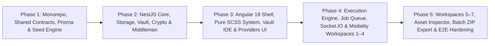

# ForgeStudio Control Room — Master Architecture & Phased Implementation Blueprint

This directory contains the complete, zero-ambiguity **Master Architecture & Phased Implementation Blueprint** for **ForgeStudio Control Room**—a multi-modal AI game & media asset generation studio featuring a Project Context Vault, a Middleman LLM Prompt Compiler, and a unified Cloud API / RunPod Serverless / Local GPU execution engine.

It is designed for verbatim execution by an autonomous coding agent (**Gemini Argon 4.0**) across **5 sequential build phases**.

---

## Blueprint Index

| Part | File | Sections Covered | Scope Summary |
| :--- | :--- | :--- | :--- |
| **Part 1** | [`blueprint_part1_foundation.md`](./blueprint_part1_foundation.md) | **§0 – §2** | Global Conventions & Pinned Toolchain, Complete Monorepo File Tree (tagged `[P1]`–`[P5]`), Full `schema.prisma` (9 models, 7 enums, composite indexes), Shared TypeScript Contracts, Zod Schemas, Read Models, WebSocket Event Contracts, Job State Machine, and Shared Utility Algorithms (`interpolateTemplate`, `parsePromptMentions`, `estimateTokenCount`). |
| **Part 2** | [`blueprint_part2_design_system.md`](./blueprint_part2_design_system.md) | **§3** | Complete Pure SCSS Design System (`_tokens.scss`, `_functions.scss`, `_root-vars.scss`, `_mixins.scss`, `_reset.scss`, `_typography.scss`, `_grid.scss`, `_animations.scss`), Global Base Classes (`_buttons.scss`, `_forms.scss`, `_badges.scss`, `_scrollbars.scss`, `_utilities.scss`), ASCII & CSS Grid Layout Blueprints, 42-symbol Inline SVG Sprite Spec, and Accessibility Rules. Strictly zero Tailwind CSS, Bootstrap, or Angular Material. |
| **Part 3** | [`blueprint_part3_backend.md`](./blueprint_part3_backend.md) | **§4** | NestJS 11 Backend Architecture: Dependency-acyclic Module Graph (`LlmModule` extracted to prevent circular dependency between `ProjectsVaultModule` and `MiddlemanModule`), `StorageModule` (`LocalDiskStorageProvider` with HTTP 206 Range streaming & `sharp` icon mipmaps), `ProjectsVaultModule` + `VisionAnalysisService`, `ProvidersModule` with AES-256-GCM encryption, `LlmModule` (`@google/genai` Interactions API, Anthropic, OpenAI, Ollama, Deterministic Demo), `MiddlemanCompilerService`, 21-Provider `IGeneratorAdapter` Matrix (Cloud APIs, RunPod Serverless with cold-start telemetry, Local ComfyUI/A1111/Audio, and procedural `DemoFallbackAdapter`), `JobProcessorService` with Postgres `FOR UPDATE SKIP LOCKED`, Complete REST API Table, and Socket.IO `/studio` Gateway. |
| **Part 4** | [`blueprint_part4_frontend.md`](./blueprint_part4_frontend.md) | **§5** | Angular 19 Zoneless Frontend Architecture: `provideExperimentalZonelessChangeDetection()` bootstrap, Complete Route Table, Component Hierarchy, 6 Reactive Signal Stores (`StudioStateService`, `VaultStateService`, `GeneratorJobStore`, `ProviderStateService`, `AssetGalleryStore`, `SocketService`), 10 In-House Reusable UI Primitives, Section 8 Vault IDE, Section 9 Providers & RunPod Visual Template Editor, Sections 1–7 Modality Workspaces, `ModelViewportEngine` (Three.js r172 with full GPU memory disposal), and `AudioEngineService` (Web Audio API dual-waveform & A/B seamless loop boundary auditioning). |
| **Part 5** | [`blueprint_part5_seed_and_phases.md`](./blueprint_part5_seed_and_phases.md) | **§6 – §7** | Rich Seed Data Specification (21 ProviderConfigs, 5 Middleman Profiles, 7 Verbatim Modality System Prompts, 2 Complete Game Projects *"Astra Dream"* and *"Anime Awakening RNG"*, 27 Realistic Vault Files, 39 Historical/Active Jobs, 45 Generated Assets with procedural binary generation in `prisma/seed-assets.ts`) and **5 Self-Contained Copy-Paste Execution Prompts** for Gemini Argon 4.0 with strict Verification & Acceptance Gates. |

---

## Phase Dependency Map

---

## How to Execute the 5 Phases with Gemini Argon 4.0

Open [`blueprint_part5_seed_and_phases.md`](./blueprint_part5_seed_and_phases.md) (`§7`) and feed each Phase Prompt in strict sequential order (`Phase 1` $\rightarrow$ `Phase 2` $\rightarrow$ `Phase 3` $\rightarrow$ `Phase 4` $\rightarrow$ `Phase 5`) to Gemini Argon 4.0.

### Pre-Flight Environment Requirements
- **Node.js**: `>= 22.12.0 LTS`
- **pnpm**: `9.15.x` (`corepack enable && corepack prepare pnpm@9.15.0 --activate`)
- **Docker Desktop / Docker Engine**: Running locally for `docker compose up -d` (PostgreSQL 16 Alpine on port `5432`)

### Acceptance-Gate Checklist

Before advancing from Phase $N$ to Phase $N+1$, verify every command in that phase's **Acceptance Gate**:

- [ ] **Phase 1 Gate (`[P1]`)**:
  - `pnpm install` succeeds across root, `/shared`, `/backend`, and `/frontend`.
  - `pnpm --filter @forgestudio/shared build && pnpm --filter @forgestudio/shared test` passes all unit tests (`interpolateTemplate`, `parsePromptMentions`, `estimateTokenCount`).
  - `docker compose up -d` starts `forgestudio-postgres` cleanly.
  - `pnpm db:migrate` and `pnpm db:seed` populate 21 providers, 5 middleman profiles, 7 system templates, 2 projects (*"Astra Dream"* and *"Anime Awakening RNG"*), 27 vault files, 39 jobs, and 45 procedural binary assets on disk (`storage/projects/...`).
- [ ] **Phase 2 Gate (`[P2]`)**:
  - `pnpm --filter @forgestudio/backend build` compiles with zero TypeScript errors.
  - `GET /api/v1/health`, `GET /api/v1/projects`, `POST /api/v1/middleman/compile`, and `GET /api/v1/storage/...` with `Range: bytes=0-1023` return expected `200`/`206` responses.
  - `pnpm --filter @forgestudio/backend test` passes unit tests for `CryptoService`, `MiddlemanCompilerService`, and `VisionAnalysisService`.
- [ ] **Phase 3 Gate (`[P3]`)**:
  - `pnpm --filter @forgestudio/frontend build` compiles with zero errors and zero SCSS warnings.
  - Strictly zero external CSS libraries (`tailwindcss`, `@angular/material`, `bootstrap`) in `frontend/package.json`.
  - Switching projects in the top-left switcher updates `activeProjectSignal` and reloads the Section 8 Vault IDE tree; editing and saving Markdown updates token badges; Section 9 Providers & RunPod tests connections and validates `{{variable}}` chips.
- [ ] **Phase 4 Gate (`[P4]`)**:
  - Submitting a job in **Auto-Fire** or **Intercept & Review** mode streams live Socket.IO events (`job:queued` $\rightarrow$ `job:middleman_compiling` $\rightarrow$ `job:middleman_chunk` $\rightarrow$ `job:middleman_completed` $\rightarrow$ `job:dispatched` $\rightarrow$ `job:progress` $\rightarrow$ `job:completed`).
  - Workspaces `2D Icons`, `3D Assets` (Three.js `.glb` viewport), `Images` (Seamless 3x3 tiling toggle), and `Music` (Web Audio dual-canvas waveform + Seamless Loop A/B auditioning) render and function end-to-end.
- [ ] **Phase 5 Gate (`[P5]`)**:
  - Workspaces `Voices` (synced word-pill transcript), `Sound Effects` (1–8 batch variation grid), and `Other Assets` (60fps spritesheet flipbook, VFX canvas preview, Monaco/code viewer, SVG DAG dialogue graph) function end-to-end.
  - Right-hand Collapsible Asset Inspector Drawer displays lineage, one-click `Restore Exact State to Composer`, `Promote to Project Vault`, and streaming multi-asset `.zip` export (`POST /api/v1/assets/export-zip`).
