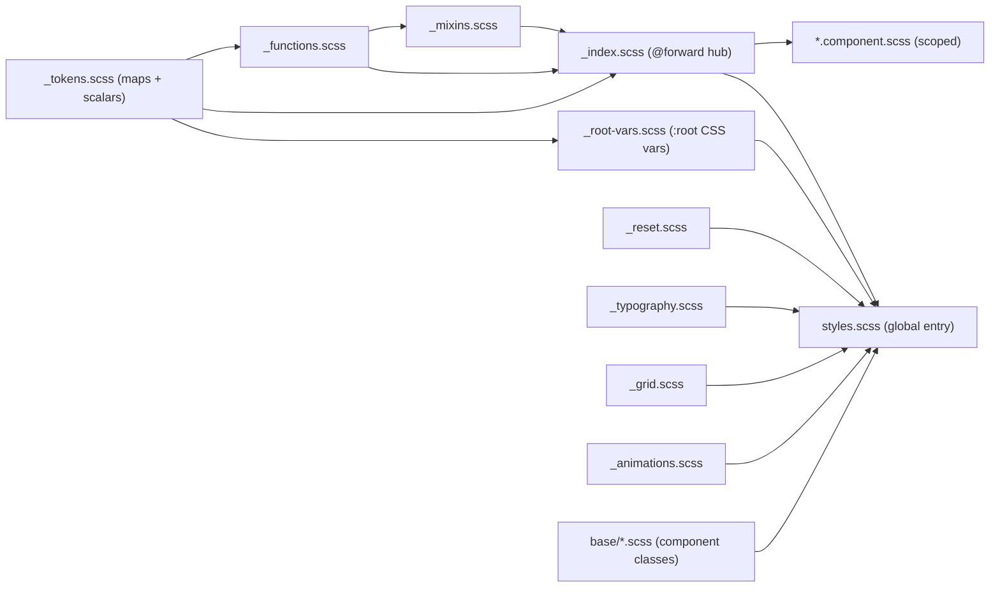

# ForgeStudio Control Room — Master Blueprint · Part 2 of 5
## §3 Pure SCSS Design System Specification (`/frontend/src/styles`)

> [!IMPORTANT]
> **Zero external UI/CSS frameworks.** Only Dart Sass (bundled with the Angular CLI) using the `@use`/`@forward` module system. `@import` is forbidden. Every component stylesheet begins with `@use 'styles' as *;` (resolved through `stylePreprocessorOptions.includePaths: ["src"]` → `src/styles/_index.scss`).

### 3.1 Module architecture



`angular.json` (frontend project → `architect.build.options`):
```json
"styles": ["src/styles.scss"],
"stylePreprocessorOptions": { "includePaths": ["src"] },
"inlineStyleLanguage": "scss",
"budgets": [
  { "type": "initial", "maximumWarning": "1.2mb", "maximumError": "2mb" },
  { "type": "anyComponentStyle", "maximumWarning": "8kb", "maximumError": "16kb" }
]
```

`_index.scss` (forwards **only** compile-time APIs — emits zero CSS, safe to `@use` in every component):
```scss
@forward 'styles/tokens';
@forward 'styles/functions';
@forward 'styles/mixins';
```

`styles.scss` (the only file that emits global CSS):
```scss
@use '@fontsource-variable/inter';
@use '@fontsource-variable/jetbrains-mono';
@use 'styles/root-vars';
@use 'styles/reset';
@use 'styles/typography';
@use 'styles/grid';
@use 'styles/animations';
@use 'styles/base/buttons';
@use 'styles/base/forms';
@use 'styles/base/badges';
@use 'styles/base/pills';
@use 'styles/base/tabs';
@use 'styles/base/cards';
@use 'styles/base/drawers';
@use 'styles/base/modals';
@use 'styles/base/tables';
@use 'styles/base/tooltips';
@use 'styles/base/progress';
@use 'styles/base/code';
@use 'styles/base/markdown';
```

### 3.2 `_tokens.scss` (complete, exact)

```scss
// ForgeStudio design tokens — single source of truth. No CSS output.
@use 'sass:map';

// ── Surfaces (deep studio obsidian) ──────────────────────────────
$surface: (
  'void':      #06070B,   // behind the shell / modal backdrop base
  'base':      #090A0F,   // app background
  'raised':    #11131C,   // sidebar, panels
  'overlay':   #181B28,   // cards, drawers, inputs
  'elevated':  #1F2333,   // hover, popovers, menus
  'sunken':    #0C0D14,   // code blocks, viewports, waveform beds
);

// ── Borders ──────────────────────────────────────────────────────
$border: (
  'subtle':  #1B1E2C,
  'default': #25293A,
  'strong':  #343A52,
  'focus':   #7C3AED,
);

// ── Text ─────────────────────────────────────────────────────────
$text: (
  'primary':   #E7E9F3,
  'secondary': #A4AAC4,
  'muted':     #6C7291,
  'disabled':  #474C66,
  'inverse':   #090A0F,
);

// ── Accents (semantic) ───────────────────────────────────────────
//  violet  = brand / primary actions / selection
//  cyan    = Middleman AI compiler states (streaming, compiled, diff insertions)
//  emerald = active/healthy workers, completed
//  amber   = RunPod cold starts, warnings, awaiting review
//  coral   = errors, destructive
$accent: (
  'violet':  #7C3AED,
  'cyan':    #06B6D4,
  'emerald': #10B981,
  'amber':   #F59E0B,
  'coral':   #EF4444,
);

// Tonal ramps generated per accent (used for hover/active/soft fills)
$accent-ramp: (
  'violet':  ('50': #F3EEFF, '200': #C9B5FB, '300': #A78BFA, '400': #8B5CF6, '500': #7C3AED, '600': #6D28D9, '700': #5B21B6, '900': #2E1065),
  'cyan':    ('50': #ECFEFF, '200': #A5F3FC, '300': #67E8F9, '400': #22D3EE, '500': #06B6D4, '600': #0891B2, '700': #0E7490, '900': #083344),
  'emerald': ('50': #ECFDF5, '200': #A7F3D0, '300': #6EE7B7, '400': #34D399, '500': #10B981, '600': #059669, '700': #047857, '900': #022C22),
  'amber':   ('50': #FFFBEB, '200': #FDE68A, '300': #FCD34D, '400': #FBBF24, '500': #F59E0B, '600': #D97706, '700': #B45309, '900': #451A03),
  'coral':   ('50': #FEF2F2, '200': #FECACA, '300': #FCA5A5, '400': #F87171, '500': #EF4444, '600': #DC2626, '700': #B91C1C, '900': #450A0A),
);

// Status → accent mapping (JobStatus / HealthState / ExecutionTier)
$status-accent: (
  'QUEUED': 'muted', 'COMPILING': 'cyan', 'AWAITING_REVIEW': 'amber', 'READY': 'violet',
  'DISPATCHING': 'violet', 'COLD_START': 'amber', 'RUNNING': 'emerald', 'INGESTING': 'emerald',
  'COMPLETED': 'emerald', 'FAILED': 'coral', 'CANCELLED': 'muted',
  'HEALTHY': 'emerald', 'DEGRADED': 'amber', 'UNREACHABLE': 'coral', 'UNAUTHORIZED': 'coral', 'UNKNOWN': 'muted',
);
$tier-accent: ('CLOUD_API': 'violet', 'RUNPOD': 'amber', 'LOCAL': 'emerald');

// ── Spacing (4px grid) ───────────────────────────────────────────
$space: (
  '0': 0, 'px': 1px, '0.5': 2px, '1': 4px, '1.5': 6px, '2': 8px, '3': 12px, '4': 16px,
  '5': 20px, '6': 24px, '8': 32px, '10': 40px, '12': 48px, '16': 64px, '20': 80px,
);

// ── Radii ────────────────────────────────────────────────────────
$radius: ('none': 0, 'xs': 4px, 'sm': 6px, 'md': 8px, 'lg': 12px, 'xl': 16px, '2xl': 20px, 'pill': 999px);

// ── Typography ───────────────────────────────────────────────────
$font-family: (
  'sans': ('Inter Variable', 'Inter', ui-sans-serif, system-ui, -apple-system, 'Segoe UI', sans-serif),
  'mono': ('JetBrains Mono Variable', 'JetBrains Mono', ui-monospace, 'Cascadia Code', Consolas, monospace),
);
$font-size: (
  '2xs': 10px, 'xs': 11px, 'sm': 12px, 'base': 13px, 'md': 14px, 'lg': 16px,
  'xl': 18px, '2xl': 22px, '3xl': 28px, '4xl': 36px,
);
$line-height: ('tight': 1.2, 'snug': 1.35, 'normal': 1.5, 'relaxed': 1.65);
$font-weight: ('regular': 400, 'medium': 500, 'semibold': 600, 'bold': 700);
$letter-spacing: ('tight': -0.01em, 'normal': 0, 'wide': 0.04em, 'caps': 0.08em);

// ── Elevation ────────────────────────────────────────────────────
$shadow: (
  'sm':    (0 1px 2px rgba(0, 0, 0, 0.45)),
  'md':    (0 4px 12px rgba(0, 0, 0, 0.45), 0 1px 0 rgba(255, 255, 255, 0.02) inset),
  'lg':    (0 12px 32px rgba(0, 0, 0, 0.55), 0 1px 0 rgba(255, 255, 255, 0.03) inset),
  'xl':    (0 24px 64px rgba(0, 0, 0, 0.65)),
  'focus': (0 0 0 2px #090A0F, 0 0 0 4px rgba(124, 58, 237, 0.65)),
);
$glow: (
  'violet':  (0 0 0 1px rgba(124, 58, 237, 0.45), 0 0 24px rgba(124, 58, 237, 0.25)),
  'cyan':    (0 0 0 1px rgba(6, 182, 212, 0.45), 0 0 24px rgba(6, 182, 212, 0.25)),
  'emerald': (0 0 0 1px rgba(16, 185, 129, 0.45), 0 0 20px rgba(16, 185, 129, 0.2)),
  'amber':   (0 0 0 1px rgba(245, 158, 11, 0.45), 0 0 20px rgba(245, 158, 11, 0.2)),
  'coral':   (0 0 0 1px rgba(239, 68, 68, 0.5), 0 0 20px rgba(239, 68, 68, 0.2)),
);

// ── Motion ───────────────────────────────────────────────────────
$duration: ('instant': 80ms, 'fast': 140ms, 'base': 200ms, 'slow': 320ms, 'slower': 480ms);
$easing: (
  'standard':   cubic-bezier(0.2, 0, 0, 1),
  'emphasized': cubic-bezier(0.3, 0, 0, 1.15),
  'exit':       cubic-bezier(0.4, 0, 1, 1),
  'linear':     linear,
);

// ── Layering ─────────────────────────────────────────────────────
$z: ('base': 0, 'raised': 10, 'sticky': 20, 'sidebar': 30, 'drawer': 40, 'dropdown': 50,
     'modal-backdrop': 60, 'modal': 70, 'toast': 80, 'tooltip': 90);

// ── Layout constants ─────────────────────────────────────────────
$layout: (
  'sidebar-width': 264px,
  'sidebar-collapsed': 64px,
  'context-bar-height': 48px,
  'history-drawer-width': 380px,
  'composer-min-width': 420px,
  'composer-max-width': 560px,
  'vault-tree-width': 280px,
  'vault-inspector-width': 340px,
  'queue-widget-max-height': 280px,
);
$breakpoint: ('sm': 640px, 'md': 960px, 'lg': 1280px, 'xl': 1536px, '2xl': 1920px);

// ── Media-specific ───────────────────────────────────────────────
$checker: ('size': 16px, 'light': #2A2E40, 'dark': #1A1D2A);
$waveform: ('height': 96px, 'compact-height': 48px, 'bar-color': #3A4060, 'progress-color': #06B6D4,
            'played-color': #7C3AED, 'playhead': #E7E9F3, 'loop-region': rgba(245, 158, 11, 0.14));
$viewport: ('bg-top': #141726, 'bg-bottom': #07080D, 'grid': #25293A);
```

### 3.3 `_functions.scss`

```scss
@use 'sass:map';
@use 'sass:math';
@use 'sass:color';
@use 'tokens' as t;

@function surface($key)  { @return map.get(t.$surface, $key); }
@function border-c($key) { @return map.get(t.$border, $key); }
@function text-c($key)   { @return map.get(t.$text, $key); }
@function accent($key, $tone: null) {
  @if $key == 'muted' { @return map.get(t.$text, 'muted'); }
  @if $tone == null { @return map.get(t.$accent, $key); }
  @return map.get(map.get(t.$accent-ramp, $key), $tone);
}
/// Translucent accent fill: accent-alpha('cyan', 0.12)
@function accent-alpha($key, $alpha) {
  @if $key == 'muted' { @return rgba(map.get(t.$text, 'muted'), $alpha); }
  @return rgba(map.get(t.$accent, $key), $alpha);
}
@function space($key)  { @return map.get(t.$space, '#{$key}'); }
@function radius($key) { @return map.get(t.$radius, $key); }
@function fs($key)     { @return map.get(t.$font-size, $key); }
@function fw($key)     { @return map.get(t.$font-weight, $key); }
@function lh($key)     { @return map.get(t.$line-height, $key); }
@function z($key)      { @return map.get(t.$z, $key); }
@function dur($key)    { @return map.get(t.$duration, $key); }
@function ease($key)   { @return map.get(t.$easing, $key); }
@function layout($key) { @return map.get(t.$layout, $key); }
@function rem($px)     { @return math.div($px, 16px) * 1rem; }
/// CSS custom-property reference, e.g. v(accent-cyan) → var(--fs-accent-cyan)
@function v($name)     { @return var(--fs-#{$name}); }
```

### 3.4 `_root-vars.scss` (emits `:root` CSS custom properties for runtime use, e.g. project accent override)

```scss
@use 'sass:map';
@use 'tokens' as t;

:root {
  @each $k, $val in t.$surface { --fs-surface-#{$k}: #{$val}; }
  @each $k, $val in t.$border  { --fs-border-#{$k}: #{$val}; }
  @each $k, $val in t.$text    { --fs-text-#{$k}: #{$val}; }
  @each $k, $val in t.$accent  { --fs-accent-#{$k}: #{$val}; }
  --fs-project-accent: #{map.get(t.$accent, 'violet')}; // StudioStateService effect() overwrites on project switch
  --fs-sidebar-width: #{map.get(t.$layout, 'sidebar-width')};
  --fs-context-bar-height: #{map.get(t.$layout, 'context-bar-height')};
  --fs-history-width: #{map.get(t.$layout, 'history-drawer-width')};
  color-scheme: dark;
}
```

### 3.5 `_mixins.scss` (complete library)

```scss
@use 'sass:map';
@use 'sass:math';
@use 'tokens' as t;
@use 'functions' as f;

// ── Responsive ───────────────────────────────────────────────────
@mixin bp-up($key)   { @media (min-width: map.get(t.$breakpoint, $key)) { @content; } }
@mixin bp-down($key) { @media (max-width: (map.get(t.$breakpoint, $key) - 0.02px)) { @content; } }
@mixin reduced-motion { @media (prefers-reduced-motion: reduce) { @content; } }

// ── Typography ───────────────────────────────────────────────────
@mixin text($size: 'base', $weight: 'regular', $lh: 'normal') {
  font-size: f.fs($size); font-weight: f.fw($weight); line-height: f.lh($lh);
}
@mixin mono($size: 'sm') { font-family: map.get(t.$font-family, 'mono'); font-size: f.fs($size); font-feature-settings: 'calt' 0; }
@mixin caps-label { @include text('2xs', 'semibold', 'tight'); letter-spacing: map.get(t.$letter-spacing, 'caps'); text-transform: uppercase; color: f.text-c('muted'); }
@mixin truncate($lines: 1) {
  @if $lines == 1 { overflow: hidden; white-space: nowrap; text-overflow: ellipsis; }
  @else { display: -webkit-box; -webkit-line-clamp: $lines; -webkit-box-orient: vertical; overflow: hidden; }
}

// ── Surfaces ─────────────────────────────────────────────────────
@mixin panel($level: 'raised', $radius: 'lg') {
  background: f.surface($level); border: 1px solid f.border-c('default'); border-radius: f.radius($radius);
}
/// Glass panel: translucent obsidian with backdrop blur + 1px inner highlight.
@mixin glass-panel($opacity: 0.72, $blur: 14px, $radius: 'lg') {
  background: linear-gradient(180deg, rgba(31, 35, 51, $opacity) 0%, rgba(17, 19, 28, $opacity + 0.08) 100%);
  border: 1px solid rgba(52, 58, 82, 0.7);
  border-radius: f.radius($radius);
  backdrop-filter: blur($blur) saturate(140%);
  -webkit-backdrop-filter: blur($blur) saturate(140%);
  box-shadow: map.get(t.$shadow, 'lg'), inset 0 1px 0 rgba(255, 255, 255, 0.04);
  @supports not (backdrop-filter: blur(1px)) { background: f.surface('overlay'); }
}
@mixin card-interactive {
  transition: border-color f.dur('fast') f.ease('standard'), background f.dur('fast') f.ease('standard'), transform f.dur('fast') f.ease('standard');
  &:hover { border-color: f.border-c('strong'); background: f.surface('elevated'); }
  &:active { transform: translateY(1px); }
  &[aria-selected='true'], &.is-selected { border-color: f.accent('violet'); box-shadow: map.get(t.$glow, 'violet'); }
}
@mixin accent-glow($accent: 'violet') { box-shadow: map.get(t.$glow, $accent); }
@mixin hairline($side: 'bottom', $color: f.border-c('default')) { border-#{$side}: 1px solid $color; }

// ── Focus & interaction ──────────────────────────────────────────
@mixin focus-ring { outline: none; &:focus-visible { box-shadow: map.get(t.$shadow, 'focus'); } }
@mixin interactive-reset { appearance: none; background: none; border: 0; padding: 0; color: inherit; font: inherit; cursor: pointer; }
@mixin disabled { &:disabled, &[aria-disabled='true'] { opacity: 0.45; cursor: not-allowed; pointer-events: none; } }

// ── Scrollbars ───────────────────────────────────────────────────
@mixin custom-scrollbar($size: 8px, $thumb: f.border-c('strong'), $track: transparent) {
  scrollbar-width: thin; scrollbar-color: $thumb $track;
  &::-webkit-scrollbar { width: $size; height: $size; }
  &::-webkit-scrollbar-track { background: $track; }
  &::-webkit-scrollbar-thumb { background: $thumb; border-radius: f.radius('pill'); border: 2px solid transparent; background-clip: content-box; }
  &::-webkit-scrollbar-thumb:hover { background-color: f.text-c('muted'); }
  &::-webkit-scrollbar-corner { background: transparent; }
}
@mixin scroll-y { overflow-y: auto; overflow-x: hidden; overscroll-behavior: contain; @include custom-scrollbar; }
@mixin scroll-x { overflow-x: auto; overflow-y: hidden; @include custom-scrollbar(6px); }

// ── Alpha checkerboard (2D icon transparency) ───────────────────
@mixin alpha-checkerboard($size: map.get(t.$checker, 'size'), $light: map.get(t.$checker, 'light'), $dark: map.get(t.$checker, 'dark')) {
  background-color: $dark;
  background-image:
    linear-gradient(45deg, $light 25%, transparent 25%),
    linear-gradient(-45deg, $light 25%, transparent 25%),
    linear-gradient(45deg, transparent 75%, $light 75%),
    linear-gradient(-45deg, transparent 75%, $light 75%);
  background-size: $size $size;
  background-position: 0 0, 0 math.div($size, 2), math.div($size, 2) math.div(-$size, 2), math.div(-$size, 2) 0;
}
/// Pixel-exact preview (64px/32px icon readability checks)
@mixin pixelated { image-rendering: pixelated; image-rendering: crisp-edges; }

// ── Waveform containers ─────────────────────────────────────────
@mixin waveform-container($height: map.get(t.$waveform, 'height')) {
  position: relative; height: $height; border-radius: f.radius('md'); overflow: hidden;
  background:
    linear-gradient(180deg, transparent calc(50% - 0.5px), rgba(52, 58, 82, 0.6) 50%, transparent calc(50% + 0.5px)),
    f.surface('sunken');
  border: 1px solid f.border-c('subtle');
  canvas { position: absolute; inset: 0; width: 100%; height: 100%; display: block; }
  .playhead { position: absolute; top: 0; bottom: 0; width: 1px; background: map.get(t.$waveform, 'playhead'); box-shadow: 0 0 8px rgba(231, 233, 243, 0.6); pointer-events: none; will-change: transform; }
  .loop-region { position: absolute; top: 0; bottom: 0; background: map.get(t.$waveform, 'loop-region'); border-inline: 1px dashed f.accent('amber'); pointer-events: none; }
  &.is-loading::after { content: ''; position: absolute; inset: 0; @include shimmer; }
}

// ── 3D viewport overlays ────────────────────────────────────────
@mixin viewport-surface {
  position: relative; overflow: hidden; border-radius: f.radius('lg'); border: 1px solid f.border-c('default');
  background: radial-gradient(120% 90% at 50% 15%, map.get(t.$viewport, 'bg-top') 0%, map.get(t.$viewport, 'bg-bottom') 70%);
  canvas { display: block; width: 100%; height: 100%; outline: none; }
}
@mixin viewport-overlay($position: 'top-left') {
  position: absolute; z-index: f.z('raised'); display: flex; gap: f.space(1); padding: f.space(1);
  @include glass-panel(0.6, 10px, 'md');
  @if $position == 'top-left'     { top: f.space(3); left: f.space(3); }
  @if $position == 'top-right'    { top: f.space(3); right: f.space(3); }
  @if $position == 'bottom-left'  { bottom: f.space(3); left: f.space(3); }
  @if $position == 'bottom-right' { bottom: f.space(3); right: f.space(3); }
  @if $position == 'bottom-center' { bottom: f.space(3); left: 50%; transform: translateX(-50%); }
}
@mixin viewport-stat { @include mono('2xs'); color: f.text-c('secondary'); dt { color: f.text-c('muted'); } dd { color: f.text-c('primary'); margin: 0; } }

// ── Responsive galleries ────────────────────────────────────────
@mixin auto-grid($min: 160px, $gap: f.space(3)) {
  display: grid; gap: $gap; grid-template-columns: repeat(auto-fill, minmax(min($min, 100%), 1fr));
}
@mixin gallery-grid($min: 180px, $aspect: 1) {
  @include auto-grid($min);
  > * { aspect-ratio: $aspect; min-width: 0; }
}
@mixin masonry-columns($col-width: 220px, $gap: f.space(3)) {
  columns: $col-width; column-gap: $gap; > * { break-inside: avoid; margin-bottom: $gap; }
}

// ── Status visuals ──────────────────────────────────────────────
@mixin status-dot($accent: 'emerald', $pulse: false) {
  width: 8px; height: 8px; border-radius: 50%; background: f.accent($accent); flex: none;
  box-shadow: 0 0 0 3px f.accent-alpha($accent, 0.18);
  @if $pulse { animation: fs-pulse-ring 1.6s f.ease('standard') infinite; --pulse-color: #{f.accent-alpha($accent, 0.45)}; }
}
@mixin tinted($accent) {
  color: f.accent($accent, '300'); background: f.accent-alpha($accent, 0.12); border: 1px solid f.accent-alpha($accent, 0.35);
}
@mixin shimmer($accent: 'cyan') {
  background: linear-gradient(100deg, transparent 20%, f.accent-alpha($accent, 0.12) 45%, f.accent-alpha($accent, 0.22) 50%, f.accent-alpha($accent, 0.12) 55%, transparent 80%);
  background-size: 220% 100%; animation: fs-shimmer 1.4s linear infinite;
}
/// Middleman streaming border (rotating conic gradient)
@mixin ai-stream-border($radius: 'pill') {
  position: relative; isolation: isolate; border-radius: f.radius($radius);
  &::before {
    content: ''; position: absolute; inset: -1px; z-index: -1; border-radius: inherit; padding: 1px;
    background: conic-gradient(from var(--fs-angle, 0deg), f.accent('cyan'), f.accent('violet'), transparent 40%, f.accent('cyan'));
    -webkit-mask: linear-gradient(#000 0 0) content-box, linear-gradient(#000 0 0); -webkit-mask-composite: xor; mask-composite: exclude;
    animation: fs-rotate-angle 2.4s linear infinite;
  }
}
@mixin diff-insert { background: f.accent-alpha('cyan', 0.16); color: f.accent('cyan', '200'); border-radius: 3px; box-shadow: inset 0 -1px 0 f.accent-alpha('cyan', 0.6); }
@mixin diff-delete { background: f.accent-alpha('coral', 0.12); color: f.accent('coral', '300'); text-decoration: line-through; text-decoration-color: f.accent-alpha('coral', 0.7); border-radius: 3px; }

// ── Layout helpers ──────────────────────────────────────────────
@mixin stack($gap: f.space(3)) { display: flex; flex-direction: column; gap: $gap; }
@mixin cluster($gap: f.space(2), $align: center) { display: flex; flex-wrap: wrap; align-items: $align; gap: $gap; }
@mixin center { display: grid; place-items: center; }
@mixin fill { position: absolute; inset: 0; }
@mixin sr-only { position: absolute; width: 1px; height: 1px; padding: 0; margin: -1px; overflow: hidden; clip: rect(0, 0, 0, 0); white-space: nowrap; border: 0; }
@mixin section-header { display: flex; align-items: center; justify-content: space-between; gap: f.space(2); padding: f.space(3) f.space(4); @include hairline('bottom'); }
@mixin dropzone-active { border: 1px dashed f.accent('violet'); background: f.accent-alpha('violet', 0.08); box-shadow: inset 0 0 0 4px f.accent-alpha('violet', 0.06); }
```

### 3.6 `_reset.scss`, `_typography.scss`, `_grid.scss`, `_animations.scss`

```scss
// _reset.scss
@use 'tokens' as t; @use 'functions' as f; @use 'mixins' as m;
*, *::before, *::after { box-sizing: border-box; }
* { margin: 0; }
html, body { height: 100%; }
body {
  background: f.surface('base'); color: f.text-c('primary');
  font-family: map-get(t.$font-family, 'sans'); @include m.text('base');
  -webkit-font-smoothing: antialiased; -moz-osx-font-smoothing: grayscale; text-rendering: optimizeLegibility;
  overflow: hidden;   // shell manages scrolling regions
}
img, picture, video, canvas, svg { display: block; max-width: 100%; }
input, button, textarea, select { font: inherit; color: inherit; }
button { cursor: pointer; }
p, h1, h2, h3, h4, h5, h6 { overflow-wrap: break-word; }
a { color: f.accent('violet', '300'); text-decoration: none; &:hover { text-decoration: underline; } }
::selection { background: f.accent-alpha('violet', 0.45); color: f.text-c('primary'); }
:focus-visible { outline: none; box-shadow: map-get(t.$shadow, 'focus'); }
[hidden] { display: none !important; }
```
(Use `sass:map` `map.get` instead of `map-get` in the real file; shown compactly here.)

```scss
// _typography.scss — global type classes
.fs-h1 { @include m.text('3xl', 'semibold', 'tight'); letter-spacing: -0.02em; }
.fs-h2 { @include m.text('2xl', 'semibold', 'tight'); letter-spacing: -0.015em; }
.fs-h3 { @include m.text('lg', 'semibold', 'snug'); }
.fs-h4 { @include m.text('md', 'semibold', 'snug'); }
.fs-body { @include m.text('base'); color: f.text-c('secondary'); }
.fs-small { @include m.text('sm'); color: f.text-c('secondary'); }
.fs-micro { @include m.text('xs'); color: f.text-c('muted'); }
.fs-label { @include m.caps-label; }
.fs-mono { @include m.mono('sm'); }
.fs-num { font-variant-numeric: tabular-nums; }
.fs-text-cyan { color: f.accent('cyan', '300'); } .fs-text-amber { color: f.accent('amber', '300'); }
.fs-text-emerald { color: f.accent('emerald', '300'); } .fs-text-coral { color: f.accent('coral', '300'); }
.fs-text-muted { color: f.text-c('muted'); }
```

```scss
// _grid.scss — layout primitives (global utility classes, used sparingly)
.fs-stack   { @include m.stack; }   .fs-stack-sm { @include m.stack(f.space(2)); }  .fs-stack-lg { @include m.stack(f.space(5)); }
.fs-cluster { @include m.cluster; } .fs-spread { display: flex; align-items: center; justify-content: space-between; gap: f.space(2); }
.fs-grid-2  { display: grid; grid-template-columns: repeat(2, minmax(0, 1fr)); gap: f.space(3); }
.fs-grid-3  { display: grid; grid-template-columns: repeat(3, minmax(0, 1fr)); gap: f.space(3); }
.fs-gallery { @include m.gallery-grid(180px); }
.fs-gallery-sm { @include m.gallery-grid(120px); }
.fs-scroll-y { @include m.scroll-y; }
.fs-sr-only { @include m.sr-only; }
.fs-divider { height: 1px; background: f.border-c('default'); border: 0; }
```

```scss
// _animations.scss
@property --fs-angle { syntax: '<angle>'; initial-value: 0deg; inherits: false; }
@keyframes fs-rotate-angle { to { --fs-angle: 360deg; } }
@keyframes fs-shimmer { from { background-position: 120% 0; } to { background-position: -120% 0; } }
@keyframes fs-pulse-ring { 0% { box-shadow: 0 0 0 0 var(--pulse-color); } 70% { box-shadow: 0 0 0 8px transparent; } 100% { box-shadow: 0 0 0 0 transparent; } }
@keyframes fs-fade-in { from { opacity: 0; } to { opacity: 1; } }
@keyframes fs-slide-in-right { from { transform: translateX(16px); opacity: 0; } to { transform: none; opacity: 1; } }
@keyframes fs-slide-up { from { transform: translateY(8px); opacity: 0; } to { transform: none; opacity: 1; } }
@keyframes fs-scale-in { from { transform: scale(0.96); opacity: 0; } to { transform: none; opacity: 1; } }
@keyframes fs-indeterminate { from { transform: translateX(-100%); } to { transform: translateX(250%); } }
@keyframes fs-caret-blink { 50% { opacity: 0; } }
@keyframes fs-spin { to { transform: rotate(360deg); } }
.fs-anim-fade { animation: fs-fade-in f.dur('base') f.ease('standard') both; }
.fs-anim-slide-up { animation: fs-slide-up f.dur('base') f.ease('emphasized') both; }
.fs-anim-scale { animation: fs-scale-in f.dur('base') f.ease('emphasized') both; }
@include m.reduced-motion { *, *::before, *::after { animation-duration: 1ms !important; animation-iteration-count: 1 !important; transition-duration: 1ms !important; } }
```

### 3.7 `base/*` component class catalog (global, BEM-ish `fs-` prefix)

| File | Classes (all required) | Spec |
|---|---|---|
| `_buttons.scss` | `.fs-btn`, modifiers `--primary` (violet fill, white text, glow on hover), `--secondary` (overlay bg, default border), `--ghost`, `--danger` (coral), `--ai` (cyan gradient border via `ai-stream-border` when `.is-streaming`), sizes `--sm` (28px h), default 32px, `--lg` 40px, `--icon` (square), `.is-loading` (inline 14px spinner, text hidden via `color: transparent`) | `@include m.interactive-reset; @include m.focus-ring; @include m.disabled;` radius `md`, font `sm/medium`, gap 6px |
| `_forms.scss` | `.fs-field`, `.fs-field__label`, `.fs-field__hint`, `.fs-field__error`, `.fs-input`, `.fs-textarea`, `.fs-select-native`, `.fs-input--mono`, `.fs-input-group` | inputs: bg `overlay`, border `default`, hover `strong`, focus border violet + `focus` shadow, h 32px, radius `md`; error state `[aria-invalid=true]` coral border |
| `_badges.scss` | `.fs-badge`, `--tier-CLOUD_API`, `--tier-RUNPOD`, `--tier-LOCAL`, `--scope`, `--count` | generated with `@each $tier, $acc in t.$tier-accent { &--tier-#{$tier} { @include m.tinted($acc); } }` |
| `_pills.scss` | `.fs-status-pill`, `--<JobStatus>` for all 11 statuses, `.fs-status-pill__dot` | `@each $status, $acc in t.$status-accent`; `COMPILING` adds `ai-stream-border` + pulsing dot; `COLD_START` amber pulsing dot; `RUNNING` emerald pulsing dot |
| `_tabs.scss` | `.fs-tabs`, `.fs-tab`, `.fs-tab[aria-selected=true]` (2px violet underline via `::after`), `.fs-segmented`, `.fs-segmented__option` | |
| `_cards.scss` | `.fs-card`, `.fs-card--interactive`, `.fs-card__media`, `.fs-card__body`, `.fs-card__meta` | `panel('overlay')`, interactive mixin |
| `_drawers.scss` | `.fs-drawer`, `--right`, `--bottom`, `.fs-drawer__header`, `__body` (scroll-y), `__footer` | slide animations, z `drawer`, glass |
| `_modals.scss` | `.fs-modal-backdrop` (rgba(6,7,11,0.72) + blur 6px), `.fs-modal`, `--sm` 420 / `--md` 640 / `--lg` 920 / `--xl` 1200, `__header/__body/__footer` | scale-in animation |
| `_tables.scss` | `.fs-table` (dense 32px rows, sticky header, zebra `rgba(255,255,255,0.015)`), `.fs-kv` (definition list grid `120px 1fr`) | |
| `_tooltips.scss` | `.fs-tooltip` (elevated surface, xs text, 6px radius, max-width 280px, arrow via `::after`) | positioned by `TooltipDirective` |
| `_progress.scss` | `.fs-progress`, `__bar` (width via `--value` custom prop), `--indeterminate`, accent modifiers `--cyan/--emerald/--amber/--coral`, `.fs-spinner` | height 4px, radius pill |
| `_code.scss` | `.fs-code` (sunken bg, mono xs, line numbers via CSS counters `.fs-code__line::before`), token classes `.tok-kw .tok-str .tok-num .tok-com .tok-fn` | used by in-house highlighter (§5.9) |
| `_markdown.scss` | `.fs-markdown` scoping h1–h4, p, ul/ol, table (fs-table look), code, blockquote (cyan left border), hr, **color swatch auto-chips** `.md-swatch` | markdown renderer wraps `#RRGGBB` occurrences in `<span class="md-swatch" style="--sw:#hex">` |

### 3.8 Layout blueprints

#### 3.8.1 Studio Shell
```text
┌──────────────┬──────────────────────────────────────────────────────────────┐
│  SIDEBAR     │ CONTEXT BAR  [● Astra Dream] · 14 ctx files · Middleman: Claude│
│  264px       ├──────────────────────────────────────────────────────────────┤
│ ┌──────────┐ │                                                              │
│ │Project ▾ │ │                 <router-outlet> (route content)              │
│ └──────────┘ │                                                              │
│ ASSET GEN.   │                                                              │
│  2D Icons    │                                                              │
│  3D Assets   │                                                              │
│  …           │                                                              │
│ KNOWLEDGE    │                                                              │
│  Database    │                                                              │
│  Providers   │                                                              │
│ ┌──────────┐ │                                                              │
│ │JOB QUEUE │ │                                                              │
│ └──────────┘ │                                                              │
└──────────────┴──────────────────────────────────────────────────────────────┘
```
```scss
// studio-shell.component.scss
@use 'styles' as *;
:host {
  display: grid; height: 100dvh;
  grid-template-columns: var(--fs-sidebar-width) minmax(0, 1fr);
  grid-template-rows: layout('context-bar-height') minmax(0, 1fr);
  grid-template-areas: 'sidebar context' 'sidebar main';
  &.is-collapsed { --fs-sidebar-width: #{layout('sidebar-collapsed')}; }
  transition: grid-template-columns dur('slow') ease('standard');
}
.shell-sidebar { grid-area: sidebar; min-height: 0; }
.shell-context { grid-area: context; }
.shell-main { grid-area: main; min-height: 0; min-width: 0; position: relative; overflow: hidden; }
```
```scss
// sidebar.component.scss
:host { display: grid; grid-template-rows: auto auto minmax(0, 1fr) auto; height: 100%;
  background: surface('raised'); @include hairline('right'); }
.brand { display: flex; align-items: center; gap: space(2); padding: space(4); @include text('md', 'bold'); }
.nav { @include scroll-y; padding: space(2) space(2) space(4); }
.nav-group__title { @include caps-label; padding: space(4) space(3) space(2); }
.nav-item { display: flex; align-items: center; gap: space(3); height: 34px; padding: 0 space(3);
  border-radius: radius('md'); color: text-c('secondary'); @include text('sm', 'medium');
  &:hover { background: surface('overlay'); color: text-c('primary'); }
  &.is-active { background: accent-alpha('violet', 0.14); color: text-c('primary');
    box-shadow: inset 2px 0 0 v(project-accent); }
  .nav-item__count { margin-left: auto; @include mono('2xs'); color: text-c('muted'); } }
.queue-slot { padding: space(2); @include hairline('top'); }
```

#### 3.8.2 Generator Workspace (shared by all 7 modalities)
```text
┌───────────────────────────┬──────────────────────────────────┬────────────────┐
│ COMPOSER (420–560px)       │ PREVIEW STAGE (fluid)             │ HISTORY DRAWER │
│ ┌ Project badge + pins ──┐ │ ┌ toolbar: zoom / bg / A-B ───┐  │ (380px,        │
│ │ Prompt input (@mention)│ │ │                              │  │  collapsible)  │
│ └────────────────────────┘ │ │  modality preview component  │  │ filters        │
│ Provider ▾ [RunPod GPU]    │ │  (icon / 3D / image / audio) │  │ gallery grid   │
│ Middleman ▾  Auto|Intercept│ │                              │  │ inspector      │
│ ── Modality params ──      │ └──────────────────────────────┘  │                │
│ ── Advanced (ParamSpec) ── │ ┌ Middleman status pill / review ┐│                │
│ [Compile First] [Generate] │ └────────────────────────────────┘│                │
└───────────────────────────┴──────────────────────────────────┴────────────────┘
```
```scss
// generator-workspace.component.scss
:host {
  display: grid; height: 100%; min-height: 0;
  grid-template-columns: clamp(#{layout('composer-min-width')}, 32vw, #{layout('composer-max-width')}) minmax(0, 1fr) var(--fs-history-width);
  grid-template-areas: 'composer stage history';
  &.history-collapsed { --fs-history-width: 0px; }
  @include bp-down('lg') { grid-template-columns: minmax(360px, 420px) minmax(0, 1fr); grid-template-areas: 'composer stage';
    .ws-history { position: fixed; right: 0; top: var(--fs-context-bar-height); bottom: 0; width: layout('history-drawer-width'); z-index: z('drawer'); } }
}
.ws-composer { grid-area: composer; @include scroll-y; @include hairline('right'); background: surface('raised'); padding: space(4); @include stack(space(4)); }
.ws-stage { grid-area: stage; display: grid; grid-template-rows: auto minmax(0, 1fr) auto; min-height: 0; padding: space(4); gap: space(3); }
.ws-stage__canvas { @include panel('sunken', 'xl'); min-height: 0; overflow: hidden; position: relative; }
.ws-history { grid-area: history; min-width: 0; overflow: hidden; @include hairline('left'); background: surface('raised'); }
.ws-actions { position: sticky; bottom: calc(-1 * #{space(4)}); display: flex; gap: space(2); padding: space(3) 0;
  background: linear-gradient(180deg, transparent, surface('raised') 30%); }
```

#### 3.8.3 Middleman Prompt Diff Inspector (Compile Review Drawer)
```text
┌──────────────────────────────────────────────────────────────────────────┐
│ ◆ Middleman Compilation · claude · 1.8s · 2,140 in / 412 out   [×]       │
├──────────────┬───────────────────────────────────────────────────────────┤
│ TABS: Diff | Enhanced (edit) | Negative | Params | Context Sources | Raw  │
├──────────────────────────────────────────────────────────────────────────┤
│ RAW  "A legendary fire katana icon"                                       │
│ DIFF  A legendary ~~fire~~ [ember-forged] katana [, centered die-cut …]   │
├──────────────────────────────────────────────────────────────────────────┤
│ warnings (amber)                     [Recompile] [Discard] [Dispatch ▶]   │
└──────────────────────────────────────────────────────────────────────────┘
```
```scss
// compile-review-drawer.component.scss
@use 'sass:map';
@use 'styles' as *;
:host { display: grid; grid-template-rows: auto auto minmax(0, 1fr) auto; max-height: min(70vh, 720px);
  @include glass-panel(0.86, 16px, 'xl'); border-color: accent-alpha('cyan', 0.45); box-shadow: map.get($glow, 'cyan'), map.get($shadow, 'xl');
  animation: fs-slide-up dur('slow') ease('emphasized') both; }
.crd-header { @include section-header; .crd-title { display: flex; align-items: center; gap: space(2); color: accent('cyan', '300'); @include text('sm', 'semibold'); } .crd-usage { @include mono('2xs'); color: text-c('muted'); } }
.crd-body { @include scroll-y; padding: space(4); }
.crd-raw { @include mono('xs'); color: text-c('muted'); padding: space(3); border-radius: radius('md'); background: surface('sunken'); }
.crd-diff { @include text('md', 'regular', 'relaxed'); white-space: pre-wrap; ins { @include diff-insert; text-decoration: none; } del { @include diff-delete; } }
.crd-editor { min-height: 180px; @include mono('sm'); }
.crd-params { display: grid; grid-template-columns: repeat(auto-fill, minmax(200px, 1fr)); gap: space(2); }
.crd-footer { display: flex; align-items: center; gap: space(2); padding: space(3) space(4); @include hairline('top');
  .crd-warnings { margin-right: auto; color: accent('amber', '300'); @include text('xs'); } }
```

#### 3.8.4 Project Vault File Explorer
```text
┌───────────────┬───────────────────────────────────────────┬─────────────────┐
│ FOLDER TREE   │ TOOLBAR: breadcrumb · search · scope filter│ INSPECTOR       │
│ 280px         │          · view(list/grid) · Upload · New  │ 340px           │
│ ▾ Root        ├───────────────────────────────────────────┤ name, kind      │
│  ▾ Art Dir.   │ FILE BROWSER (list or grid)                │ Scope tags ▢▢▢  │
│    Palettes   │   or                                       │ priority slider │
│  ▸ Lore       │ FILE EDITOR split-pane (md | preview)      │ Vision panel    │
│  ▸ Audio      │                                            │ (styleDescriptor│
│               │                                            │  + re-analyze)  │
└───────────────┴───────────────────────────────────────────┴─────────────────┘
```
```scss
// vault-page.component.scss
:host { display: grid; height: 100%; min-height: 0;
  grid-template-columns: layout('vault-tree-width') minmax(0, 1fr) layout('vault-inspector-width');
  grid-template-rows: auto minmax(0, 1fr);
  grid-template-areas: 'tree toolbar inspector' 'tree content inspector';
  &.no-inspector { grid-template-columns: layout('vault-tree-width') minmax(0, 1fr) 0; } }
.vault-tree { grid-area: tree; @include scroll-y; background: surface('raised'); @include hairline('right'); padding: space(2); }
.vault-toolbar { grid-area: toolbar; @include section-header; }
.vault-content { grid-area: content; min-height: 0; overflow: hidden; position: relative;
  &.is-drag-over { @include dropzone-active; } }
.vault-inspector { grid-area: inspector; @include scroll-y; background: surface('raised'); @include hairline('left'); padding: space(4); @include stack(space(4)); }
// file-editor.component.scss (split pane)
:host { display: grid; grid-template-columns: minmax(0, var(--split, 50%)) 6px minmax(0, 1fr); height: 100%; }
.editor-pane textarea { width: 100%; height: 100%; resize: none; border: 0; padding: space(4); background: surface('sunken'); @include mono('sm'); line-height: 1.7; tab-size: 2; @include custom-scrollbar; }
.split-handle { cursor: col-resize; background: border-c('subtle'); &:hover, &.is-dragging { background: accent('violet'); } }
.preview-pane { @include scroll-y; padding: space(6); }
```

#### 3.8.5 Providers & RunPod page
Two-column: provider list (360px, grouped by tier with tier badge headers) + editor panel (fluid) with tabs `Connection | Models | Payload Template | Output Mapping | Workflow (ComfyUI) | Advanced | Health`. RunPod template editor = 2-column split: JSON editor (left) + live interpolated preview (right, cyan-tinted `fs-code`), variable chip palette above (`{{enhanced_prompt}}` chips insert at caret). Middleman Profiles + Templates are tabs at the top of the page: `Providers | Middleman Profiles | Modality Templates`.

### 3.9 Iconography
- One hand-authored SVG sprite at `src/assets/icons/sprite.svg` with `<symbol id="icon-*" viewBox="0 0 24 24">`, 1.75px stroke, `stroke="currentColor"`, `fill="none"`. Required symbols: `icon-badge icon-cube icon-image icon-music icon-mic icon-wave icon-layers icon-database icon-plug icon-folder icon-folder-open icon-file-md icon-file-json icon-file-text icon-file-image icon-file-audio icon-file-3d icon-upload icon-plus icon-trash icon-edit icon-search icon-filter icon-star icon-star-filled icon-check icon-x icon-chevron-down icon-chevron-right icon-play icon-pause icon-stop icon-loop icon-download icon-sparkles icon-bolt icon-eye icon-grid icon-list icon-wireframe icon-sun icon-refresh icon-cloud icon-gpu icon-server icon-link icon-copy icon-settings icon-warning icon-info icon-clock icon-dollar icon-vault-save icon-diff`.
- `IconComponent` (`<fs-icon name="cube" [size]="16" />`) renders `<svg><use [attr.href]="'assets/icons/sprite.svg#icon-' + name()"/></svg>`.

### 3.10 Accessibility requirements (design-system level)
- Contrast: text-primary on surface-base ≥ 14:1; text-secondary ≥ 7:1; muted only for non-essential metadata.
- Every interactive primitive: visible `:focus-visible` ring, `aria-*` semantics (tabs = `role=tablist/tab/tabpanel`, toggle = `role=switch aria-checked`, slider = native `<input type=range>` styled), keyboard: Esc closes drawers/modals, `Ctrl/Cmd+Enter` = Generate, `Ctrl/Cmd+Shift+Enter` = Compile First, `/` focuses prompt input.
- Status is never conveyed by color alone: pills always include text label; tier badges include text.
