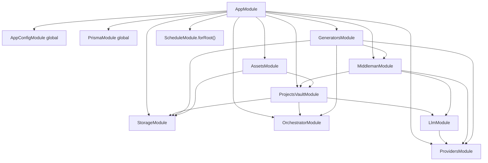
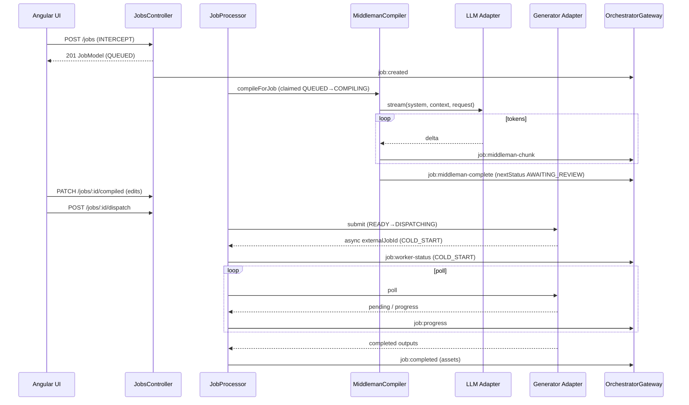

# ForgeStudio Control Room — Master Blueprint · Part 3 of 5
## §4 Backend Architecture (NestJS 11 · Prisma 6 · socket.io)

### 4.1 Module graph



**Cycle rule:** Vault needs `LlmAdapterRegistry` (for vision) and Middleman needs `VaultContextService`. To avoid a module cycle, `LlmAdapterRegistry` and all `llm/*` adapters live in a small `LlmModule` (`src/middleman/llm/llm.module.ts`, imports `ProvidersModule`). Both Vault and Middleman import `LlmModule`, and Middleman imports Vault one way. **Do not use `forwardRef`.**

`OrchestratorModule` exports `JobEventsPublisher`; the gateway only manages rooms. Nothing imports `GeneratorsModule` except `AppModule`.

### 4.2 Bootstrap (`main.ts`)
```ts
const app = await NestFactory.create<NestExpressApplication>(AppModule, { bufferLogs: true });
const cfg = app.get(AppConfigService);
app.setGlobalPrefix('api/v1', { exclude: ['health'] });
app.enableCors({ origin: cfg.corsOrigin, credentials: true });
app.useGlobalFilters(new AllExceptionsFilter());
app.useBodyParser('json', { limit: '25mb' });          // base64 reference images in webhook bodies
app.useWebSocketAdapter(new IoAdapter(app));
app.enableShutdownHooks();
await app.listen(cfg.port);
```
- `env.schema.ts` validates with zod at startup; `FORGE_MASTER_KEY` must decode to exactly 32 bytes, otherwise process exits with a clear message and the `npm run keygen` hint.
- `AllExceptionsFilter`: maps `DomainError` → its status/code; `ZodError` → 400 `VALIDATION_FAILED` with `details = issues`; `Prisma.PrismaClientKnownRequestError` P2002 → 409 `CONFLICT`, P2025 → 404 `NOT_FOUND`; everything else → 500 `INTERNAL` (message hidden in production). Always sets `traceId` (`randomUUID()`), logs with it.
- `ZodValidationPipe(schema)` + decorators `@ZodBody(schema)`, `@ZodQuery(schema)` = `Body(new ZodValidationPipe(schema))`.
- `HttpClientService.request<T>(url, { method, headers, body, timeoutMs, retries, retryOn: [429, 502, 503, 504], responseType: 'json'|'buffer'|'text'|'stream' })` using global `fetch` + `AbortSignal.timeout`. Retries with `backoff(attempt) = min(30s, 500ms·2^attempt) + jitter(0–250ms)`, honours `Retry-After`. Maps 401/403 → `PROVIDER_AUTH_FAILED`, 429 → `PROVIDER_RATE_LIMITED`, timeout → `PROVIDER_TIMEOUT`, others → `PROVIDER_ERROR` with the first 2 KB of the body in `details`.
- `sse-reader.ts`: `async function* readSse(body: ReadableStream<Uint8Array>): AsyncGenerator<{ event: string | null; data: string }>`: TextDecoder streaming, splits on `\n\n`, joins multi-line `data:`, skips comments, stops at `data: [DONE]`.
- `ndjson-reader.ts`: yields `JSON.parse(line)` per non-empty line.

### 4.3 StorageModule

```ts
// storage-driver.interface.ts
export interface StoredObjectStat { key: string; sizeBytes: number; mimeType: string; etag: string; modifiedAt: Date }
export interface ByteRange { start: number; end: number }   // inclusive
export interface IStorageDriver {
  put(key: string, data: Buffer | NodeJS.ReadableStream, mimeType: string): Promise<StoredObjectStat>;
  getStream(key: string, range?: ByteRange): Promise<NodeJS.ReadableStream>;
  getBuffer(key: string): Promise<Buffer>;
  stat(key: string): Promise<StoredObjectStat | null>;
  delete(key: string): Promise<void>;
  deletePrefix(prefix: string): Promise<number>;
  copy(srcKey: string, dstKey: string): Promise<void>;
}
export const STORAGE_DRIVER = Symbol('STORAGE_DRIVER');
```
- `LocalStorageDriver`: root = `path.resolve(STORAGE_ROOT)`. **Path-traversal guard:** `resolveSafe(key)` rejects keys containing `..`, backslashes, absolute paths or NUL, and asserts `resolved.startsWith(root + path.sep)`. Writes are atomic (`<file>.tmp-<rand>` then `rename`). Mime type is persisted in a sidecar `<file>.meta.json` `{ mimeType, sha256 }`. ETag = `sha256` of content.
- `S3StorageDriver`: `PutObjectCommand` / `GetObjectCommand` (`Range: bytes=s-e`) / `HeadObjectCommand` / `DeleteObjectsCommand` (paged `ListObjectsV2`) / `CopyObjectCommand`, `forcePathStyle` from env. Chosen by factory provider on `STORAGE_DRIVER`.
- `storage-keys.ts` (the only place keys are built):
```ts
export const StorageKeys = {
  vaultFile:  (p: string, fileId: string, name: string) => `projects/${p}/vault/${fileId}/${sanitizeFilename(name)}`,
  vaultThumb: (p: string, fileId: string) => `projects/${p}/vault/${fileId}/thumb.webp`,
  assetFile:  (p: string, m: Modality, assetId: string, v: number, name: string) => `projects/${p}/assets/${m.toLowerCase()}/${assetId}/v${v}/${sanitizeFilename(name)}`,
  reference:  (p: string, uploadId: string, name: string) => `projects/${p}/references/${uploadId}/${sanitizeFilename(name)}`,
  projectCover: (p: string) => `projects/${p}/cover.webp`,
  voiceSample: (p: string, voiceId: string, name: string) => `projects/${p}/voices/${voiceId}/${sanitizeFilename(name)}`,
};
```
- `StorageService` wraps the driver and adds `putBuffer(key, buf, mime)` returning `{ key, sizeBytes, sha256 }`, `readAsBase64(key)`, `readAsDataUri(key)`.
- `ImageProcessingService` (sharp):
  - `thumbnail(buf, 384) → webp` (fit `inside`, quality 82).
  - `probe(buf) → { width, height, hasAlpha, format }`.
  - `iconVariants(png) → { 512, 128, 64, 32 }` PNGs (`kernel: lanczos3` for 512/128, `kernel: nearest` disabled — use `mitchell` for 64/32, then `sharpen({ sigma: 0.6 })`).
  - `chromaKeyToAlpha(buf, { tolerance = 38 })`: read raw RGBA; sample the 4 corners (8×8 px median) as the key colour; BFS flood-fill from every border pixel whose Euclidean RGB distance to key ≤ tolerance, setting alpha 0; then 1-px feather: pixels adjacent to cleared ones with distance ≤ tolerance·1.6 get alpha = `255·(d - tol)/(0.6·tol)`. Returns PNG. Used when an icon adapter cannot natively output transparency and `removeBackground = true` (the Middleman is told to request a flat `#00FF00` background — see §4.6.4).
  - `makeTileable(buf)` check: `seamScore` = mean abs difference between left/right and top/bottom edge columns (reported in metadata as `tileSeamScore`, lower is better).
  - `sliceSpritesheet(buf, columns, rows) → Buffer[]`.
- `MediaStreamController` (`/api/v1/media`):
  - `GET /media/vault/:fileId`, `GET /media/vault/:fileId/thumbnail`, `GET /media/assets/:assetFileId`, `GET /media/references/:projectId/:uploadId/:name`.
  - Looks up the DB row → storage key (never accepts raw keys from clients). Supports `Range: bytes=start-end` → `206` with `Content-Range`, `Accept-Ranges: bytes`, `Content-Length`; unsatisfiable → `416`. Sets `ETag`, `Cache-Control: private, max-age=31536000, immutable` for asset files (content-addressed by version), `no-cache` for vault text files. `?download=1` adds `Content-Disposition: attachment; filename*=UTF-8''…`.
  - `POST /media/references/:projectId` (multipart `file`, image only, ≤ 25 MB) → stores under `StorageKeys.reference` and returns `{ storageKey, url, width, height }` — used by Img2Img / Image-to-3D slots.

### 4.4 ProjectsVaultModule

**ProjectsService**
- `create(dto)`: slug = dto.slug ?? kebab(name) with `-2`, `-3` suffix on conflict; transaction creates Project + root folder.
- `list()` returns `ProjectModel[]` with `stats` via `groupBy`/`_count` (vault files, assets, active jobs, `_sum.costUsd`).
- `update`, `archive` (`archivedAt`), `delete` (cascade + `storage.deletePrefix('projects/<id>/')`), `uploadCover` (webp 1200×630 cover).

**VaultFoldersService**
- `tree(projectId)`: single query of all folders + `_count.files`, assembled into a nested tree in memory, children sorted by `sortOrder, name`.
- `create(projectId, { parentId, name })`: path = `parent.path === '/' ? '/' + name : parent.path + '/' + name`.
- `update` rename/move: in a transaction recompute `path` for the folder and **all descendants** (`WHERE path LIKE oldPath || '/%'` replaced by prefix swap); reject moving into own descendant (`CONFLICT`).
- `delete(folderId, { recursive })`: non-empty without `recursive=true` → 409; recursive deletes storage objects of every contained file.

**VaultFilesService**
- `kindFromName(name, mime)`: `.md→MARKDOWN`, `.txt→TEXT`, `.json→JSON`, `image/*→IMAGE`, `audio/*→AUDIO`, `.glb/.gltf/.fbx/.obj→MODEL_3D`, else `OTHER`.
- `createText(dto)`: JSON kind must `JSON.parse` (400 otherwise); `tokenEstimate = estimateTokens(contentText)`; also mirrors content to storage for download parity.
- `upload(file, fields)`: Multer memory storage, limit `MAX_UPLOAD_MB`. Text kinds → decoded UTF-8 into `contentText`. Images → `probe`, thumbnail, `width/height`. Audio → `durationMs` via WAV header parse (RIFF) or `music-metadata`‑free MP3 frame scan is **not** required: set `durationMs = null` for non-WAV and let the frontend compute it. Name collision in the same folder → auto-suffix ` (2)`.
- If `kind = IMAGE && runVision` → `visionStatus = PENDING`, then `VisionAnalysisService.enqueue(fileId)` (fire-and-forget, in-process queue with concurrency 2).
- `update(fileId, dto)`: recompute `tokenEstimate` when content changes; manual `styleDescriptorText` edit sets `visionModel = 'manual'`.
- `search(projectId, query)`: `name ILIKE %q% OR contentText ILIKE %q% OR styleDescriptorText ILIKE %q%`, optional `scopes: { has: scope }`, ordered by priority desc. Used by the `@mention` autocomplete.
- Every mutation emits `vault:file-updated` via `JobEventsPublisher.vaultFileUpdated()`.

**VisionAnalysisService**
- Resolves profile: explicit → `isVisionDefault` → first profile with `supportsVision`. None → `visionStatus = FAILED`, `visionError = 'No vision-capable Middleman profile configured'`.
- Image is downscaled to max 1536px JPEG q85 before sending.
- Prompt (system): *"You are an art-direction analyst for a game studio. Extract reproducible visual rules from the reference image. Respond with JSON only."* User content: image + instruction listing the exact `StyleDescriptor` keys (§2.6) and requiring `paletteHex` to hold 5–10 dominant colours as `#RRGGBB`, plus `styleDescriptorText`: a dense 80–160 word paragraph usable verbatim inside an image-generation prompt.
- Output parsed by the same JSON-extraction routine as the compiler (§4.6.5) against `z.object({ styleDescriptorText: z.string().min(40), descriptor: StyleDescriptorSchema })`. Persist `styleDescriptorText`, `styleDescriptorJson`, `visionModel`, `visionAnalyzedAt`, `visionStatus = DONE`, recompute `tokenEstimate` (descriptor text counts for image files).
- `POST /vault/files/:id/analyze` re-runs it.

**VaultContextService** (consumed by Middleman)
```ts
async collectCandidates(projectId: string, modality: Modality, explicitPinnedIds: string[], rawPrompt: string): Promise<ContextCandidate[]>
// ContextCandidate = { file: VaultFile & { folder: { path } }, reason: 'PINNED' | 'ALWAYS_INCLUDE' | 'SCOPE' }
```
1. `mentionTokens = extractMentions(rawPrompt)`; resolve each against the project's files where `normalizeForMention(name) = token` OR the same without extension OR `normalizeForMention(folderPath + '/' + name)` ends with token. Unresolved mentions are returned as `warnings`.
2. `pinned = explicitPinnedIds ∪ resolvedMentionIds` (validated to belong to `projectId`, else 400).
3. `scoped = findMany({ projectId, scopes: { hasSome: ['ALWAYS_INCLUDE', modality] }, id: { notIn: pinned } })`.
4. Reason assignment: pinned → `PINNED`; contains `ALWAYS_INCLUDE` → `ALWAYS_INCLUDE`; else `SCOPE`.

**VoiceProfilesService**: CRUD; `characterSheetFileId` must be a MARKDOWN/TEXT file in the same project. The character sheet is automatically added as a `PINNED` context file when a voice job references the profile.

### 4.5 ProvidersModule

**SecretCipherService** (AES-256-GCM):
```ts
encrypt(plain: string): string {
  const iv = randomBytes(12);
  const c = createCipheriv('aes-256-gcm', this.key, iv);
  const enc = Buffer.concat([c.update(plain, 'utf8'), c.final()]);
  return `v1:${iv.toString('base64')}:${c.getAuthTag().toString('base64')}:${enc.toString('base64')}`;
}
decrypt(payload: string): string {   // throws DomainError(INTERNAL,'Secret decryption failed') on tag mismatch
  const [v, ivB, tagB, encB] = payload.split(':');
  if (v !== 'v1' || !ivB || !tagB || !encB) throw …;
  const d = createDecipheriv('aes-256-gcm', this.key, Buffer.from(ivB, 'base64'));
  d.setAuthTag(Buffer.from(tagB, 'base64'));
  return Buffer.concat([d.update(Buffer.from(encB, 'base64')), d.final()]).toString('utf8');
}
```
`secretLast4 = plain.slice(-4)`. Secrets are **never** serialized: mapper exposes only `hasSecret` and `secretLast4`. Tests: round-trip, tamper detection, wrong key.

**ProvidersService**
- CRUD with `UpsertProviderSchema`; enforces invariant 3 (default-per-modality) in a transaction.
- `getRuntimeConfig(id): ProviderRuntimeConfig` = DB row + decrypted `secret` + parsed `settings` (defaults applied) — **only** used server-side by adapters.
- `catalog(): ProviderCatalogEntry[]` from `provider-catalog.ts` (static data, one entry per `ProviderKind`, listing suggested models — see table §4.7.3).
- `adapters(providerId)`: returns `AdapterDescriptor[]` for each modality the provider supports (from the generator registry) — the frontend uses it to render ParamSpec controls.
- `previewTemplate({ template, variables })` → `interpolateTemplate` result (no secrets involved).

**ProviderHealthService**
- `check(id)` per kind (timeout 8 s, measures latency):
  - ANTHROPIC `GET https://api.anthropic.com/v1/models` · OPENAI / OPENAI_COMPATIBLE `GET {base}/v1/models` · GEMINI `client.models.list()` · FAL `GET https://queue.fal.run/fal-ai/flux/dev/requests/healthcheck` → 404/200 both count as reachable when auth accepted (401 ⇒ UNAUTHORIZED) · REPLICATE `GET https://api.replicate.com/v1/account` · STABILITY `GET https://api.stability.ai/v1/user/account` · MESHY `GET https://api.meshy.ai/openapi/v1/balance` · TRIPO3D `GET https://api.tripo3d.ai/v2/openapi/user/balance` · RODIN `POST …/api/v2/check_balance` · ELEVENLABS `GET https://api.elevenlabs.io/v1/user` · CARTESIA `GET https://api.cartesia.ai/voices?limit=1` · FISH_AUDIO `GET https://api.fish.audio/model?page_size=1` · RUNPOD `GET https://api.runpod.ai/v2/{endpointId}/health` (returns worker counts; DEGRADED if `workers.throttled > 0`) · COMFYUI `GET {base}/system_stats` · A1111 `GET {base}/sdapi/v1/options` · OLLAMA `GET {base}/api/tags` · GENERIC_HTTP `GET {base}` (any < 500 = reachable) · DEMO always HEALTHY.
- `@Cron('*/2 * * * *')` re-checks enabled providers; persists health fields; emits `provider:health`.

### 4.6 MiddlemanModule

#### 4.6.1 LLM adapter contract (`llm/llm-adapter.interface.ts`)
```ts
export interface LlmMessagePart { type: 'text'; text: string } | { type: 'image'; mimeType: string; base64: string }
export interface LlmRequest {
  model: string; system: string; userParts: LlmMessagePart[];
  temperature: number; maxOutputTokens: number; jsonMode: boolean;
  jsonSchema?: Record<string, unknown>;     // JSON Schema for CompiledPrompt (from zod → hand-written constant, §4.6.5)
  signal?: AbortSignal;
}
export type LlmStreamEvent = { type: 'delta'; text: string } | { type: 'done'; usage: { inputTokens: number; outputTokens: number } };
export interface ILlmAdapter {
  readonly kind: ProviderKind;
  stream(cfg: ProviderRuntimeConfig, req: LlmRequest): AsyncGenerator<LlmStreamEvent>;
  complete(cfg: ProviderRuntimeConfig, req: LlmRequest): Promise<{ text: string; usage: { inputTokens: number; outputTokens: number } }>; // default impl: drain stream()
}
```
`LlmAdapterRegistry.get(kind)` → adapter or `DomainError(MODALITY_UNSUPPORTED)`.

| Adapter | Vendor contract (only in this file) |
|---|---|
| `AnthropicLlmAdapter` | `POST https://api.anthropic.com/v1/messages`, headers `x-api-key`, `anthropic-version: 2023-06-01`, body `{ model, system, max_tokens, temperature, stream: true, messages: [{ role: 'user', content: [ {type:'text',text}, {type:'image',source:{type:'base64',media_type,data}} ] }] }`. SSE: `content_block_delta` with `delta.type === 'text_delta'` → delta; `message_start.message.usage.input_tokens`, `message_delta.usage.output_tokens`. JSON mode: append to system *"Respond with a single JSON object and nothing else."* and prefill is **not** used. |
| `OpenAiLlmAdapter` | `POST {baseUrl ?? https://api.openai.com}/v1/chat/completions`, `Authorization: Bearer`, body `{ model, temperature, max_completion_tokens, stream: true, stream_options: { include_usage: true }, response_format: jsonSchema ? { type: 'json_schema', json_schema: { name: 'compiled_prompt', strict: false, schema } } : { type: 'json_object' }, messages: [{role:'system',content:system},{role:'user',content:[{type:'text',text},{type:'image_url',image_url:{url:'data:<mime>;base64,<b64>'}}]}] }`. SSE `choices[0].delta.content`; final chunk `usage`. |
| `GeminiLlmAdapter` | `@google/genai` ≥ 2.29.1 **Interactions API**: `const ai = new GoogleGenAI({ apiKey })`; `ai.interactions.create({ model, system_instruction: system, input: [{type:'text',text}, {type:'image',data:b64,mime_type}], generation_config: { temperature, max_output_tokens }, response_format: { type: 'text', mime_type: 'application/json', schema: jsonSchema }, stream: true, store: false })`. Iterate events: `event.event_type === 'step.delta' && event.delta.type === 'text'` → delta; `interaction.completed` → `event.interaction.usage`. Default models: `gemini-3.8-flash` (Middleman), `gemini-3.5-flash-lite` (cheap), `gemini-4-argon` (premium). **Never** use legacy `gemini-2.x` ids. Before implementing, Argon MUST query the Gemini docs MCP for `interactions.create` streaming + `response_format`. |
| `OllamaLlmAdapter` | `POST {base}/api/chat` `{ model, stream: true, format: jsonSchema ?? 'json', options: { temperature, num_predict }, messages: [{role:'system',content},{role:'user',content:text, images:[b64…]}] }`; NDJSON lines `message.content`, final line `done: true` with `prompt_eval_count`, `eval_count`. |
| `OpenAiCompatibleLlmAdapter` | LM Studio / vLLM / llama.cpp server: same as OpenAI adapter but `baseUrl` required, `Authorization` only if a secret is set, `response_format: { type: 'json_object' }` only when `settings.supportsJsonMode !== false`. |
| `DemoLlmAdapter` | Offline, deterministic: builds a valid CompiledPrompt from the request (see §4.6.6) and streams its JSON serialization in 24-char chunks every 18 ms. |

#### 4.6.2 `ContextAssemblerService`
```ts
assemble(candidates: ContextCandidate[], budgetTokens: number, opts: { attachImages: boolean; maxImages: number }):
  { blocks: ContextBlock[]; included: ContextFileRef[]; dropped: ContextFileRef[]; imageParts: LlmMessagePart[] }
```
1. **Render** each candidate into a block body:
   - MARKDOWN/TEXT/JSON → `contentText`.
   - IMAGE → `styleDescriptorText ?? description ?? '(reference image, no descriptor yet)'` + `Palette: #… #…` from `styleDescriptorJson.paletteHex`.
   - AUDIO / MODEL_3D / OTHER → `description` + key metadata (`durationMs`, dimensions).
2. **Order**: `PINNED` (in pin order) → `ALWAYS_INCLUDE` (priority desc, updatedAt desc) → `SCOPE` (priority desc, updatedAt desc).
3. **Budget**: walk in order; `tokens = estimateTokens(body) + 30` (envelope). If it fits, include. If not: PINNED and ALWAYS_INCLUDE files are **truncated** to the remaining budget if remaining ≥ 300 tokens (`truncated: true`); SCOPE files are dropped (`dropped[]`). Project `globalSummary` is always injected first and counts against the budget.
4. **Envelope format** (exact):
```xml
<vault_file id="clx…" name="Color Palette.md" folder="/Art Direction" scopes="ALWAYS_INCLUDE,2D_ICONS" reason="PINNED" truncated="false">
…body…
</vault_file>
```
5. **Images**: if `opts.attachImages`, take up to `maxImages` IMAGE candidates in the same order, read the thumbnail-or-original, downscale to 1024px JPEG, push as `image` parts preceded by a text part `Reference image for vault_file id="…"`.

#### 4.6.3 `SystemPromptBuilder`
```ts
build(input: { template: MiddlemanTemplate; descriptor: AdapterDescriptor; modality: Modality; params: ModalityParams; project: Project }): string
```
Concatenates **exactly these sections** separated by blank lines:
```text
# ROLE
You are the ForgeStudio Middleman Prompt Compiler for the game project "{project.name}" ({project.genre}).
You transform a short creative request into a production-ready generation payload for a specific
{modalityLabel} generator, strictly obeying the project's vault context.

# COMPILER RULES
1. The vault context is authoritative. When it specifies colours (hex), proportions, materials,
   naming, tone or audio direction, encode them explicitly in enhancedPrompt.
2. Never invent lore that contradicts the vault. If the request conflicts with the vault, follow the
   vault and add a warning.
3. Write enhancedPrompt in the style the target generator responds to best (see TARGET GENERATOR).
4. Keep enhancedPrompt ≤ {descriptor.maxPromptChars} characters.
5. negativePrompt lists concrete exclusions, comma-separated. {if !supportsNegativePrompt: "The target
   does not accept negative prompts: still fill negativePrompt; the system will fold it in."}
6. recommendedParams may ONLY use keys from ALLOWED PARAMETERS, within their ranges.
7. contextSourcesUsed lists every vault_file id that materially influenced the output, each with a
   reasoningNote ≤ 200 chars. Never list ids that were not provided.
8. assetTitle is a short in-world display name following the project's naming conventions.
9. Output ONLY the JSON object described in OUTPUT CONTRACT. No markdown fences, no commentary.

# MODALITY SYSTEM BLUEPRINT
{template.systemTemplate}

# HARD CONSTRAINTS
{template.hardConstraints (one per line, prefixed "- ")}
{auto constraints derived from params — see table below}

# TARGET GENERATOR
Provider: {providerKind} · Model: {model} · Tier: {tier}
Supports negative prompt: {yes/no} · Supports seed: {yes/no} · Reference image attached: {yes/no}

# ALLOWED PARAMETERS
{for each ParamSpec: "- key (type, min–max | options) default=…: description"}

# DEFAULT NEGATIVE PROMPT (merge, do not drop)
{template.defaultNegativePrompt}

# OUTPUT CONTRACT
{"assetTitle": string, "enhancedPrompt": string, "negativePrompt": string,
 "recommendedParams": { [key]: string|number|boolean|null|string[] },
 "contextSourcesUsed": [{"fileId": string, "fileName": string, "reasoningNote": string}],
 "warnings": string[]}
```
**Auto constraints derived from params** (appended to HARD CONSTRAINTS):

| Modality | Param condition | Injected constraint |
|---|---|---|
| ICONS_2D | always | `Single centered subject, die-cut silhouette, occupies 70–80% of frame, readable at 64x64 and 32x32, no text, no border unless frameShape ≠ NONE.` |
| ICONS_2D | `removeBackground && !adapter.supportsNativeTransparency` | `Render on a perfectly flat pure #00FF00 background with no shadows touching the edges and no green in the subject.` |
| ICONS_2D | `removeBackground && supportsNativeTransparency` | `Transparent background (alpha).` |
| ICONS_2D | `frameShape ≠ NONE` | `Enclose the subject in a {frameShape} frame consistent with the project's UI style.` |
| ASSETS_3D | always | `Single isolated object, no floor plane, no environment, neutral lighting, clean readable silhouette, {polycountTier} game-ready topology (~{target} triangles), PBR materials: describe base colour, roughness, metalness.` |
| ASSETS_3D | `pose ≠ NONE` | `Character in a strict {T-pose/A-pose}, symmetrical, arms clear of torso.` |
| IMAGES | `SEAMLESS_TILE` | `Seamlessly tileable texture, no vignette, no perspective, uniform lighting, edges must wrap.` |
| IMAGES | `PBR_TEXTURE` | `Flat albedo texture, no baked shadows or highlights.` |
| MUSIC | always | `Specify BPM, key, instrumentation, structure with timestamps; duration {durationSec}s.` + `seamlessLoop ⇒ ending must resolve into the opening bar for a seamless loop.` + `instrumentalOnly ⇒ no vocals.` |
| VOICES | always | `enhancedPrompt is the exact text to be spoken: preserve the transcript wording; only add delivery tags supported by the provider. Put acting direction in recommendedParams.instructions.` |
| SFX | always | `Describe the physical sound source, material, attack/decay, duration {durationSec}s{, seamlessly loopable}. No music, no voices.` |
| OTHER/SPRITESHEET | always | `A {columns}x{rows} grid of {frameCount} evenly spaced animation frames of the same subject, identical scale and position, flat background.` |
| OTHER/VFX_TEXTURE | always | `{grayscale ? 'Grayscale' : 'Colour'} {textureType} texture on pure black, centered, soft falloff{, tileable}.` |
| OTHER/SHADER_CODE | always | `enhancedPrompt is a precise engineering spec for {language} targeting {targetEngine}.` |
| OTHER/LORE_JSON | always | `enhancedPrompt is a precise spec for {entryCount} {schemaKind} entries; include the exact JSON schema.` |

**User message** = `<project_summary>{globalSummary}</project_summary>` + all context blocks + `<user_request>{rawPrompt with @ stripped}</user_request>` + `<user_params>{JSON.stringify(params, null, 2)}</user_params>` + (voices) `<transcript>…</transcript>` + (voice profile) `<voice_profile name="…">description</voice_profile>`.

#### 4.6.4 `MiddlemanCompilerService` (exact flow)
```ts
@Injectable()
export class MiddlemanCompilerService {
  async compileForJob(jobId: string, signal: AbortSignal): Promise<CompiledPrompt>;   // streams + persists + emits
  async preview(dto: CompilePreviewDto): Promise<CompilePreviewResult>;                // no job, no streaming
}
```
`compileForJob`:
1. Load job (+project, provider). `profile = job.middlemanProfileId ? find : findFirst({ isDefault: true })`; none → fail `PROVIDER_NOT_CONFIGURED`.
2. `template = MiddlemanTemplatesService.resolve(projectId, modality)` (invariant 4). Store `middlemanTemplateId`.
3. `descriptor = GeneratorAdapterRegistry.describe(provider.kind, modality, subMode)`.
4. `candidates = VaultContextService.collectCandidates(...)` (+ voice character sheet as PINNED).
5. `assembled = ContextAssembler.assemble(candidates, profile.maxContextTokens, { attachImages: profile.supportsVision && profile.attachReferenceImages, maxImages: profile.maxReferenceImages })`. If the job has `referenceStorageKeys` and the profile supports vision, attach those images too (labelled "User-supplied reference image").
6. Build system + user message. `middlemanStartedAt = now`; transition → `COMPILING`.
7. Stream: for each `delta`, append to buffer, `seq++`, emit `job:middleman-chunk` (throttled: coalesce deltas, max 1 emit / 40 ms per job), keep a ring buffer of the last 400 chunks in memory (`MiddlemanStreamCache`) for `job:subscribe` replay.
8. On `done`: `CompiledOutputParser.parse(buffer, ctx)` → on failure, **one repair round**: send a second non-streamed request with system *"You fix malformed JSON. Return only valid JSON matching this contract: …"* and user = the raw output; parse again. Still failing → transition `FAILED` with `MIDDLEMAN_PARSE_FAILED`, emit `job:middleman-error` with a 500-char excerpt.
9. Persist `middlemanRawOutput`, `compiledPayload`, `contextFileIds`, `middlemanUsage` `{ inputTokens, outputTokens, latencyMs, model }`, `middlemanCompletedAt`.
10. Emit `job:middleman-complete` with `nextStatus`; transition to `AWAITING_REVIEW` (INTERCEPT) or `READY` (AUTO_FIRE).

#### 4.6.5 `CompiledOutputParser`
1. **Extract**: strip BOM; remove ```` ```json ```` / ```` ``` ```` fences; take substring from the first `{` to its matching `}` using a brace-depth scanner that respects JSON strings and escapes.
2. `JSON.parse`; on failure attempt light repair: remove trailing commas before `}`/`]`, replace smart quotes, then parse again.
3. `CompiledPromptSchema.safeParse`.
4. **Post-validate**:
   - `contextSourcesUsed`: drop entries whose `fileId` is not in the provided set; if `fileName` mismatches, overwrite with the real name.
   - `recommendedParams`: keep only keys present in `descriptor.paramSpecs`; clamp numbers to `[min,max]` and round integers; coerce `"true"/"false"`; drop invalid enum values (add a warning for each dropped/clamped key).
   - Merge the template's `defaultNegativePrompt` terms into `negativePrompt` (case-insensitive dedupe, comma-joined).
   - Truncate `enhancedPrompt` to `descriptor.maxPromptChars` at a word boundary (warning).
5. The JSON Schema constant `COMPILED_PROMPT_JSON_SCHEMA` (hand-written in `compiled-output.parser.ts`, mirrors the zod schema) is passed to adapters that support schema-constrained output.

#### 4.6.6 `DemoLlmAdapter` deterministic compile (so the full pipeline runs with zero API keys)
- Parses `<user_request>`, `<user_params>`, every `<vault_file …>` block from the user message.
- `palette` = first 6 unique `#RRGGBB` found across blocks (pinned first).
- `styleClauses` = first sentence of each `vault_file` body whose name matches `/art bible|style|guide|direction|standards/i` (max 3, ≤ 160 chars each).
- `enhancedPrompt` = `[userRequest, modalityLead[modality], ...styleClauses, palette.length ? 'strict palette ' + palette.join(', ') : '', ...hardConstraintLinesFromSystem].filter(Boolean).join('. ')` truncated to the limit. `modalityLead` is a fixed map, e.g. ICONS_2D → "game item icon, centered die-cut subject, bold readable silhouette, soft rim light".
- `negativePrompt` = the `DEFAULT NEGATIVE PROMPT` section of the system prompt.
- `recommendedParams` = each ParamSpec default.
- `contextSourcesUsed` = every vault_file id with reasoningNote `"Applied {reason} context from {folder}/{name}"`.
- `assetTitle` = Title Case of the first 4 meaningful words of the request.

### 4.7 GeneratorsModule

#### 4.7.1 `IGeneratorAdapter` contract
```ts
export interface GeneratorDispatchContext {
  job: GenerationJob; project: Project; provider: ProviderRuntimeConfig;
  modality: Modality; subMode: GenerationSubMode; params: ModalityParams;
  compiled: CompiledPrompt;                       // editedPayload ?? compiledPayload ?? synthesized from rawPrompt when skipMiddleman
  mergedParams: Record<string, unknown>;          // ParamSpec defaults ← recommendedParams ← explicit user advanced params
  seed: number;                                   // params.seed ?? random int in [0, SEED_MAX]
  references: Array<{ storageKey: string; mimeType: string; base64: () => Promise<string>; dataUri: () => Promise<string>; publicUrl: string | null }>;
  voiceProfile: VoiceProfile | null;
  webhookUrl: string | null;                      // set when PUBLIC_WEBHOOK_BASE_URL && settings.useWebhook
  signal: AbortSignal;
  reportProgress(p: { percent: number; stage: string; message?: string }): void;
  reportWorker(w: Omit<WorkerStatusEvent, 'jobId' | 'projectId' | 'at' | 'tier' | 'providerKind'>): void;
  log(message: string, payload?: unknown): void;  // → GenerationJobEvent(type='adapter-log')
}
export interface GeneratorOutput {
  kind: 'buffer' | 'base64' | 'url' | 'text';
  data: Buffer | string;                          // url → downloaded by ingestion (with provider auth headers if sameOrigin)
  mimeType: string; fileName: string; role: AssetFileRole;
  batchIndex: number;                             // groups outputs into GeneratedAsset rows
  metadata?: Record<string, unknown>;
}
export type GeneratorSubmitResult =
  | { mode: 'sync'; outputs: GeneratorOutput[]; costUsd?: number; executionMs?: number }
  | { mode: 'async'; externalJobId: string; handle: Record<string, unknown>; initialStatus: 'COLD_START' | 'RUNNING'; pollAfterMs: number };
export type GeneratorPollResult =
  | { state: 'pending'; coldStart: boolean; externalStatus: string; progress?: number; pollAfterMs?: number; queueDelayMs?: number }
  | { state: 'completed'; outputs: GeneratorOutput[]; externalStatus: string; costUsd?: number; executionMs?: number; queueDelayMs?: number }
  | { state: 'failed'; externalStatus: string; code: ErrorCode; message: string; retryable: boolean };
export interface IGeneratorAdapter {
  readonly id: string;                            // e.g. 'openai-image'
  readonly providerKind: ProviderKind;
  readonly modalities: readonly Modality[];
  readonly subModes: readonly GenerationSubMode[];
  readonly tier: ExecutionTier | 'ANY';
  describe(modality: Modality, subMode: GenerationSubMode, provider?: ProviderRuntimeConfig): AdapterDescriptor;
  submit(ctx: GeneratorDispatchContext): Promise<GeneratorSubmitResult>;
  poll?(ctx: GeneratorDispatchContext, handle: Record<string, unknown>): Promise<GeneratorPollResult>;
  cancel?(ctx: GeneratorDispatchContext, handle: Record<string, unknown>): Promise<void>;
  readonly supportsNativeTransparency?: boolean;
}
```
`BaseGeneratorAdapter` provides: `auth headers` helper, `foldNegative(prompt, negative) = negative ? prompt + '. Avoid: ' + negative : prompt`, `pickModel(ctx, fallback)`, `sizeFor(params)`, `num(mergedParams, key, fallback)`.

#### 4.7.2 Registry
`GeneratorAdapterRegistry` is built from a multi-provider token `GENERATOR_ADAPTERS` (array of all adapter classes). `resolve(kind, modality, subMode)` returns the first adapter whose `providerKind === kind && modalities.includes(modality) && subModes.includes(subMode)`; else `MODALITY_UNSUPPORTED`. `describe(...)` = `resolve(...).describe(...)`.

#### 4.7.3 Adapter matrix (all must be implemented)

| Adapter (`id`) | Kind | Modalities / subModes | Mode | Vendor contract essentials |
|---|---|---|---|---|
| `openai-image` | OPENAI | ICONS_2D, IMAGES, OTHER(SPRITESHEET, VFX_TEXTURE) | sync | `POST /v1/images/generations` `{ model: 'gpt-image-1' (default; dall-e-3 supported), prompt, n: batch, size: '1024x1024'|'1536x1024'|'1024x1536', quality, background: removeBackground ? 'transparent' : 'opaque', output_format: 'png' }` → `data[].b64_json`. Img2Img: `POST /v1/images/edits` multipart `image[]`. `supportsNativeTransparency = true`. dall-e-3: `n=1`, sizes `1024x1024|1792x1024|1024x1792`, `response_format: 'b64_json'`. |
| `gemini-image` | GEMINI | ICONS_2D, IMAGES, OTHER(SPRITESHEET, VFX_TEXTURE) | sync | `ai.interactions.create({ model: 'gemini-nano-banana-2.1', input: [text, …reference images], response_format: { type: 'image', aspect_ratio, image_size: '1K'|'2K' }, store: false })` → `interaction.output_image { data, mime_type }`; loop `batchCount` times with distinct prompts suffix `variation n`. No negative prompt (fold). |
| `fal-image` | FAL | ICONS_2D, IMAGES, OTHER(SPRITESHEET, VFX_TEXTURE) | async | `POST https://queue.fal.run/{modelPath}` (`fal-ai/flux-pro/v1.1` default, `fal-ai/flux/dev` alt; img2img `fal-ai/flux/dev/image-to-image`), `Authorization: Key <secret>`, body `{ prompt, image_size: {width,height}, num_images, seed, guidance_scale, num_inference_steps, output_format: 'png', image_url? }` → `{ request_id, status_url, response_url }`. Poll `GET status_url` (`IN_QUEUE`→cold/queued with `queue_position`, `IN_PROGRESS`, `COMPLETED`) then `GET response_url` → `images[].url`. Cancel `PUT …/requests/{id}/cancel`. |
| `replicate` | REPLICATE | IMAGES, ICONS_2D, MUSIC, SFX, ASSETS_3D | async | `POST https://api.replicate.com/v1/models/{owner}/{name}/predictions` `{ input }` (input built from per-modality map: flux → `{prompt, aspect_ratio, num_outputs, seed, output_format:'png'}`; `meta/musicgen` → `{prompt, duration, model_version:'stereo-large', output_format:'wav', normalization_strategy:'peak', seed}`; audiogen-style models → `{prompt, duration}`); poll `GET /v1/predictions/{id}` (`starting` = cold start, `processing`, `succeeded`, `failed`, `canceled`); output = string or string[] URLs; cancel `POST /v1/predictions/{id}/cancel`. Model slug from `providerModel`. |
| `stability-image` | STABILITY | IMAGES, ICONS_2D | sync | `POST https://api.stability.ai/v2beta/stable-image/generate/{sd3|ultra|core}` multipart `{ prompt, negative_prompt, aspect_ratio, seed, output_format: 'png', model: 'sd3.5-large', image?, strength? }`, `Accept: image/*` → binary. |
| `stability-audio` | STABILITY | MUSIC, SFX | sync | `POST https://api.stability.ai/v2beta/audio/stable-audio-2/text-to-audio` multipart `{ prompt, duration, seed, steps, cfg_scale, output_format: 'wav'|'mp3' }`, `Accept: audio/*`. SFX variations: `variationCount` sequential calls with `seed + i`. |
| `meshy` | MESHY | ASSETS_3D (TEXT_TO_3D, IMAGE_TO_3D) | async (2-stage) | Text: `POST https://api.meshy.ai/openapi/v2/text-to-3d` `{ mode:'preview', prompt, negative_prompt, art_style:'realistic', topology, target_polycount, should_remesh: true, seed }` → `{ result: taskId }`; poll `GET …/text-to-3d/{id}` (`PENDING`→cold, `IN_PROGRESS` + `progress`, `SUCCEEDED`, `FAILED`); on preview success, if `enablePbr` submit `{ mode:'refine', preview_task_id, enable_pbr: true, texture_prompt }` and keep polling (handle stores `stage: 'preview'|'refine'`; progress mapped 0–50 / 50–100). Image: `POST /openapi/v1/image-to-3d` `{ image_url: dataUri, enable_pbr, should_remesh, topology, target_polycount }`, poll `GET /openapi/v1/image-to-3d/{id}`. Outputs: `model_urls[format]` (PRIMARY) + `thumbnail_url` (THUMBNAIL) + `texture_urls[0].base_color/normal/metallic` (TEXTURE_*). |
| `tripo3d` | TRIPO3D | ASSETS_3D (both) | async | `POST https://api.tripo3d.ai/v2/openapi/task` `{ type:'text_to_model', prompt, negative_prompt, model_seed, face_limit }` or image: first `POST /v2/openapi/upload` (multipart) → `image_token`, then `{ type:'image_to_model', file: { type:'png', file_token } }`; poll `GET /v2/openapi/task/{id}` (`queued`, `running` + `progress`, `success`, `failed|banned|expired|cancelled`); output `output.pbr_model ?? output.model` (glb) + `output.rendered_image`. FBX/OBJ: submit `{ type:'convert_model', original_model_task_id, format:'FBX'|'OBJ' }` as a chained stage. |
| `rodin` | RODIN | ASSETS_3D (both) | async | `POST https://hyperhuman.deemos.com/api/v2/rodin` multipart `{ prompt, images?, geometry_file_format: glb|fbx|obj, material: 'PBR', quality: low|medium|high (from polycountTier), seed, tier: 'Regular' }` → `{ uuid, jobs: { subscription_key } }`; poll `POST /api/v2/status { subscription_key }` (all `Done` = complete, any `Failed`); `POST /api/v2/download { task_uuid }` → `list[{ url, name }]`. |
| `elevenlabs-tts` | ELEVENLABS | VOICES | sync | `POST https://api.elevenlabs.io/v1/text-to-speech/{voice_id}/with-timestamps?output_format=pcm_44100` (wrapped to WAV) or `mp3_44100_128`, headers `xi-api-key`, body `{ text: enhancedPrompt, model_id: providerModel ?? 'eleven_multilingual_v2', seed, voice_settings: { stability, similarity_boost, style, use_speaker_boost: true, speed } }` → `{ audio_base64, alignment: { characters, character_start_times_seconds, character_end_times_seconds } }`. Ingestion converts character alignment → word alignment (`VoiceAlignment`) stored in metadata + `ALIGNMENT` json file. voice_id = voiceProfile.externalVoiceId (required → 400 if missing). |
| `elevenlabs-sfx` | ELEVENLABS | SFX | sync | `POST /v1/sound-generation` `{ text, duration_seconds, prompt_influence, loop: loopable, model_id? }` → audio bytes (mp3); `variationCount` calls in parallel (max 4 concurrent). |
| `elevenlabs-music` | ELEVENLABS | MUSIC | sync | `POST /v1/music` `{ prompt: enhancedPrompt, music_length_ms: durationSec*1000, force_instrumental: instrumentalOnly }` → audio bytes. |
| `openai-tts` | OPENAI | VOICES | sync | `POST /v1/audio/speech` `{ model: 'gpt-4o-mini-tts', voice: externalVoiceId \|\| 'alloy', input: enhancedPrompt, instructions: recommendedParams.instructions, response_format: 'wav', speed }` → bytes. |
| `gemini-tts` | GEMINI | VOICES | sync | `ai.interactions.create({ model: 'gemini-3.8-flash-tts', input: enhancedPrompt, response_format: { type: 'audio', … voice config per docs }, store: false })` → `output_audio`. Argon MUST consult Gemini docs MCP (speech-generation) for the exact voice config shape before implementing. |
| `cartesia-tts` | CARTESIA | VOICES | sync | `POST https://api.cartesia.ai/tts/bytes`, headers `X-API-Key`, `Cartesia-Version: 2025-04-16`, body `{ model_id: 'sonic-2', transcript, voice: { mode: 'id', id }, output_format: { container: 'wav', encoding: 'pcm_s16le', sample_rate: 44100 }, language: 'en' }`. |
| `fish-audio-tts` | FISH_AUDIO | VOICES | sync | `POST https://api.fish.audio/v1/tts`, `Authorization: Bearer`, header `model: s1`, JSON `{ text, reference_id, format: 'wav', latency: 'normal' }` → bytes. |
| `llm-text` | ANTHROPIC, OPENAI, GEMINI, OLLAMA, OPENAI_COMPATIBLE, DEMO | OTHER (SHADER_CODE, LORE_JSON) | sync | Uses `LlmAdapterRegistry` with a code-generation system prompt: SHADER_CODE → "Return only {language} source in one fenced block"; LORE_JSON → JSON mode with `customSchema` or built-in schema per `schemaKind`. Output `kind:'text'`, `.luau/.gd/.gdshader/.hlsl/.glsl/.json`. LORE_JSON must `JSON.parse` (one repair round). |
| `runpod-serverless` | RUNPOD_SERVERLESS | ALL modalities & subModes (configured per endpoint) | async | §4.7.4 |
| `comfyui` | COMFYUI | ICONS_2D, IMAGES, OTHER(SPRITESHEET, VFX_TEXTURE), ASSETS_3D (if the workflow outputs meshes) | async | §4.7.5 |
| `a1111` | A1111 | ICONS_2D, IMAGES, OTHER(SPRITESHEET, VFX_TEXTURE) | sync + progress | `POST {base}/sdapi/v1/txt2img` (or `img2img` with `init_images:[b64]`, `denoising_strength`) `{ prompt, negative_prompt, steps, cfg_scale, width, height, seed, sampler_name, batch_size }` → `images[]` b64. While waiting, poll `GET /sdapi/v1/progress` every 1 s → `reportProgress(progress*100)`. |
| `openai-compatible-tts` | OPENAI_COMPATIBLE | VOICES | sync | `POST {base}/v1/audio/speech` `{ model, voice, input, response_format:'wav', speed }` (Kokoro-FastAPI, local OpenAI-compatible TTS). |
| `generic-http` | GENERIC_HTTP | ALL | sync | `POST {base}{settings.path ?? ''}` with interpolated `payloadTemplate`; response parsed with `outputMapping` (same extractor as RunPod). Covers F5-TTS, Coqui, RVC servers, Suno/Udio third-party wrappers (no official API — documented in the catalog note). |
| `demo-synth` | DEMO | ALL modalities & subModes | sync (simulated progress) | §4.7.6 |

**Catalog suggested models** (`provider-catalog.ts` → `suggestedModels`): ANTHROPIC `claude-sonnet-4-5`, `claude-opus-4-1`, `claude-haiku-4-5` · OPENAI `gpt-5`, `gpt-5-mini`, `gpt-image-1`, `dall-e-3`, `gpt-4o-mini-tts` · GEMINI `gemini-3.8-flash`, `gemini-3.5-flash-lite`, `gemini-4-argon`, `gemini-nano-banana-2.1`, `gemini-3-pro-image`, `gemini-3.8-flash-tts` · FAL `fal-ai/flux-pro/v1.1`, `fal-ai/flux/dev` · REPLICATE `black-forest-labs/flux-1.1-pro`, `meta/musicgen` · STABILITY `sd3.5-large`, `ultra`, `stable-audio-2` · ELEVENLABS `eleven_multilingual_v2`, `eleven_v3`, `music_v1` · CARTESIA `sonic-2` · OLLAMA `llama3.1:8b`, `qwen2.5:14b`, `llava:13b`. Model ids are editable data (users can add), never hard-coded in adapters except as fallbacks.

#### 4.7.4 `RunPodServerlessAdapter` (exact)
`runpod-client.ts`:
```ts
run(endpointId, apiKey, body)    → POST https://api.runpod.ai/v2/{endpointId}/run      { input, webhook?, policy?: { executionTimeout, ttl } } → { id, status }
status(endpointId, apiKey, id)   → GET  https://api.runpod.ai/v2/{endpointId}/status/{id} → { id, status, delayTime?, executionTime?, output?, error? }
cancel(endpointId, apiKey, id)   → POST https://api.runpod.ai/v2/{endpointId}/cancel/{id}
health(endpointId, apiKey)       → GET  https://api.runpod.ai/v2/{endpointId}/health → { jobs: { inQueue, inProgress, completed, failed }, workers: { idle, running, initializing, ready, throttled, unhealthy } }
// header: Authorization: Bearer <apiKey>
```
`submit(ctx)`:
1. Variables = `buildTemplateVariables(ctx)`: `enhanced_prompt`, `negative_prompt`, `raw_prompt`, `seed`, `width/height/aspect_ratio` (from `ASPECT_DIMENSIONS` / outputSize / frameSize), `steps`, `cfg_scale`, `batch_count`, `duration_seconds`, `bpm`, `key_signature`, `loop`, `reference_image_b64` (lazy — only resolved if the template uses it: check `used` from a dry-run `interpolateTemplate` with a proxy), `reference_image_url`, `reference_image_data_uri`, `voice_id`, `transcript`, `speed`, `stability`, `target_polycount`, `texture_resolution`, `output_format`, `model`, `job_id`, `project_slug`, `params` (= mergedParams).
2. `input = interpolateTemplate(provider.payloadTemplate, vars)`; if `missing` contains anything other than optional reference vars → fail `VALIDATION_FAILED` listing missing vars. If the template root has an `input` key, use it as-is; otherwise wrap: `{ input: value }`.
3. Fetch `health()` (non-fatal on error) → `warm = workers.idle + workers.running > 0`.
4. `run()` with `webhook = ctx.webhookUrl` and `policy = { executionTimeout: settings.executionTimeoutMs, ttl: settings.ttlMs }`.
5. Return `{ mode:'async', externalJobId: id, handle: { endpointId, submittedAt, warmAtSubmit: warm }, initialStatus: warm ? 'RUNNING' : 'COLD_START', pollAfterMs: settings.pollIntervalMs }`; `reportWorker({ phase: warm ? 'WARM' : 'COLD_START', coldStart: !warm, workers, externalStatus: 'IN_QUEUE', externalJobId: id, queueDelayMs: null })`.

`poll(ctx, handle)`:
| RunPod `status` | Result |
|---|---|
| `IN_QUEUE` | `pending`, `coldStart = (health.workers.running === 0 && health.workers.initializing > 0) \|\| !handle.warmAtSubmit`; emit worker status (`IN_QUEUE`/`COLD_START`) with live worker counts (health fetched at most every 5 s per endpoint, cached) |
| `IN_PROGRESS` | `pending`, `coldStart = false`, `queueDelayMs = delayTime`, progress from `outputMapping.progressPath` if streamed partial output exists, else time-based estimate `min(90, elapsed / settings.timeoutMs * 100)` |
| `COMPLETED` | extract outputs via `outputMapping.assets[]`: for each mapping, `selectPath(statusResponse, path)` → each value → `GeneratorOutput` by `encoding` (`base64` → strip `data:` prefix if present; `data_uri` → parse mime; `url` → download; `text` → utf8). Zero outputs → `failed PROVIDER_ERROR 'Output mapping matched nothing'` with the top-level keys of `output` in the message. `executionMs = executionTime`, `queueDelayMs = delayTime`, `coldStartMs = handle.warmAtSubmit ? 0 : delayTime`, `costUsd = executionTime/1000 * settings.costPerSecondUsd` |
| `FAILED` | `failed`, message = `error` (or `outputMapping.errorPath`), `retryable = false` |
| `TIMED_OUT` | `failed PROVIDER_TIMEOUT retryable = true` |
| `CANCELLED` | `failed` with code `PROVIDER_ERROR 'Cancelled at provider'` |

Poll interval: `next = min(maxPollIntervalMs, pollIntervalMs * 1.5^(pollCount/4))`; while `COLD_START` use `max(next, 3000)`.

**Webhook path**: `POST /api/v1/webhooks/runpod/:jobId?token=<hmac>` where `token = HMAC_SHA256(WEBHOOK_SIGNING_SECRET, jobId)` hex. Controller verifies with `timingSafeEqual`, then calls `JobProcessorService.handleRemoteResult(jobId, body)` which runs the same `COMPLETED/FAILED` branch as polling (idempotent: ignored if the job is already terminal or `INGESTING`). Polling still runs as a fallback at `maxPollIntervalMs`.

Seeded RunPod example templates (stored in `payloadTemplate` for the seed providers):
```json
// "RunPod · ComfyUI Flux Worker" (worker-comfyui style)
{ "input": { "workflow": { "6": { "class_type": "CLIPTextEncode", "inputs": { "text": "{{enhanced_prompt}}", "clip": ["30", 1] } },
                           "33": { "class_type": "CLIPTextEncode", "inputs": { "text": "{{negative_prompt}}", "clip": ["30", 1] } },
                           "31": { "class_type": "KSampler", "inputs": { "seed": "{{seed}}", "steps": "{{steps}}", "cfg": "{{cfg_scale}}", "sampler_name": "euler", "scheduler": "simple", "denoise": 1, "model": ["30", 0], "positive": ["6", 0], "negative": ["33", 0], "latent_image": ["27", 0] } },
                           "27": { "class_type": "EmptySD3LatentImage", "inputs": { "width": "{{width}}", "height": "{{height}}", "batch_size": "{{batch_count}}" } },
                           "30": { "class_type": "CheckpointLoaderSimple", "inputs": { "ckpt_name": "flux1-dev-fp8.safetensors" } },
                           "8":  { "class_type": "VAEDecode", "inputs": { "samples": ["31", 0], "vae": ["30", 2] } },
                           "9":  { "class_type": "SaveImage", "inputs": { "filename_prefix": "forge_{{job_id}}", "images": ["8", 0] } } } } }
// outputMapping
{ "assets": [{ "path": "output.images[*].data", "encoding": "base64", "mimeType": "image/png", "role": "PRIMARY" }], "errorPath": "error" }

// "RunPod · F5-TTS Voice Worker"
{ "input": { "text": "{{enhanced_prompt}}", "ref_audio_url": "{{params.ref_audio_url}}", "speed": "{{speed}}", "seed": "{{seed}}", "format": "wav" } }
// outputMapping
{ "assets": [{ "path": "output.audio_base64", "encoding": "base64", "mimeType": "audio/wav", "role": "PRIMARY" }] }
```

#### 4.7.5 `ComfyUiAdapter` (local)
- `submit`: `clientId = 'forge-' + job.id`; open `ComfyUiWsClient` to `ws(s)://{base}/ws?clientId=…` **before** queueing; `workflow = interpolateTemplate(provider.workflowTemplate, vars).value`; if a reference image is used, first `POST {base}/upload/image` (multipart `image`, `overwrite=true`) and set var `reference_image_name`. `POST {base}/prompt { prompt: workflow, client_id }` → `{ prompt_id, number }`. Return async with `handle = { promptId, clientId }`, `initialStatus: 'RUNNING'`.
- WS messages: `{type:'progress', data:{value,max,prompt_id}}` → `reportProgress(value/max*100, 'sampling')`; `{type:'executing', data:{node:null, prompt_id}}` → mark finished in an in-memory map; `execution_error` → mark failed.
- `poll`: if finished or every poll: `GET {base}/history/{promptId}` → when present, collect `outputs[*].images[]` (and `gifs[]`, `audio[]`, `3d[]` if present) → each `GET {base}/view?filename=&subfolder=&type=output` as buffer. Missing in history and WS says running → `pending`.
- `cancel`: `POST {base}/interrupt` + `POST {base}/queue { delete: [promptId] }`.
- Reconnect logic: WS closes on server restart → the adapter falls back to history polling (no failure).

#### 4.7.6 `DemoSynthAdapter`
Uses `src/synth/*` with `rng = mulberry32(seed)`; simulates progress `0→100` in 6 steps over `600–1800 ms` (and emits a fake `COLD_START` worker status for the first 400 ms when `seed % 3 === 0` so cold-start UI is demonstrable). Outputs:
- ICONS_2D → `svg-icon.synth` (shape from frameShape, gradient fill from the palette hexes found in `enhancedPrompt`, glyph from hashed keywords: sword/shield/potion/gem/star/flame) rendered 1024px PNG with alpha.
- IMAGES / VFX → `svg-art.synth` (layered gradients, starfield, noise blobs; tileable variant wraps with modulo positioning) at `ASPECT_DIMENSIONS`.
- SPRITESHEET → grid of frames (rotating/scaling glyph per frame) PNG.
- ASSETS_3D → `glb-mesh.synth` (category → shape: WEAPON = elongated blade from extruded profile, PROP = beveled crate, ENVIRONMENT = rock icosphere with seeded vertex noise, CHARACTER_BASE = capsule body + sphere head + limbs in T/A pose) with a PBR material whose baseColorFactor comes from the first palette hex. Only `glb` output (fbx/obj requests fall back to glb with a warning).
- MUSIC → `wav-audio.synth.music` (chord progression i–VI–III–VII in the requested key at the requested BPM, pad + pluck arpeggio + kick on beats, loop-perfect length = whole bars; stems = separate pad/arp/drums WAVs when `generateStems`).
- VOICES → formant-like vowel buzz modulated by syllable count of the transcript; alignment synthesized evenly across words.
- SFX → category-specific envelopes (hit = noise burst + pitched thump; click = 8 ms square blip; footstep = filtered noise ×2; magic = rising FM shimmer; explosion = long low-passed noise).
- SHADER_CODE / LORE_JSON → `text.synth` templated code/JSON referencing the enhanced prompt.

`glb-mesh.synth.ts` writer requirements: little-endian GLB header (`magic 0x46546C67`, version 2, total length), JSON chunk (type `0x4E4F534A`, padded with spaces to 4 bytes), BIN chunk (type `0x004E4942`, padded with zeros); single buffer containing POSITION (float32 vec3, with `min`/`max`), NORMAL (float32 vec3, computed by face-normal averaging), indices (uint16 if < 65 536 verts, else uint32); one mesh, one node, one scene, one `pbrMetallicRoughness` material. Unit test parses the output with three's `GLTFLoader.parse` in Node (jsdom-free: only `TextDecoder` needed) **or** validates header + JSON chunk structure if loader use is impractical.

`wav-audio.synth.ts`: `encodeWavPcm16(samples: Float32Array[], sampleRate = 44100): Buffer` (RIFF/WAVE, fmt PCM, interleaved, clamped `[-1,1]` → int16). Test: header fields + data length.

#### 4.7.7 `JobsService` (REST-facing)
- `create(dto)`:
  1. Validate project, provider enabled, `provider.modalities.includes(modality)`, adapter resolvable for `(kind, modality, subMode)`; voice job needs a profile with `externalVoiceId` unless provider is DEMO/GENERIC_HTTP/RUNPOD.
  2. `subMode` = params.subMode (ASSETS_3D / OTHER) or `STANDARD`.
  3. `referenceStorageKeys` = params.referenceStorageKey (if any, verified to exist under the project prefix).
  4. `batchCount` = params.batchCount ?? params.variationCount ?? 1.
  5. Insert job `QUEUED`, event log `created`, emit `job:created`. Return `JobModel`.
- `updateCompiled(id, compiled)`: only in `AWAITING_REVIEW`; validates; stores `editedPayload`.
- `recompile(id, dto)`: `AWAITING_REVIEW → COMPILING` (optionally new rawPrompt/pins); processor picks it up.
- `dispatch(id)`: `AWAITING_REVIEW → READY`.
- `cancel(id)`: any non-terminal → `CANCELLED`; aborts the in-flight `AbortController` (registry in processor) and calls `adapter.cancel` if remote.
- `retry(id)`: `FAILED → QUEUED`, `attempt++`, clears error, keeps compiled payload (skips recompiling if `compiledPayload` present → goes straight to `READY` on pickup).
- `duplicate(id)` → new job with same inputs (`parentJobId`), new seed.
- `get`, `list(query)`, `events(id)`.

#### 4.7.8 `JobProcessorService` (in-process worker; no Redis)
```ts
@Injectable()
export class JobProcessorService implements OnApplicationBootstrap, OnApplicationShutdown {
  private readonly inflight = new Map<string, AbortController>();
  private ticking = false;
  onApplicationBootstrap(): void   // recover() then setInterval(tick, JOB_WORKER_TICK_MS)
  private async tick(): Promise<void>  // re-entrancy guarded
}
```
**Tick algorithm**
1. `free = JOB_MAX_CONCURRENT_GLOBAL - inflight.size`; if `free <= 0` skip to step 4.
2. **Claim compile work** (`QUEUED` jobs and `COMPILING` jobs requested by recompile with no inflight controller):
```sql
UPDATE "generation_jobs" SET "status" = 'COMPILING', "updatedAt" = now()
WHERE "id" IN (
  SELECT "id" FROM "generation_jobs"
  WHERE "status" = 'QUEUED' AND "skipMiddleman" = false AND "compiledPayload" IS NULL
  ORDER BY "createdAt" ASC LIMIT $1 FOR UPDATE SKIP LOCKED)
RETURNING "id";
```
   (Jobs with `skipMiddleman = true` or a retained `compiledPayload` are moved `QUEUED → READY` by a sibling query.) Each claimed id → `runCompile(id)` (not awaited; registered in `inflight`). The status change performed by raw SQL is followed by `JobStateService.recordExternalTransition(id, 'QUEUED', 'COMPILING')` to write the event + emit.
3. **Claim dispatch work** — `READY` jobs, respecting per-provider `settings.maxConcurrency` (count of that provider's jobs in `DISPATCHING|COLD_START|RUNNING|INGESTING`): same `FOR UPDATE SKIP LOCKED` pattern setting `DISPATCHING`, then `runDispatch(id)`.
4. **Poll work**: `SELECT id FROM generation_jobs WHERE status IN ('COLD_START','RUNNING') AND "nextPollAt" <= now() AND id NOT IN (inflight polls) LIMIT 20 FOR UPDATE SKIP LOCKED` → `runPoll(id)`.
5. **Timeouts**: any job in `DISPATCHING|COLD_START|RUNNING` longer than `settings.timeoutMs` (provider) since `dispatchedAt` → cancel at provider (best-effort) and `FAILED PROVIDER_TIMEOUT`.

**`runDispatch(id)`**: build `GeneratorDispatchContext` (compiled = `editedPayload ?? compiledPayload ?? synthesizeCompiled(rawPrompt)`, where `synthesizeCompiled` = `{ assetTitle: titleCase(raw), enhancedPrompt: raw, negativePrompt: template.defaultNegativePrompt, recommendedParams: {}, contextSourcesUsed: [], warnings: ['Middleman bypassed'] }`), set `dispatchedAt`, `seed`, call `adapter.submit(ctx)`:
- `sync` → `INGESTING` → `OutputIngestionService.ingest(job, outputs)` → `COMPLETED`.
- `async` → store `externalJobId`, `remoteHandle`, `nextPollAt = now + pollAfterMs`, transition to `initialStatus`.
- throws `DomainError` → `FAILED` with code; unknown error → `FAILED PROVIDER_ERROR`.

**`runPoll(id)`**: `pollCount++`; call `adapter.poll`; `pending` → update `externalStatus`, `progressPercent`, `coldStartMs/queueDelayMs`, possibly `COLD_START → RUNNING` when `!coldStart`, `nextPollAt`; `completed` → `INGESTING` → ingest → `COMPLETED`; `failed` → `FAILED`.

**`recover()`** on boot: `COMPILING` jobs without a live controller → back to `QUEUED` (compiled payload discarded); `DISPATCHING` older than 60 s → `FAILED PROVIDER_ERROR 'Interrupted by server restart'` (`retryable`); `COLD_START|RUNNING` → `nextPollAt = now()` (polling resumes using `remoteHandle`); `INGESTING` → re-run poll once to re-fetch outputs (adapters must be idempotent on re-poll); ComfyUI jobs resume via `/history`.

**Shutdown**: abort all inflight controllers; remote jobs keep running and are resumed on next boot.

#### 4.7.9 `JobStateService`
```ts
async transition(jobId: string, to: JobStatus, patch: Prisma.GenerationJobUpdateInput = {}, message = ''): Promise<GenerationJob>
```
Inside a transaction: `SELECT … FOR UPDATE` the job; `if (!canTransition(from, to)) throw DomainError(INVALID_TRANSITION)`; update with patch (+ `startedAt` when entering `RUNNING` first time, `completedAt` on terminal); insert `GenerationJobEvent { type: 'status', fromStatus, toStatus, message }`. After commit: emit `job:status`, plus `job:failed` (when `FAILED`, with `retryable`). `COMPLETED` emission is done by ingestion (needs assets).

#### 4.7.10 `OutputIngestionService`
1. Group outputs by `batchIndex` → one `GeneratedAsset` per group. `assetGroupId` = parent asset's group (when `parentAssetId` set) else new cuid; `version` = `max(version in group) + 1`.
2. For each output: resolve bytes (`url` → `HttpClientService` buffer download with 200 MB cap; `base64` → decode; `text` → utf8), sniff mime from magic bytes when vendor mime is generic (`application/octet-stream`), extension from mime map, store under `StorageKeys.assetFile`.
3. **Post-processors** by modality:
   - `icon.post.ts`: if `removeBackground && !adapter.supportsNativeTransparency` → `chromaKeyToAlpha`; generate `VARIANT_512/128/64/32`; `THUMBNAIL` = 256 webp; metadata `{ width, height, hasAlpha, frameShape, iconCategory }`.
   - Images: THUMBNAIL (384 webp); `SEAMLESS_TILE` → `tileSeamScore`.
   - `spritesheet.post.ts`: slice frames (FRAME files, `sortIndex`), write `METADATA` JSON `{ frameCount, columns, rows, frameSize, fps }`.
   - `model3d.post.ts`: for GLB parse the JSON chunk to compute `vertexCount` (sum of POSITION accessor counts), `triangleCount` (index count / 3), bounding box from accessor min/max; vendor thumbnail → THUMBNAIL.
   - `audio.post.ts`: WAV header → `durationMs`, `sampleRate`; PCM from ElevenLabs wrapped into WAV; alignment conversion (characters → words by splitting on whitespace and taking first char start / last char end).
4. Create rows in one transaction, write `costUsd`/`executionMs` on the job (cost from `CostEstimatorService` when adapter didn't report it: `settings.costPerRequestUsd * batchCount` + per-second when `executionMs` known).
5. Transition `INGESTING → COMPLETED`, emit `job:completed` with mapped `AssetModel[]`.

### 4.8 OrchestratorModule
```ts
@WebSocketGateway({ namespace: WS_NAMESPACE, cors: { origin: process.env.CORS_ORIGIN, credentials: true } })
export class OrchestratorGateway implements OnGatewayInit, OnGatewayConnection {
  @WebSocketServer() server!: Namespace<ClientToServerEvents, ServerToClientEvents>;
  afterInit(server) { this.publisher.bind(server); }
  @SubscribeMessage('studio:subscribe-project')   handleSub(@ConnectedSocket() s, @MessageBody() p) { /* zod validate, project exists, s.join(roomForProject(id)), return { ok: true } */ }
  @SubscribeMessage('studio:unsubscribe-project') handleUnsub(...)
  @SubscribeMessage('job:subscribe') handleJob(...) { s.join(roomForJob(id)); return { ok: true, replay: streamCache.get(id) }; }
}
```
`JobEventsPublisher` methods: `jobCreated, jobStatus, middlemanChunk, middlemanComplete, middlemanError, workerStatus, progress, completed, failed, vaultFileUpdated, providerHealth`. All job events are sent to `roomForProject(projectId)` **and** `roomForJob(jobId)` via `server.to([a, b]).emit(...)` (socket.io de-duplicates multi-room). `provider:health` broadcasts to all. Progress events are throttled to max 4/s per job.

### 4.9 REST API (prefix `/api/v1`)

| Method | Path | Body / Query (shared schema) | Response |
|---|---|---|---|
| GET | `/health` (no prefix) | — | `{ status: 'ok', db: boolean, storage: boolean, version }` |
| GET | `/projects` | `?includeArchived` | `ProjectModel[]` |
| POST | `/projects` | `CreateProjectSchema` | `ProjectModel` |
| GET | `/projects/:id` | — | `ProjectModel` |
| PATCH | `/projects/:id` | `UpdateProjectSchema` | `ProjectModel` |
| DELETE | `/projects/:id` | — | `204` |
| POST | `/projects/:id/cover` | multipart `file` | `ProjectModel` |
| GET | `/projects/:id/vault/tree` | — | `VaultFolderModel` (root with children) |
| POST | `/projects/:id/vault/folders` | `CreateFolderSchema` | `VaultFolderModel` |
| PATCH | `/vault/folders/:folderId` | `UpdateFolderSchema` | `VaultFolderModel` |
| DELETE | `/vault/folders/:folderId` | `?recursive=true` | `204` |
| GET | `/projects/:id/vault/files` | `?folderId&scope&kind` | `VaultFileModel[]` |
| GET | `/projects/:id/vault/search` | `VaultSearchQuerySchema` | `VaultFileModel[]` |
| POST | `/projects/:id/vault/files` | `CreateTextFileSchema` | `VaultFileDetailModel` |
| POST | `/projects/:id/vault/files/upload` | multipart `file` + `UploadVaultFileFieldsSchema` | `VaultFileDetailModel` |
| GET | `/vault/files/:fileId` | — | `VaultFileDetailModel` |
| PATCH | `/vault/files/:fileId` | `UpdateVaultFileSchema` | `VaultFileDetailModel` |
| DELETE | `/vault/files/:fileId` | — | `204` |
| POST | `/vault/files/:fileId/analyze` | `AnalyzeVisionSchema` | `VaultFileModel` (status PENDING) |
| GET | `/projects/:id/vault/context-preview` | `?modality&pinned=id,id&rawPrompt` | `{ included: ContextFileRef[]; dropped: ContextFileRef[]; totalTokens: number; budget: number }` |
| GET/POST | `/projects/:id/voice-profiles` | `UpsertVoiceProfileSchema` | `VoiceProfileModel[]` / `VoiceProfileModel` |
| PATCH/DELETE | `/voice-profiles/:voiceId` | `UpsertVoiceProfileSchema.partial()` | `VoiceProfileModel` / `204` |
| GET | `/providers` | — | `ProviderConfigModel[]` |
| GET | `/providers/catalog` | — | `ProviderCatalogEntry[]` |
| POST | `/providers` | `UpsertProviderSchema` | `ProviderConfigModel` |
| PATCH | `/providers/:id` | `UpsertProviderSchema` (partial semantics for secret) | `ProviderConfigModel` |
| DELETE | `/providers/:id` | — | `204` (409 if referenced by active jobs) |
| POST | `/providers/:id/health` | — | `ProviderConfigModel` |
| GET | `/providers/:id/adapters` | — | `AdapterDescriptor[]` |
| POST | `/providers/template-preview` | `TemplatePreviewSchema` | `InterpolationResult` |
| GET/POST | `/middleman/profiles` | `UpsertMiddlemanProfileSchema` | `MiddlemanProfileModel[]` / model |
| PATCH/DELETE | `/middleman/profiles/:id` | partial | model / `204` |
| GET | `/middleman/templates` | `?modality&projectId` | `MiddlemanTemplateModel[]` |
| POST | `/middleman/templates` | `UpsertMiddlemanTemplateSchema` | creates new **version** (`version = max+1`, previous `isActive=false`) |
| PATCH | `/middleman/templates/:id/activate` | — | model |
| POST | `/middleman/compile-preview` | `CompilePreviewSchema` | `CompilePreviewResult` |
| POST | `/jobs` | `CreateJobSchema` | `JobModel` (201) |
| GET | `/jobs` | `JobListQuerySchema` | `Paginated<JobModel>` |
| GET | `/jobs/:id` | — | `JobModel` |
| GET | `/jobs/:id/events` | — | `JobEventModel[]` |
| PATCH | `/jobs/:id/compiled` | `UpdateCompiledSchema` | `JobModel` |
| POST | `/jobs/:id/recompile` | `RecompileSchema` | `JobModel` |
| POST | `/jobs/:id/dispatch` | — | `JobModel` |
| POST | `/jobs/:id/cancel` | — | `JobModel` |
| POST | `/jobs/:id/retry` | — | `JobModel` |
| POST | `/jobs/:id/duplicate` | — | `JobModel` |
| GET | `/assets` | `AssetListQuerySchema` | `Paginated<AssetModel>` |
| GET | `/assets/:id` | — | `AssetModel` (+ `lineage: AssetModel[]` same group) |
| PATCH | `/assets/:id` | `UpdateAssetSchema` | `AssetModel` |
| DELETE | `/assets/:id` | — | `204` (deletes storage objects) |
| POST | `/assets/:id/save-to-vault` | `SaveAssetToVaultSchema` | `VaultFileModel` (copies file into vault, sets `sourceAssetId`, optional vision) |
| POST | `/assets/:id/variation` | `{ executionMode }` | `JobModel` (re-runs with `parentAssetId`, same compiled payload, new seed) |
| GET | `/media/...` | §4.3 | binary (Range) |
| POST | `/media/references/:projectId` | multipart | `{ storageKey, url, width, height }` |
| POST | `/webhooks/runpod/:jobId` | `?token` + RunPod body | `200 { ok: true }` |

### 4.10 Realtime event specification & sequence

| Event | Room(s) | Emitted by | When |
|---|---|---|---|
| `job:created` | project | JobsService | after insert |
| `job:status` | project + job | JobStateService | every transition |
| `job:middleman-chunk` | project + job | MiddlemanCompilerService | streaming (≤ 25/s/job) |
| `job:middleman-complete` | project + job | MiddlemanCompilerService | after parse + persist |
| `job:middleman-error` | project + job | MiddlemanCompilerService | parse/LLM failure |
| `job:worker-status` | project + job | adapters via ctx.reportWorker | submit + each poll where phase/workers changed |
| `job:progress` | project + job | adapters / processor | ≤ 4/s/job |
| `job:completed` | project + job | OutputIngestionService | after assets committed |
| `job:failed` | project + job | JobStateService | on FAILED |
| `vault:file-updated` | project | VaultFilesService, VisionAnalysisService | any vault file change |
| `provider:health` | all | ProviderHealthService | after each check |



### 4.11 Backend tests (must pass in Phases 2–3)
- `secret-cipher.spec.ts`: round-trip, tamper → throws, wrong key → throws, last4.
- `compiled-output.parser.spec.ts`: fenced JSON, prose-wrapped JSON, trailing commas, unknown fileIds dropped, param clamping, enum drop with warning, negative merge dedupe, truncation.
- `context-assembler.spec.ts`: ordering, budget truncation of pinned, scope drop, envelope format, image descriptor rendering.
- `system-prompt.builder.spec.ts`: snapshot per modality (7 snapshots) with seeded template.
- `runpod-serverless.adapter.spec.ts`: mocked fetch — cold start → in progress → completed (base64 + url mappings), failed, timed out, missing vars error, wrap-in-`input` behaviour, cost calculation.
- `job-state.service.spec.ts`: valid/invalid transitions, events written.
- `glb-mesh.synth.spec.ts`, `wav-audio.synth.spec.ts`: binary structure.
- `e2e/jobs.e2e-spec.ts` (Testcontainers **not** required; uses `DATABASE_URL` of a test DB `forgestudio_test`, `prisma migrate reset --force --skip-seed` in `globalSetup`): create project → AUTO_FIRE job with DEMO LLM + DEMO generator for each of the 7 modalities → assert `COMPLETED` within 15 s, assets & files exist, socket client receives `job:middleman-chunk`, `job:middleman-complete`, `job:completed`; INTERCEPT job stops at `AWAITING_REVIEW`, edit + dispatch completes.
