# ForgeStudio Control Room — Master Blueprint · Part 4 of 5
## §5 Frontend Architecture (Angular · Signals · Three.js · Web Audio)

### 5.1 Application bootstrap (`app.config.ts`)
```ts
export const appConfig: ApplicationConfig = {
  providers: [
    provideZonelessChangeDetection(),
    provideBrowserGlobalErrorListeners(),
    provideRouter(routes, withComponentInputBinding(), withViewTransitions(), withRouterConfig({ paramsInheritanceStrategy: 'always' })),
    provideHttpClient(withFetch(), withInterceptors([apiErrorInterceptor])),
    { provide: API_BASE_URL, useValue: environment.apiBaseUrl },   // '/api/v1'
    { provide: WS_URL, useValue: environment.wsUrl },             // '' (same origin, proxied)
  ],
};
```
Rules: **every** component is `standalone` (default), `changeDetection: ChangeDetectionStrategy.OnPush`, uses `input()`, `output()`, `model()`, `viewChild()`, `computed()`, `effect()`, `linkedSignal()`, `inject()`. No `NgModule`, no `zone.js` in `polyfills`, no RxJS `Subject`s for state (RxJS only for HTTP streams, converted with `firstValueFrom` or `toSignal`). Templates use `@if/@for/@switch` with `track`.

`proxy.conf.json`:
```json
{ "/api": { "target": "http://localhost:3000", "secure": false },
  "/socket.io": { "target": "http://localhost:3000", "ws": true, "secure": false } }
```

### 5.2 Routing table (`app.routes.ts`)

| Path | Component (lazy `loadComponent`) | Data / guards |
|---|---|---|
| `''` | redirect → `generate/icons` | — |
| `generate/:modalityRoute` | `GeneratorWorkspaceComponent` | `canActivate: [activeProjectGuard]`, `canMatch` validates `modalityRoute ∈ {icons,3d,images,music,voices,sfx,other}` |
| `vault` | `VaultPageComponent` | `activeProjectGuard` |
| `vault/folder/:folderId` | `VaultPageComponent` | same |
| `vault/file/:fileId` | `VaultPageComponent` (opens editor) | same |
| `providers` | `ProvidersPageComponent` | tab query `?tab=providers|profiles|templates` |
| `providers/:providerId` | `ProvidersPageComponent` (editor open) | — |
| `**` | redirect → `generate/icons` | — |

All routes are children of `StudioShellComponent` (path `''`, component shell). `activeProjectGuard`: awaits `StudioStateService.ready()`; if no projects exist, opens `ProjectFormModal` and returns `true` (workspaces render an empty-state CTA).

### 5.3 Component hierarchy

```mermaid
flowchart TD
  App[AppComponent] --> Shell[StudioShellComponent]
  Shell --> Sidebar[SidebarComponent]
  Sidebar --> PS[ProjectSwitcherComponent]
  Sidebar --> NG[NavGroupComponent x2]
  Sidebar --> JQ[JobQueueWidgetComponent]
  Shell --> CB[ContextBarComponent]
  Shell --> Outlet["router-outlet"]
  Shell --> Toasts[ToastHostComponent]
  Outlet --> WS[GeneratorWorkspaceComponent]
  Outlet --> VP[VaultPageComponent]
  Outlet --> PP[ProvidersPageComponent]
  WS --> Comp[GenerationComposerComponent]
  Comp --> PI[PromptInputComponent]
  Comp --> Pins[VaultPinPickerComponent]
  Comp --> ProvSel[ProviderSelectorComponent]
  Comp --> MMSel[MiddlemanSelectorComponent]
  Comp --> EMT[ExecutionModeToggleComponent]
  Comp --> Params["ModalityParams (one of 7)"]
  Comp --> Adv[AdvancedParamsComponent]
  Comp --> Ref[ReferenceSlotComponent]
  WS --> Stage[Preview stage]
  Stage --> Prev["Preview (icon / 3D / image / audio / sprite / code / json)"]
  Stage --> Pill[MiddlemanStatusPillComponent]
  Stage --> CRD[CompileReviewDrawerComponent]
  CRD --> Diff[PromptDiffComponent]
  CRD --> CSL[ContextSourcesListComponent]
  WS --> Hist[AssetHistoryDrawerComponent]
  Hist --> Filt[HistoryFiltersComponent]
  Hist --> Card[AssetCardComponent]
  Hist --> Insp[AssetInspectorComponent]
  VP --> Tree[FolderTreeComponent]
  VP --> FB[FileBrowserComponent]
  VP --> FE[FileEditorComponent]
  FE --> MDP[MarkdownPreviewComponent]
  VP --> MP[MediaPreviewComponent]
  VP --> STE[ScopeTagEditorComponent]
  VP --> VisP[VisionPanelComponent]
  VP --> UQ[UploadQueueComponent]
  VP --> VPP[VoiceProfilesPanelComponent]
  PP --> PL[ProviderListComponent]
  PP --> PE[ProviderEditorComponent]
  PE --> RTE[RunPodTemplateEditorComponent]
  PE --> HI[HealthIndicatorComponent]
  PP --> MPP[MiddlemanProfilesPanelComponent]
  PP --> MTP[MiddlemanTemplatesPanelComponent]
```



### 5.4 Signal stores (all `@Injectable({ providedIn: 'root' })`)

#### 5.4.1 `StudioStateService`
```ts
export class StudioStateService {
  private readonly api = inject(ProjectsApi);
  private readonly socket = inject(SocketService);
  private readonly router = inject(Router);
  private readonly storageKey = 'forge.activeProjectId';

  // state
  readonly projects = signal<ProjectModel[]>([]);
  readonly activeProjectId = signal<string | null>(localStorage.getItem(this.storageKey));
  readonly sidebarCollapsed = signal<boolean>(localStorage.getItem('forge.sidebarCollapsed') === '1');
  readonly historyCollapsed = signal<boolean>(false);
  readonly loading = signal<boolean>(true);
  private readonly readyPromise: Promise<void>;

  // derived
  readonly activeProject = computed(() => this.projects().find((p) => p.id === this.activeProjectId()) ?? null);
  readonly activeProjectSignal = this.activeProject;                       // name required by spec
  readonly visibleProjects = computed(() => this.projects().filter((p) => !p.archived));
  /** Current modality derived from the router URL (generate/:modalityRoute). */
  readonly activeModality = toSignal(
    this.router.events.pipe(filter((e) => e instanceof NavigationEnd), map(() => modalityFromUrl(this.router.url)), startWith(modalityFromUrl(this.router.url))),
    { initialValue: null as Modality | null });

  constructor() {
    this.readyPromise = this.load();
    // persist + socket room membership + CSS project accent
    effect(() => {
      const id = this.activeProjectId();
      if (id) localStorage.setItem(this.storageKey, id); else localStorage.removeItem(this.storageKey);
    });
    effect((onCleanup) => {
      const id = this.activeProjectId();
      if (!id) return;
      this.socket.subscribeProject(id);
      onCleanup(() => this.socket.unsubscribeProject(id));
    });
    effect(() => document.documentElement.style.setProperty('--fs-project-accent', this.activeProject()?.accentHex ?? '#7C3AED'));
    effect(() => localStorage.setItem('forge.sidebarCollapsed', this.sidebarCollapsed() ? '1' : '0'));
  }
  ready(): Promise<void> { return this.readyPromise; }
  private async load(): Promise<void> {
    try {
      const list = await this.api.list();
      this.projects.set(list);
      if (!list.some((p) => p.id === this.activeProjectId())) this.activeProjectId.set(list.find((p) => !p.archived)?.id ?? null);
    } finally { this.loading.set(false); }
  }
  selectProject(id: string): void { this.activeProjectId.set(id); }
  async createProject(dto: CreateProjectDto): Promise<ProjectModel> { const p = await this.api.create(dto); this.projects.update((l) => [...l, p]); this.selectProject(p.id); return p; }
  async updateProject(id: string, dto: UpdateProjectDto): Promise<void> { const p = await this.api.update(id, dto); this.projects.update((l) => l.map((x) => (x.id === id ? p : x))); }
  async refreshStats(): Promise<void> { this.projects.set(await this.api.list()); }
}
```
All other stores read `activeProjectId` and reset/reload via `effect()` when it changes.

#### 5.4.2 `VaultStateService`
```ts
export class VaultStateService {
  readonly tree = signal<VaultFolderModel | null>(null);
  readonly files = signal<VaultFileModel[]>([]);                  // all files of project (metadata only)
  readonly selectedFolderId = signal<string | null>(null);
  readonly selectedFileId = signal<string | null>(null);
  readonly openFile = signal<VaultFileDetailModel | null>(null);
  readonly draftContent = linkedSignal(() => this.openFile()?.contentText ?? '');   // editor buffer resets when file changes
  readonly searchQuery = signal('');
  readonly scopeFilter = signal<ContextScope | null>(null);
  readonly viewMode = signal<'list' | 'grid'>('list');
  readonly uploads = signal<UploadTask[]>([]);                   // { id, name, progress, status, error }
  readonly saving = signal(false);

  readonly isDirty = computed(() => this.openFile() !== null && this.draftContent() !== (this.openFile()!.contentText ?? ''));
  readonly folderIndex = computed(() => flattenTree(this.tree()));          // Map<id, VaultFolderModel>
  readonly breadcrumb = computed(() => pathToRoot(this.folderIndex(), this.selectedFolderId()));
  readonly visibleFiles = computed(() => {
    const q = this.searchQuery().trim().toLowerCase(); const scope = this.scopeFilter(); const folder = this.selectedFolderId();
    return this.files()
      .filter((f) => (q ? true : f.folderId === folder))                   // search spans the whole project
      .filter((f) => !q || f.name.toLowerCase().includes(q) || (f.styleDescriptorText ?? '').toLowerCase().includes(q))
      .filter((f) => !scope || f.scopes.includes(scope))
      .sort((a, b) => b.priority - a.priority || a.name.localeCompare(b.name));
  });
  readonly filesByScope = computed(() => groupBy(this.files(), (f) => f.scopes));     // Record<ContextScope, VaultFileModel[]>
  readonly contextCountFor = (m: Modality) => computed(() => this.files().filter((f) => f.scopes.includes('ALWAYS_INCLUDE') || f.scopes.includes(m)).length);
  readonly pendingVision = computed(() => this.files().filter((f) => f.visionStatus === 'PENDING' || f.visionStatus === 'RUNNING').length);

  constructor() {
    effect(() => { const pid = this.studio.activeProjectId(); untracked(() => (pid ? this.loadProject(pid) : this.reset())); });
    this.socket.on('vault:file-updated', (e) => {
      if (e.projectId !== this.studio.activeProjectId()) return;
      this.files.update((l) => upsertById(l, e.file));
      if (this.openFile()?.id === e.file.id && !this.isDirty()) this.reloadOpenFile();
    });
  }
  // methods (all async, optimistic where safe): loadProject, selectFolder, openFileById, saveDraft (Ctrl+S),
  // createFolder, renameFolder, moveFolder, deleteFolder, createTextFile, uploadFiles(FileList, folderId, scopes, runVision)
  // (uses HttpClient reportProgress events → uploads signal), updateScopes, updatePriority, renameFile, moveFile,
  // deleteFile, analyzeVision(fileId), search(q) for @mention (debounced 150ms via a signal + effect + AbortController)
}
```
Unsaved-changes rule: switching file/folder/project while `isDirty()` opens `ConfirmDialog` ("Save / Discard / Cancel"). `beforeunload` listener when dirty.

#### 5.4.3 `GeneratorJobStore`
```ts
interface MiddlemanStream { jobId: string; text: string; seq: number; startedAt: number; done: boolean }
interface WorkerState { phase: WorkerStatusEvent['phase']; coldStart: boolean; workers: WorkerStatusEvent['workers']; queueDelayMs: number | null; externalStatus: string }
export class GeneratorJobStore {
  readonly jobs = signal<Record<string, JobModel>>({});
  readonly streams = signal<Record<string, MiddlemanStream>>({});
  readonly workerStates = signal<Record<string, WorkerState>>({});
  readonly focusedJobId = signal<Record<Modality, string | null>>({ ICONS_2D: null, ASSETS_3D: null, IMAGES: null, MUSIC: null, VOICES: null, SFX: null, OTHER: null });

  readonly jobList = computed(() => Object.values(this.jobs()).sort((a, b) => b.createdAt.localeCompare(a.createdAt)));
  readonly activeJobs = computed(() => this.jobList().filter((j) => ACTIVE_JOB_STATUSES.includes(j.status) || j.status === 'AWAITING_REVIEW'));
  readonly queueSummary = computed(() => ({
    running: this.activeJobs().filter((j) => ['RUNNING', 'INGESTING', 'DISPATCHING'].includes(j.status)).length,
    coldStarts: this.activeJobs().filter((j) => j.status === 'COLD_START').length,
    compiling: this.activeJobs().filter((j) => j.status === 'COMPILING').length,
    awaitingReview: this.activeJobs().filter((j) => j.status === 'AWAITING_REVIEW').length,
    queued: this.activeJobs().filter((j) => ['QUEUED', 'READY'].includes(j.status)).length,
  }));
  readonly focusedJob = (m: Modality) => computed(() => { const id = this.focusedJobId()[m]; return id ? this.jobs()[id] ?? null : null; });
  readonly streamFor = (jobId: string) => computed(() => this.streams()[jobId] ?? null);

  constructor() {
    effect(() => { const pid = this.studio.activeProjectId(); untracked(() => this.reset(pid)); });   // loads ?active=true + last 30
    this.socket.on('job:created', ({ job }) => this.upsert(job));
    this.socket.on('job:status', (e) => this.patch(e.jobId, { status: e.to }));
    this.socket.on('job:middleman-chunk', (e) => this.streams.update((s) => {
      const cur = s[e.jobId] ?? { jobId: e.jobId, text: '', seq: -1, startedAt: Date.now(), done: false };
      if (e.seq <= cur.seq) return s;                                    // drop duplicates (replay + live)
      return { ...s, [e.jobId]: { ...cur, text: cur.text + e.delta, seq: e.seq } };
    }));
    this.socket.on('job:middleman-complete', (e) => { this.patch(e.jobId, { compiled: e.compiled, contextFiles: e.contextFiles, status: e.nextStatus });
      this.streams.update((s) => (s[e.jobId] ? { ...s, [e.jobId]: { ...s[e.jobId]!, done: true } } : s)); });
    this.socket.on('job:middleman-error', (e) => this.toast.error(`Middleman failed: ${e.message}`));
    this.socket.on('job:worker-status', (e) => this.workerStates.update((w) => ({ ...w, [e.jobId]: { phase: e.phase, coldStart: e.coldStart, workers: e.workers, queueDelayMs: e.queueDelayMs, externalStatus: e.externalStatus } })));
    this.socket.on('job:progress', (e) => this.patch(e.jobId, { progressPercent: e.percent, progressStage: e.stage }));
    this.socket.on('job:completed', (e) => { this.patch(e.jobId, { status: 'COMPLETED', progressPercent: 100, assetIds: e.assets.map((a) => a.id), costUsd: e.costUsd, executionMs: e.executionMs });
      this.gallery.prepend(e.assets); });
    this.socket.on('job:failed', (e) => { this.patch(e.jobId, { status: 'FAILED', errorCode: e.code, errorMessage: e.message }); this.toast.error(e.message); });
    this.socket.onReconnect(() => this.resync());                         // refetch active jobs after reconnect
  }
  async submit(dto: CreateJobDto): Promise<JobModel> { const job = await this.api.create(dto); this.upsert(job); this.focus(job.modality, job.id); this.socket.subscribeJob(job.id, (replay) => replay.forEach(/* apply chunk */)); return job; }
  // saveEdits(jobId, compiled), recompile(jobId, dto?), dispatch(jobId), cancel(jobId), retry(jobId), duplicate(jobId), focus(m, id)
}
```

#### 5.4.4 `ProviderStateService`
Signals: `providers`, `catalog`, `profiles`, `templates`, `adapterDescriptors: Record<providerId, AdapterDescriptor[]>` (lazy cache), `selectedProviderId`.
Computed: `byTier` (grouped for the list), `enabledForModality(m)` → providers with `isEnabled && modalities.includes(m)` sorted default-first, `defaultProviderFor(m)`, `llmProviders` (role LLM), `defaultProfile`, `descriptorFor(providerId, m, subMode)`.
Socket: `provider:health` patches `health`.
Methods: CRUD for providers/profiles/templates, `checkHealth(id)`, `previewTemplate(template, vars)`, `loadDescriptors(id)`.

#### 5.4.5 `AssetGalleryStore`
Signals: `items: AssetModel[]`, `filters = signal<{ modality: Modality | null; approval: ApprovalStatus | null; favorite: boolean; tier: ExecutionTier | null; q: string; sort: 'newest'|'oldest'|'cost'|'duration' }>`, `nextCursor`, `loading`, `selectedAssetId`, `compareAssetId` (for A/B in dual waveform / side-by-side images).
Computed: `selected`, `compare`, `visibleItems` (client-side filter on top of server page for instant favorite toggles), `totalCost`.
Effect: reload when `(activeProjectId, filters)` change (debounced 200 ms using a `setTimeout` inside `effect` with `onCleanup`).
Methods: `loadMore()`, `prepend(assets)`, `toggleFavorite(id)` (optimistic), `setApproval(id, s)`, `rename`, `tag`, `delete`, `saveToVault(id, folderId, scopes, runVision)`, `variation(id, mode)`, `download(file)`.
The workspace sets `filters.modality` from the route.

#### 5.4.6 `ToastService`
`toasts = signal<Toast[]>`; `success/info/warn/error(message, opts?)`; auto-dismiss 4 s (errors 8 s); max 5 visible.

### 5.5 `SocketService` (socket.io-client ↔ signals)
```ts
export class SocketService {
  private readonly socket: Socket<ServerToClientEvents, ClientToServerEvents> =
    io(`${inject(WS_URL)}${WS_NAMESPACE}`, { transports: ['websocket'], autoConnect: true, reconnectionDelayMax: 5000 });
  readonly connected = signal(false);
  private readonly projectRooms = new Set<string>();
  constructor() {
    this.socket.on('connect', () => { this.connected.set(true); this.projectRooms.forEach((id) => this.socket.emit('studio:subscribe-project', { projectId: id }, () => undefined)); this.reconnectHandlers.forEach((h) => h()); });
    this.socket.on('disconnect', () => this.connected.set(false));
    inject(DestroyRef).onDestroy(() => this.socket.disconnect());
  }
  on<E extends keyof ServerToClientEvents>(event: E, handler: ServerToClientEvents[E]): () => void { this.socket.on(event, handler as never); return () => this.socket.off(event, handler as never); }
  subscribeProject(id: string): void { this.projectRooms.add(id); this.socket.emit('studio:subscribe-project', { projectId: id }, () => undefined); }
  unsubscribeProject(id: string): void { this.projectRooms.delete(id); this.socket.emit('studio:unsubscribe-project', { projectId: id }, () => undefined); }
  subscribeJob(jobId: string, onReplay: (r: MiddlemanChunkEvent[]) => void): void { this.socket.emit('job:subscribe', { jobId }, (a) => a.replay && onReplay(a.replay)); }
  onReconnect(h: () => void): void { this.reconnectHandlers.push(h); }
  private readonly reconnectHandlers: Array<() => void> = [];
}
```
The context bar shows a connection dot (`connected()`), amber when reconnecting.

### 5.6 API layer
`ApiClientService` wraps `HttpClient` with typed helpers `get<T>(path, params?)`, `post<T>(path, body)`, `patch`, `delete`, `upload<T>(path, FormData): Observable<HttpEvent<T>>`, all returning `Promise<T>` via `firstValueFrom` (except upload). One file per domain (`projects.api.ts`, …) exposes methods 1:1 with the REST table (§4.9). `apiErrorInterceptor` parses the error envelope into `ApiError { status, code, message, details, traceId }`, shows a toast for 5xx/network errors, and rethrows. Validation errors (400) are surfaced inline by forms using `details` paths.

### 5.7 UI primitives (`app/ui/*`) — required public APIs

| Component / directive | Selector | Inputs / models | Outputs | Notes |
|---|---|---|---|---|
| `ButtonComponent` | `button[fsBtn], a[fsBtn]` (attribute component) | `variant: 'primary'|'secondary'|'ghost'|'danger'|'ai'`, `size`, `loading`, `icon` | — | applies `.fs-btn` classes via host bindings |
| `IconComponent` | `fs-icon` | `name`, `size=16` | — | sprite `<use>` |
| `SelectComponent<T>` | `fs-select` | `options: SelectOption<T>[]` (`{ value, label, badge?, description?, disabled? }`), `model value`, `placeholder`, `searchable` | `opened` | custom listbox: `role=listbox`, arrow keys, type-ahead, Esc, renders `badge` (e.g. tier badge) |
| `SliderComponent` | `fs-slider` | `model value`, `min`, `max`, `step`, `label`, `format: (v) => string` | — | native range + value readout |
| `ToggleComponent` | `fs-toggle` | `model checked`, `label` | — | `role=switch` |
| `SegmentedControlComponent<T>` | `fs-segmented` | `options`, `model value` | — | radiogroup semantics |
| `TabsComponent` + `TabComponent` | `fs-tabs`, `fs-tab` | `model active` | — | content projection |
| `DrawerComponent` | `fs-drawer` | `model open`, `side: 'right'|'bottom'`, `title` | `closed` | Esc closes, focus trap |
| `ModalComponent` | `fs-modal` | `model open`, `size`, `title` | `closed` | backdrop click closes unless `persistent` |
| `TooltipDirective` | `[fsTooltip]` | `fsTooltip: string`, `placement` | — | appended to `document.body`, positioned with `getBoundingClientRect` |
| `ProgressBarComponent` | `fs-progress` | `value: number | null` (null = indeterminate), `accent` | — | |
| `StatusPillComponent` | `fs-status-pill` | `status: JobStatus`, `label?` | — | |
| `TierBadgeComponent` | `fs-tier-badge` | `tier: ExecutionTier` | — | icon cloud/gpu/server + label |
| `DropzoneComponent` | `fs-dropzone` | `accept: string`, `multiple` | `files: File[]` | drag state class |
| `EmptyStateComponent` | `fs-empty-state` | `icon`, `title`, `message` | — | projects actions |
| `ToastHostComponent` | `fs-toast-host` | — | — | reads ToastService |
| `ContextMenuComponent` | `fs-context-menu` | `items: MenuItem[]`, `model open`, `anchor: {x,y}` | `select` | |
| `SplitPaneComponent` | `fs-split-pane` | `model ratio` (0.2–0.8), persisted key | — | pointer events drag |
| `ConfirmDialogService` | — | `confirm({ title, message, confirmLabel, danger, extraAction? }): Promise<'confirm'|'cancel'|'extra'>` | — | renders a `ModalComponent` dynamically via `ViewContainerRef` on shell |
| `ChipInputComponent` | `fs-chip-input` | `model values: string[]`, `suggestions` | — | tags |
| `JsonEditorComponent` | `fs-json-editor` | `model value: string`, `variables: string[]` | `validity: { valid, error, line }` | textarea + line gutter + live `JSON.parse` validation + `insertAtCaret(text)` public method; highlights `{{var}}` tokens via overlay `<pre>` |
| `CodeViewComponent` | `fs-code-view` | `code`, `language` | — | in-house tokenizer (§5.13) |

### 5.8 Layout components
- **`SidebarComponent`**: brand row (logo mark + "ForgeStudio" + collapse button), `ProjectSwitcherComponent`, two `NavGroupComponent`s built from `MODALITY_META` (ASSET GENERATORS: 7 items, each shows a live count badge of active jobs for that modality from `GeneratorJobStore.activeJobs`) and KNOWLEDGE & CONFIG (Database with `pendingVision` spinner badge; Providers & RunPod with a coral dot if any enabled provider `UNAUTHORIZED/UNREACHABLE`). Collapsed mode shows icons only with tooltips.
- **`ProjectSwitcherComponent`**: button showing accent swatch + project name + genre; opens a listbox of `visibleProjects` with search, stats line (`{assets} assets · {vaultFiles} files`), and footer actions "New Project…" (opens `ProjectFormModalComponent`) and "Project settings…". Keyboard: `Ctrl/Cmd+P`.
- **`JobQueueWidgetComponent`**: header "JOB QUEUE" + summary chips (`compiling` cyan, `cold` amber, `running` emerald, `review` amber outline). Lists up to 6 `activeJobs` rows: modality icon, `assetTitle ?? rawPrompt` (truncate), `TierBadge`, `StatusPill`, `ProgressBar` (indeterminate during COMPILING/COLD_START; value otherwise), elapsed timer (1 s `setInterval` signal ticker shared via a `NowService`), cancel button on hover. Clicking a row navigates to its workspace and focuses the job. Rows animate with `fs-anim-slide-up`. Empty → "No active jobs".
- **`ContextBarComponent`**: active project chip (accent dot + name), "{n} context files for {modality}" (from `VaultStateService.contextCountFor(activeModality)`; click opens vault filtered by scope), default Middleman profile name + tier badge, socket connection dot, total project spend (`$` formatted).

### 5.9 Database (Project Vault) IDE
- **`VaultPageComponent`** orchestrates layout §3.8.4; handles route params (`folderId`, `fileId`), drag-and-drop uploads onto content area (dropping on a tree folder uploads there), keyboard: `Ctrl+S` save, `Del` delete selected (confirm), `F2` rename, `Ctrl+N` new markdown file.
- **`FolderTreeComponent`**: recursive template (`ng-template` + `ngTemplateOutlet`) with expand state persisted per project in localStorage; drag a file row onto a folder → `moveFile`; drag folder onto folder → `moveFolder`; context menu: New file / New folder / Rename / Delete. Shows file counts.
- **`FileBrowserComponent`**: list view (columns: icon, name, scopes chips, priority, tokens, vision status, updated) or grid view (thumbnails for images, kind icon tiles otherwise). Multi-select with Shift/Ctrl; bulk scope tagging toolbar ("Add scope ▾ / Remove scope ▾").
- **`FileEditorComponent`**: for MARKDOWN/TEXT/JSON: `SplitPaneComponent` with monospace textarea (tab inserts 2 spaces, Ctrl+B/I wrap selection for markdown, auto-indent lists) and `MarkdownPreviewComponent` (TEXT → `<pre>`, JSON → `JsonTreeViewComponent` + validity banner). Header: name (inline rename), dirty dot, Save button, token estimate, "Used by Middleman for: [scopes]".
- **`MarkdownPreviewComponent`**: `marked.parse(md, { gfm: true })` → `DOMPurify.sanitize` → post-process hex colours into `.md-swatch` spans (regex on text nodes only via a `TreeWalker`) → bound with `[innerHTML]` after `DomSanitizer.bypassSecurityTrustHtml` (safe because already DOMPurify-sanitized).
- **`MediaPreviewComponent`**: IMAGE → zoomable image on alpha checkerboard; AUDIO → `WaveformPlayerComponent`; MODEL_3D → `ModelViewportComponent` (compact mode).
- **`ScopeTagEditorComponent`**: 8 toggle chips in `CONTEXT_SCOPE_LABEL` vocabulary (`ALWAYS_INCLUDE` styled violet, modality scopes tinted with their accent), plus priority slider 0–100 and description field; saves on change (debounced 400 ms).
- **`VisionPanelComponent`** (images only): status pill (`NONE/PENDING/RUNNING/DONE/FAILED`), palette swatches from `styleDescriptorJson.paletteHex` (click copies hex), descriptor fields as a `.fs-kv` list, editable `styleDescriptorText` textarea (manual override), "Re-analyze" button with profile selector (vision-capable profiles only), error message on FAILED.
- **`UploadQueueComponent`**: floating bottom-right list of uploads with per-file progress and status.
- **`VoiceProfilesPanelComponent`**: tab in the vault page header "Voice Cast": CRUD of voice profiles, linking a character sheet file (select from MARKDOWN files), provider + external voice id, default settings sliders, sample player.
- **`ProjectFormModalComponent`**: create/edit project (name, slug preview, tagline, genre, accent colour picker = native `<input type=color>` + hex field, global summary textarea with token counter).

### 5.10 Providers & RunPod view
- **`ProvidersPageComponent`**: tabs `Providers | Middleman Profiles | Modality Templates`.
- **`ProviderListComponent`**: grouped by tier (Cloud API / RunPod GPU / Local) with headers showing tier badge; each row: name, kind, health dot + latency, enabled toggle, modality icons, "default for" chips. "+ Add Provider" opens a catalog picker (grid of `ProviderCatalogEntry` cards filtered by tier) → creates a draft editor pre-filled with catalog defaults.
- **`ProviderEditorComponent`** tabs:
  - *Connection*: name, base URL (if `requiresBaseUrl`), secret field (`type=password`, placeholder `•••• {secretLast4}` when `hasSecret`; buttons "Replace" / "Clear"; secret is sent only when changed), RunPod endpoint ID (RUNPOD), extra headers key/value editor, enabled toggle, roles, modalities checklist, default-for-modalities checklist.
  - *Models*: editable table of `ModelOption`s (+ "Add suggested" from catalog), default model select.
  - *Payload Template* (RUNPOD / GENERIC_HTTP): `RunPodTemplateEditorComponent`.
  - *Output Mapping* (RUNPOD / GENERIC_HTTP): rows of `{ path, encoding, mimeType, role }` with a "Test against sample response" textarea: paste a sample status JSON → runs shared `selectPath` client-side and lists matched values (truncated).
  - *Workflow* (COMFYUI): `JsonEditorComponent` for API-format workflow + variable palette; validation that at least `{{enhanced_prompt}}` is used.
  - *Advanced*: `ProviderSettings` fields (timeouts, poll interval, max concurrency, cost per second/request, execution timeout, TTL, use webhook (disabled with hint unless backend reports `PUBLIC_WEBHOOK_BASE_URL` configured via `/health`)).
  - *Health*: `HealthIndicatorComponent` (state, latency, message, checked-at, "Run check" button; RUNPOD shows worker breakdown idle/running/initializing/throttled from the last health payload).
  - Footer: Save (validates with `UpsertProviderSchema` client-side first; shows field errors), Delete.
- **`RunPodTemplateEditorComponent`**: left `JsonEditorComponent` (template), top chip palette of `TEMPLATE_VARIABLES` + `params.*` (click inserts `"{{var}}"` at caret), right panel "Live Preview" showing `interpolateTemplate(template, sampleVars)` computed **client-side** with the shared utility (`sampleVars` editable JSON with sensible defaults: sample prompt, seed 1234, 1024×1024 …) and a list of `missing` / `used` variables. Signals: `templateText`, `parsed = computed(() => tryParse(templateText()))`, `preview = computed(() => parsed().ok ? interpolateTemplate(parsed().value, sampleVars()) : null)`.
- **`MiddlemanProfilesPanelComponent`**: cards per profile (provider, model, temperature, budgets, vision flags, default/vision-default radio), editor form, "Test compile" button that runs `/middleman/compile-preview` with a sample request in the active project and shows the result in a `PromptDiffComponent`.
- **`MiddlemanTemplatesPanelComponent`**: modality tabs (7); shows active global template and project override (if any) with version history list; editor (system template textarea with token counter, default negative prompt, hard constraints); "Save as new version" and "Create project override"; "Activate" on old versions.

### 5.11 Generator workspaces (Sections 1–7)

#### 5.11.1 `GeneratorWorkspaceComponent` (single route host)
- `modalityRoute = input.required<string>()` (router binding) → `modality = computed(() => modalityFromRoute(this.modalityRoute()))`, `meta = computed(() => MODALITY_META[modality()])`.
- Local workspace signals (state preserved per modality across navigation via a `WorkspaceDraftService` keyed by `projectId:modality`, stored in memory + sessionStorage):
```ts
readonly rawPrompt = signal('');
readonly pinnedFileIds = signal<string[]>([]);
readonly params = linkedSignal<Modality, ModalityParams>({ source: this.modality, computation: (m) => this.drafts.paramsFor(m) ?? defaultParamsFor(m) });
readonly providerId = linkedSignal(() => this.providers.defaultProviderFor(this.modality())()?.id ?? null);
readonly providerModel = linkedSignal(() => this.selectedProvider()?.defaultModel ?? null);
readonly middlemanProfileId = linkedSignal(() => this.providers.defaultProfile()?.id ?? null);
readonly skipMiddleman = signal(false);
readonly executionMode = signal<ExecutionMode>('AUTO_FIRE');
readonly advancedOverrides = signal<Record<string, unknown>>({});
readonly descriptor = computed(() => this.providers.descriptorFor(this.providerId(), this.modality(), subModeOf(this.params()))());
readonly focusedJob = computed(() => this.jobs.focusedJob(this.modality())());
readonly canSubmit = computed(() => !!this.studio.activeProjectId() && !!this.providerId() && this.rawPrompt().trim().length > 0 && paramsValid(this.params()));
readonly previewAsset = computed(() => this.gallery.selected() ?? latestAssetForJob(this.focusedJob()));
```
- `generate()` → `jobs.submit({ …, executionMode: 'AUTO_FIRE' })`; `compileFirst()` → same with `INTERCEPT`. Advanced overrides are merged into `params` under a reserved key? **No** — they are sent as `params` fields only if part of the modality schema; adapter-level advanced params (ParamSpec keys) are passed through `CreateJobSchema.params` extension field `advanced: Record<string, string|number|boolean>`. → **Add to `CreateJobSchema`:** `advanced: z.record(z.union([z.string(), z.number(), z.boolean()])).default({})`; persisted inside `userParams.advanced`; merged last into `mergedParams` (§4.7.1).
- Template: `.ws-composer` (composer), `.ws-stage` (stage toolbar + preview `@switch (modality())` + Middleman pill + review drawer when `focusedJob()?.status === 'AWAITING_REVIEW'`), `.ws-history` (history drawer).

#### 5.11.2 Composer components
- **`GenerationComposerComponent`**: header row: modality title + `meta.description`, active project badge (accent dot + name) with context count ("12 vault files in scope") and a "Preview context" link → popover listing `GET /vault/context-preview` result (included/dropped, tokens vs budget bar).
- **`PromptInputComponent`**: auto-growing textarea (max 12 rows) with `@mention` autocomplete: on typing `@` + chars, query `VaultStateService.search` → floating listbox (kind icon, name, folder path, scopes); Enter/Tab inserts the token `@{mentionAlias(name)}` where `mentionAlias` = shared util `toMentionAlias(name)` (spaces → `-`, e.g. `@Color-Palette.md`) **and** adds the file id to `pinnedFileIds` (belt-and-braces: backend resolves both). Character counter `n / 4000`. Placeholder per modality (e.g. ICONS_2D "A legendary fire katana icon…"). `Ctrl+Enter` generate, `Ctrl+Shift+Enter` compile first.
- **`VaultPinPickerComponent`**: chips of pinned files (removable) + "Pin from vault" button opening a modal with a mini file browser (search + scope filter + thumbnails) supporting multi-select (max 12).
- **`ProviderSelectorComponent`**: `fs-select` of `enabledForModality(modality)` with `TierBadge` and health dot per option; second select for model (`models` filtered by modality); warning callout if selected provider is unhealthy or lacks a secret.
- **`MiddlemanSelectorComponent`**: select of profiles (+ option "Bypass Middleman" → `skipMiddleman = true`), shows provider tier badge and "vision" tag.
- **`ExecutionModeToggleComponent`**: segmented `Auto-Fire ⚡` / `Intercept & Review 👁` (icons from sprite, not emoji), persisted per modality.
- **`ReferenceSlotComponent`** (ICONS_2D, ASSETS_3D IMAGE_TO_3D, IMAGES, OTHER spritesheet/vfx): dropzone + "Pick from vault" + "Use history asset"; uploads via `POST /media/references/:projectId`, shows thumbnail with remove button; writes `params.referenceStorageKey`.
- **`AdvancedParamsComponent`**: collapsible section rendering `descriptor().paramSpecs.filter(s => s.advanced)` dynamically (number/integer → slider+number input; enum → select; boolean → toggle; string → input). Shows Middleman-recommended values (from focused job compiled payload) as ghost hints with "apply" buttons.
- Action bar (sticky): `[Compile Prompt First]` (secondary, cyan outline) and `[Generate]` (primary violet; label `Generate ×{batch}` when batch > 1); estimated cost hint from provider settings.

#### 5.11.3 Modality parameter panels (each `model params` two-way with typed `ParamsFor<M>`)

| Component | Controls |
|---|---|
| `IconsParamsComponent` | Icon category segmented (Item / Skill / Rank Emblem / UI Button); frame shape picker (6 SVG shape tiles); background removal toggle; solid background colour (when removal off); output size segmented 512/1024; batch 1–4; seed field with dice/lock buttons |
| `Assets3DParamsComponent` | Mode segmented Text-to-3D / Image-to-3D (shows `ReferenceSlot` when image mode); category select; polycount segmented `Low-Poly Game Ready (~5k)` / `Mid-Poly (~30k)` / `High-Res (~150k)`; texture resolution 1K/2K/4K; format `.glb/.fbx/.obj`; pose (None/T/A, only for CHARACTER_BASE); PBR toggle; topology; seed |
| `ImagesParamsComponent` | Category select; aspect presets as visual ratio tiles (`1:1`, `16:9 Thumbnail`, `9:16`, `Seamless Tile`); style weight slider; reference mode select (None / Img2Img / ControlNet Canny / ControlNet Depth / Style Reference) + strength slider + ReferenceSlot; batch; seed |
| `MusicParamsComponent` | Track type select; duration slider 5–300 s (mm:ss readout); BPM number input with "Auto" toggle + tap-tempo button (averages last 4 taps); key signature select (24 keys + Auto); Seamless Loop toggle; Instrumental only toggle; Generate stems toggle; output format; seed |
| `VoicesParamsComponent` | Character Voice Profile select (from vault voice profiles; shows linked character sheet name with "open" link; empty-state CTA to create); transcript textarea (required, with word count); line type segmented; emotion/delivery tag chips (multi, max 4); speed, stability, similarity, style sliders; format; batch 1–3 |
| `SfxParamsComponent` | Category select; duration slider 0.5–22 s (0.1 step); Loopable toggle; prompt influence slider; variation count 1–8 (default 4); format; seed |
| `OtherParamsComponent` | Sub-mode tabs `Spritesheet / Flipbook`, `VFX Texture / Mask`, `Shader Code`, `Structured Lore/Item JSON`; each tab shows its nested params (frames, columns, frame size, animation type, fps · texture type, grayscale, tileable, resolution · language, target engine · schema kind, entry count, custom JSON schema editor) |

#### 5.11.4 Middleman UI
- **`MiddlemanStatusPillComponent`** (stage bottom): input `job`, `stream`. States: `COMPILING` → cyan `ai-stream-border` pill "Middleman compiling · {chars} chars · {elapsed}s" with an expandable live token view (monospace, last 600 chars, blinking caret, auto-scroll); `AWAITING_REVIEW` → amber pill "Review compiled prompt" (click opens drawer); `READY/DISPATCHING` → violet "Dispatching to {provider}"; `COLD_START` → amber pulsing "RunPod cold start · workers {initializing} initializing · {elapsed}s"; `RUNNING` → emerald "Generating · {progress}% · {stage}"; `COMPLETED` → emerald check "Done in {executionMs} · ${cost}"; `FAILED` → coral with message + Retry.
- **`CompileReviewDrawerComponent`** (layout §3.8.3): inputs `job`; local `draft = linkedSignal(() => job().edited ?? job().compiled!)`. Tabs:
  1. **Diff** → `PromptDiffComponent [before]=job.rawPrompt [after]=draft.enhancedPrompt`.
  2. **Enhanced** → editable textarea bound to `draft.enhancedPrompt` (char counter vs `descriptor.maxPromptChars`).
  3. **Negative** → editable textarea.
  4. **Params** → grid of editable `recommendedParams` rendered via ParamSpec (unknown keys shown read-only).
  5. **Context Sources** → `ContextSourcesListComponent` (file name links to vault, reason chip PINNED/ALWAYS/SCOPE, tokens, truncated flag, `reasoningNote`), plus dropped files in muted style.
  6. **Raw** → the raw stream text (read-only code view).
  Footer: warnings, `Recompile` (opens small popover to edit raw prompt/pins → `recompile`), `Discard` (cancel job), `Dispatch to Generator` (if draft changed → `saveEdits` then `dispatch`). `Ctrl+Enter` dispatches.
- **`PromptDiffComponent`**: inputs `before`, `after`, `mode: 'inline' | 'split'`; `segments = computed(() => wordDiff(before(), after()))` (shared util); inline renders `<ins>`/`<del>`/text; split renders two columns. Legend + stats ("+{n} words injected from vault").

#### 5.11.5 Preview components
- **`IconPreviewerComponent`**: input `asset`. Main canvas: primary PNG centred on alpha checkerboard (toggle backgrounds: checker / dark `#090A0F` / light `#E7E9F3` / project accent) with zoom (fit, 100%, 200%). **Multi-resolution strip**: 512, 128, 64, 32 using the `VARIANT_*` files rendered at 1:1 CSS pixels (`pixelated` mixin for 64/32) plus an "in-context" mock slot (inventory cell frame drawn in CSS). Silhouette check toggle (CSS `filter: brightness(0)`) to judge readability. Batch outputs as a 2×2 selector.
- **`ModelViewportComponent`**: hosts `<canvas>`; creates `ModelViewportEngine` in `afterNextRender`, disposes on destroy. Overlays: top-left toolbar (Wireframe toggle, Grid toggle, Auto-rotate, Lighting rig select: `Studio 3-Point`, `Neutral PBR`, `Outdoor Sun`, `Rim Dramatic`, Reset camera, Screenshot → PNG download); bottom-left stats (triangles, vertices, materials, textures, bounding size in m); top-right format/download chip; loading progress bar (from loader `onProgress`). Accepts `.glb/.gltf/.obj/.fbx` URLs. Compact mode (vault preview) hides stats.
- **`ImagePreviewerComponent`**: pan/zoom (wheel + drag, double-click reset), seamless tile preview mode (renders 3×3 repeated `background-image` to inspect seams + shows `tileSeamScore`), A/B compare slider with `gallery.compare()` asset (clip-path split handle), batch selector.
- **`WaveformPlayerComponent`**: inputs `src`, `loop`, `height`, `accent`, `markers?`; play/pause, seek click/drag, time readout, loop toggle (true sample-accurate loop through `AudioBufferSourceNode.loop`), volume, download. Uses `AudioEngineService` + `WaveformRenderer`.
- **`DualWaveformPlayerComponent`** (Music): A = selected asset, B = compare asset (or stems when present: stacked lanes with mute/solo per stem, synchronized playback by starting all sources at the same `AudioContext.currentTime`); **Loop Seam Inspector**: renders last 2 s + first 2 s joined, plays the seam region in a loop (button "Audition loop seam"), and shows RMS jump in dB at the seam (computed from samples) — green < 3 dB, amber < 6 dB, coral otherwise.
- **`VoiceAlignmentViewComponent`** (Voices): waveform + word track below: each word a box positioned by `startMs/endMs`; current word highlighted during playback; click word → seek. Transcript shown with highlighted active word. Emotion tags and voice profile chip.
- **`SfxVariationGridComponent`** (SFX): grid of variation cards (compact waveform 48 px, play on hover/space, number key 1–8 to audition, star to favorite, approve). "Play all sequentially" button.
- **`SpritesheetPlayerComponent`**: full sheet view with grid overlay + animated preview canvas (draws frame `i` via `drawImage` source rect at `fps`, play/pause, fps slider, ping-pong toggle, onion-skin toggle at 30% alpha), export frames zip is **not** required (download sheet + metadata JSON).
- **`CodePreviewComponent`**: `CodeViewComponent` with language label, copy button, download (`.luau/.gd/.gdshader/.hlsl/.glsl`).
- **`JsonTreeViewComponent`**: collapsible tree (keys violet, strings emerald, numbers amber, booleans cyan), copy path, raw/tree toggle, validation badge.

#### 5.11.6 History & Asset Inspector drawer
- **`AssetHistoryDrawerComponent`**: header (count, total cost), `HistoryFiltersComponent` (approval segmented All/Draft/Approved/Final/Rejected, favorites toggle, tier select, search, sort), gallery grid (`gallery-grid` mixin; audio modalities use list rows with mini waveforms instead), infinite scroll (IntersectionObserver sentinel → `loadMore()`), selection drives the stage preview.
- **`AssetCardComponent`**: thumbnail (or modality glyph), title, version chip `v3`, approval dot, favorite star, tier badge, cost; hover actions: favorite, compare (sets `compareAssetId`), download.
- **`AssetInspectorComponent`** (expands within the drawer when an asset is selected): title (inline edit), approval segmented, tags `ChipInput`, notes; **Prompt Diff** (raw vs enhanced via `PromptDiffComponent` split mode) + negative prompt; provenance `.fs-kv`: provider, model, tier, seed (copy), cost `$0.0400`, duration `12.4 s`, cold start, created; context sources used (from job); lineage list (versions in group, click to switch); files list with roles + sizes + download; actions: **Export** (download primary / all files), **Save as Reference to Project Vault** (modal: folder picker from tree + scope chips pre-selected with the asset's modality scope + "Run vision analysis" toggle), **Create Variation** (AUTO_FIRE / INTERCEPT), **Re-run with edits** (loads raw prompt + params + pins into the composer), Delete.

### 5.12 `ModelViewportEngine` (`engines/model-viewport.engine.ts`)
```ts
export class ModelViewportEngine {
  constructor(canvas: HTMLCanvasElement, opts: { compact: boolean });
  load(url: string, format: 'glb' | 'gltf' | 'obj' | 'fbx', onProgress: (p: number) => void): Promise<ModelStats>;
  setWireframe(on: boolean): void; setGrid(on: boolean): void; setAutoRotate(on: boolean): void;
  setLightingRig(rig: LightingRigId): void; resetCamera(): void; screenshot(): Promise<Blob>; dispose(): void;
}
export interface ModelStats { triangles: number; vertices: number; materials: number; textures: number; size: [number, number, number] }
```
Implementation requirements:
- `WebGLRenderer({ canvas, antialias: true, alpha: true, preserveDrawingBuffer: true })`, `outputColorSpace = SRGBColorSpace`, `toneMapping = ACESFilmicToneMapping`, `toneMappingExposure = 1.0`, pixel ratio `min(devicePixelRatio, 2)`.
- `PerspectiveCamera(40, aspect, 0.01, 1000)`; `OrbitControls` with damping 0.08, `screenSpacePanning: true`.
- `ResizeObserver` on the canvas parent → `setSize(w, h, false)` + camera aspect update.
- Render loop via `renderer.setAnimationLoop` only while visible (`IntersectionObserver`) — pause otherwise.
- Loaders: `GLTFLoader` (+ `DRACOLoader` with decoder path `assets/draco/` copied from `three/examples/jsm/libs/draco/gltf/` via `angular.json` assets glob), `OBJLoader`, `FBXLoader` from `three/addons/loaders/*`.
- After load: compute `Box3`, center the model at origin, place on y = 0 (bottom), frame camera: distance = `maxDim / (2 * tan(fov/2)) * 1.6`, controls target = center.
- Stats: traverse meshes — triangles = index ? index.count/3 : position.count/3; collect unique materials and textures (`map, normalMap, roughnessMap, metalnessMap, aoMap, emissiveMap`).
- Wireframe: stores original materials; toggling sets `material.wireframe = on` on cloned materials (restored on off).
- Lighting rigs (`lighting-rigs.ts`): `studio-3pt` (key Directional 2.2 @ (3,4,2), fill 0.8 @ (-3,2,1), rim 1.6 @ (0,3,-4), ambient Hemisphere 0.35); `neutral-pbr` (`PMREMGenerator.fromScene(new RoomEnvironment(), 0.04)` as `scene.environment`, no direct lights); `outdoor-sun` (Hemisphere sky `#bcd7ff` ground `#3a2f25` 0.9 + Directional sun 3.0 warm `#fff1d6` with shadows); `rim-dramatic` (two coloured rim lights violet `#7C3AED` / cyan `#06B6D4` 2.5 + dim key 0.6). Switching disposes previous rig objects and env textures.
- Ground: `GridHelper(10, 20, #343A52, #25293A)` + shadow-catcher plane (`ShadowMaterial` opacity 0.25).
- `dispose()`: stop loop, dispose geometries/materials/textures/render targets/PMREM/controls/renderer, disconnect observers.

### 5.13 Audio engine & waveform
- **`AudioEngineService`** (root): lazily creates a single `AudioContext` on first user gesture; `decode(url): Promise<AudioBuffer>` with an LRU cache (max 24 buffers / 300 MB est. by `length*channels*4`); `play(buffer, { offset, loop, loopStart, loopEnd, gain, onEnded }): PlaybackHandle` (creates `AudioBufferSourceNode` → `GainNode` → destination; returns `{ stop(), currentTime(): number, setLoop(on) }`); only one "exclusive" playback at a time unless `group` is given (stems).
- **`waveform-peaks.ts`**: `computePeaks(buffer: AudioBuffer, buckets: number): Float32Array` (interleaved min/max per bucket, mixing channels by max abs); computed off the main thread using an inline module `Worker` (`new Worker(new URL('./waveform-peaks.worker', import.meta.url), { type: 'module' })`) when `buffer.length > 2_000_000` — **add `engines/waveform-peaks.worker.ts` to the tree**.
- **`waveform-renderer.ts`**: `drawWaveform(ctx, peaks, { width, height, dpr, progress, barWidth: 2, gap: 1, colors })` — vertical mirrored bars, played portion in `progress-color` gradient (cyan → violet), unplayed in `bar-color`, centre line; re-render on resize (ResizeObserver) and progress (rAF while playing).
- `WaveformPlayerComponent` uses `effect()` on `src()` to decode & compute peaks (shows `.is-loading` shimmer), and a `playheadX = signal(0)` updated in rAF to translate the `.playhead` element (no full redraw per frame — only progress overlay layer canvas redraws).

### 5.14 Code highlighting (in-house)
`CodeViewComponent` tokenizer: per-language keyword sets (Luau: `local function end if then else elseif for in do while repeat until return and or not nil true false`, GDScript, GLSL/HLSL, JSON) + regex passes for strings, numbers, comments (`--` Luau, `#` GDScript, `//` and `/* */` C-like), function calls `\b[a-zA-Z_]\w*(?=\()`. Escapes HTML before wrapping tokens in `<span class="tok-*">`. Renders lines with CSS-counter line numbers.

### 5.15 Frontend quality gates
- `ng build --configuration production` with zero errors and within budgets.
- Unit tests (default Angular test builder): `StudioStateService` (selection + persistence), `GeneratorJobStore` (chunk ordering/dup drop, status patches, completed → gallery prepend), `VaultStateService.visibleFiles` filtering, `PromptDiffComponent` rendering, `waveform-peaks` correctness on a synthetic buffer, `RunPodTemplateEditorComponent` preview computation.
- Manual smoke (documented in README): seeded projects load, switch project updates accent + context count, Demo pipeline in each workspace (Auto-Fire and Intercept), 3D viewport loads seeded GLB with stats, audio waveforms play/loop, vault edit/save/scope-tag, provider create + template preview.
