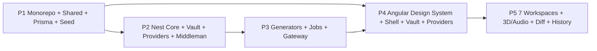

# ForgeStudio Control Room — Master Blueprint · Part 5 of 5
## §6 Rich Seed Data Specification · §7 Sequential Execution Prompts for Gemini Argon 4.0

---

## §6 Seed Data (`backend/prisma/seed.ts` + `prisma/seed/*`)

### 6.1 Orchestration
- `backend/package.json`: `"prisma": { "seed": "tsx prisma/seed.ts" }`; scripts `"prisma:migrate": "prisma migrate dev"`, `"prisma:reset": "prisma migrate reset --force"` (runs seed), `"seed": "prisma db seed"`, `"keygen": "node -e \"console.log(require('crypto').randomBytes(32).toString('base64'))\""`.
- `seed.ts` is **idempotent by reset**: in a single run it (1) deletes rows in dependency order (`generatedAssetFile → generatedAsset → generationJobEvent → generationJob → voiceProfile → vaultFile → vaultFolder → middlemanTemplate → middlemanProfile → aiProviderConfig → project`), (2) deletes `STORAGE_ROOT/projects`, (3) runs `providers.seed → middleman.seed → project-astra.seed → project-anime.seed → assets.seed`, (4) prints a summary table (counts per model, storage bytes written, elapsed).
- `seed-context.ts` exports `{ prisma, storage: LocalStorageDriver-backed StorageService (no Nest container), cipher: SecretCipherService, image: ImageProcessingService, log }` constructed manually from env (reuses the backend classes — they must be constructible without DI, i.e. plain constructor params).
- All randomness uses `mulberry32(20261022)` → seed output is byte-for-byte deterministic.

### 6.2 Providers (`providers.seed.ts`)
Optional env keys read **only by the seed** (`SEED_ANTHROPIC_API_KEY`, `SEED_OPENAI_API_KEY`, `SEED_GEMINI_API_KEY`, `SEED_FAL_KEY`, `SEED_REPLICATE_API_TOKEN`, `SEED_STABILITY_API_KEY`, `SEED_MESHY_API_KEY`, `SEED_TRIPO_API_KEY`, `SEED_RODIN_API_KEY`, `SEED_ELEVENLABS_API_KEY`, `SEED_CARTESIA_API_KEY`, `SEED_FISH_API_KEY`, `SEED_RUNPOD_API_KEY`, `SEED_RUNPOD_COMFY_ENDPOINT_ID`, `SEED_RUNPOD_TTS_ENDPOINT_ID`). When present, the secret is encrypted and the provider `isEnabled = true`; otherwise cloud/RunPod providers are created with `isEnabled = false` (visible, configurable). Documented in `.env.example` under a `# --- optional seed keys ---` block.

| Name | Kind | Tier | Roles | Modalities | Key fields | Default for | Enabled |
|---|---|---|---|---|---|---|---|
| ForgeStudio Demo Engine | DEMO | LOCAL | LLM, VISION, GENERATOR | all 7 | `settings.maxConcurrency 4`, `costPerRequestUsd 0` | all 7 | ✅ always |
| Anthropic | ANTHROPIC | CLOUD_API | LLM, VISION, GENERATOR | OTHER | models: claude-sonnet-4-5, claude-opus-4-1, claude-haiku-4-5 | — | key |
| OpenAI | OPENAI | CLOUD_API | LLM, VISION, GENERATOR | ICONS_2D, IMAGES, VOICES, OTHER | gpt-5, gpt-5-mini, gpt-image-1, dall-e-3, gpt-4o-mini-tts; `costPerRequestUsd 0.04` | — | key |
| Google Gemini | GEMINI | CLOUD_API | LLM, VISION, GENERATOR | ICONS_2D, IMAGES, VOICES, OTHER | gemini-3.8-flash, gemini-3.5-flash-lite, gemini-4-argon, gemini-nano-banana-2.1, gemini-3-pro-image, gemini-3.8-flash-tts | — | key |
| Fal.ai (Flux) | FAL | CLOUD_API | GENERATOR | ICONS_2D, IMAGES, OTHER | fal-ai/flux-pro/v1.1, fal-ai/flux/dev; `costPerRequestUsd 0.04` | — | key |
| Replicate | REPLICATE | CLOUD_API | GENERATOR | IMAGES, MUSIC, SFX | black-forest-labs/flux-1.1-pro, meta/musicgen | — | key |
| Stability AI | STABILITY | CLOUD_API | GENERATOR | IMAGES, ICONS_2D, MUSIC, SFX | sd3.5-large, ultra, stable-audio-2 | — | key |
| Meshy | MESHY | CLOUD_API | GENERATOR | ASSETS_3D | meshy-5 (`settings.timeoutMs 900000`) | — | key |
| Tripo3D | TRIPO3D | CLOUD_API | GENERATOR | ASSETS_3D | default | — | key |
| Hyper3D Rodin | RODIN | CLOUD_API | GENERATOR | ASSETS_3D | Regular | — | key |
| ElevenLabs | ELEVENLABS | CLOUD_API | GENERATOR | VOICES, SFX, MUSIC | eleven_multilingual_v2, eleven_v3, music_v1 | — | key |
| Cartesia | CARTESIA | CLOUD_API | GENERATOR | VOICES | sonic-2 | — | key |
| Fish Audio | FISH_AUDIO | CLOUD_API | GENERATOR | VOICES | s1 | — | key |
| RunPod · ComfyUI Flux Worker | RUNPOD_SERVERLESS | RUNPOD | GENERATOR | ICONS_2D, IMAGES, OTHER | `runpodEndpointId` from env or `"replace0endpoint"`, template + mapping from §4.7.4, `costPerSecondUsd 0.00044`, `pollIntervalMs 2000` | — | key+endpoint |
| RunPod · F5-TTS Voice Worker | RUNPOD_SERVERLESS | RUNPOD | GENERATOR | VOICES | template + mapping from §4.7.4, `costPerSecondUsd 0.00031` | — | key+endpoint |
| Local ComfyUI | COMFYUI | LOCAL | GENERATOR | ICONS_2D, IMAGES, OTHER | `baseUrl http://127.0.0.1:8188`, `workflowTemplate` = the RunPod workflow object (inner `workflow`) | — | ❌ (user enables) |
| Local Forge / A1111 | A1111 | LOCAL | GENERATOR | ICONS_2D, IMAGES, OTHER | `http://127.0.0.1:7860` | — | ❌ |
| Local Ollama | OLLAMA | LOCAL | LLM, VISION | — | `http://127.0.0.1:11434`, models qwen2.5:14b, llama3.1:8b, llava:13b (VISION) | — | ❌ |
| LM Studio | OPENAI_COMPATIBLE | LOCAL | LLM | — | `http://127.0.0.1:1234` | — | ❌ |
| Kokoro TTS (local) | OPENAI_COMPATIBLE | LOCAL | GENERATOR | VOICES | `http://127.0.0.1:8880`, model `kokoro`, voices af_heart, am_michael | — | ❌ |
| Local F5-TTS Server | GENERIC_HTTP | LOCAL | GENERATOR | VOICES | `http://127.0.0.1:7865`, `settings.path "/tts"`, template `{ "text": "{{enhanced_prompt}}", "speed": "{{speed}}", "seed": "{{seed}}" }`, mapping `{ assets: [{ path: "audio_base64", encoding: "base64", mimeType: "audio/wav" }] }` | — | ❌ |

### 6.3 Middleman profiles (`middleman.seed.ts`)
| Name | Provider | Model | Temp | maxContextTokens | Vision | Default |
|---|---|---|---|---|---|---|
| Demo Compiler (offline) | Demo Engine | `forge-demo-compiler-1` | 0.0 | 12 000 | ✅ (Demo vision = pixel palette analysis, see below) | `isDefault` + `isVisionDefault` when no Gemini key |
| Claude Sonnet Compiler | Anthropic | claude-sonnet-4-5 | 0.4 | 24 000 | ✅ attach 3 refs | default when Anthropic key present |
| GPT-5 mini Compiler | OpenAI | gpt-5-mini | 0.4 | 16 000 | ✅ | — |
| Gemini 3.8 Flash Compiler | Google Gemini | gemini-3.8-flash | 0.35 | 32 000 | ✅ attach 3 refs | `isVisionDefault` when Gemini key present |
| Ollama Local Compiler | Local Ollama | qwen2.5:14b | 0.3 | 8 000 | ❌ | — |

**Demo vision** (`DemoLlmAdapter` when the request contains image parts and the system prompt is the vision prompt): decode the image with sharp, resize to 64×64, quantize via median-cut to 6 colours → `paletteHex`; average luminance → lighting ("high-key soft light" / "low-key dramatic light"); saturation mean → rendering ("vivid painterly" / "muted desaturated"); compose `styleDescriptorText` from these. Deterministic and offline.

### 6.4 Modality system templates (`content/middleman-templates.ts`) — verbatim, `version 1`, global

**ICONS_2D — "Game Icon Compiler v1"**
```text
You compile prompts for 2D game icons (item icons, skill badges, rank emblems, UI buttons).
Craft rules:
- One hero subject, centered, filling 70–80% of the canvas, viewed in a slight 3/4 angle for items and
  straight-on for emblems/badges.
- Silhouette first: the outline must read instantly at 64x64 and remain recognizable at 32x32. Prefer
  bold shapes, 2–3 value groups, strong rim light separating subject from background.
- Materials are stylized and legible: describe base material, secondary material, emissive accents.
- Use the project palette hex values verbatim and name which part of the subject gets each colour.
- Rarity/rank language from the vault (e.g. tiers, glow colours, frame styles) must be applied exactly.
- Never include text, letters, numbers, watermarks, UI chrome, hands, or cropped subjects.
Structure enhancedPrompt as: [subject + defining features] · [materials & colour mapping] ·
[lighting & rim] · [style keywords from the art bible] · [composition & background rule].
```
`defaultNegativePrompt`: `text, letters, watermark, signature, cropped, cut off, multiple objects, busy background, photo, blurry, muddy low-contrast details, noisy texture, jpeg artifacts, drop shadow touching edges, frame clipping`
`hardConstraints`: `Background must follow the background rule exactly.\nNo perspective floor or horizon line.`

**ASSETS_3D — "Game-Ready 3D Compiler v1"**
```text
You compile prompts for text-to-3D and image-to-3D generators producing game-ready meshes.
Craft rules:
- Describe ONE object with clear primary/secondary/tertiary forms, real-world scale in meters, and
  readable silhouette from the front and side.
- Props/weapons: isolated, no floor, no base, no environment, no characters holding them.
- Characters: neutral expression, symmetrical, strict T-pose or A-pose when requested, separated
  fingers, no loose hair cards or capes unless the vault requires them.
- Materials: for each part specify base colour (hex from the project palette), roughness (0–1),
  metalness (0–1), and any emissive mask colour.
- Topology hints: state the polycount tier and that the mesh must be watertight and game-ready.
- Keep descriptions concrete and physical; avoid painterly or photographic language.
recommendedParams should include target_polycount, texture_resolution and art_style when allowed.
```
`defaultNegativePrompt`: `floor plane, ground, pedestal, environment, multiple objects, text, extreme thin parts, floating fragments, noisy surface, fused fingers, asymmetry, background scenery`

**IMAGES — "Concept & Texture Compiler v1"**
```text
You compile prompts for 2D game images: thumbnails, concept art, seamless PBR textures, backgrounds,
and UI splash art.
Craft rules by category:
- THUMBNAIL: bold focal subject, strong contrast, readable at small sizes, dynamic composition that
  leaves negative space for a title (but never render text).
- CONCEPT_ART: describe the subject, environment, camera (lens/angle), time of day, atmosphere,
  colour script from the vault, and art-style references from the art bible.
- PBR_TEXTURE / SEAMLESS_TILE: orthographic top-down, uniform lighting, no shadows or highlights baked,
  material described physically (grain, wear, scale in cm per tile), seamless edges.
- BACKGROUND: layered depth (foreground/midground/background), parallax-friendly, no characters unless
  requested.
- SPLASH_ART: hero moment, cinematic lighting, project palette dominance, key art quality.
Always map palette hexes to lighting and materials explicitly.
```
`defaultNegativePrompt`: `text, watermark, logo, signature, lowres, blurry, oversaturated, deformed anatomy, extra limbs, jpeg artifacts, frame, border`

**MUSIC — "Adaptive Score Compiler v1"**
```text
You compile prompts for game music generation (loopable BGM, combat tracks, ambient soundscapes,
menu themes, stingers).
Craft rules:
- Always state: genre/style blend, BPM, key and mode, time signature, instrumentation (lead, harmony,
  bass, percussion, textures), mix character (dry/wet, width), and energy curve.
- Provide structure with timestamps fitting the requested duration (e.g. 0:00 intro pad, 0:08 motif A…).
- For seamless loops: no fade-in/fade-out, the final bar must lead back into bar 1 with matching
  tempo, key and density; avoid reverb tails that cut abruptly.
- Respect the project's audio direction: leitmotifs, forbidden instruments, reference moods.
- Instrumental only unless the user asked for vocals.
recommendedParams should include bpm, key_signature, duration_seconds and loop when allowed.
```
`defaultNegativePrompt`: `vocals, lyrics, abrupt ending, fade out, clipping, distortion, lo-fi noise, tempo drift, out of tune`

**VOICES — "Character Voice Compiler v1"**
```text
You prepare text-to-speech payloads for game characters (dialogue, NPC barks, narration).
Craft rules:
- enhancedPrompt is the exact line to be spoken. Preserve the transcript wording; you may only add
  punctuation for pacing and provider-supported inline delivery tags (e.g. [whispers], [laughs]) when
  they serve the requested emotion.
- Use the character sheet (age, personality, accent, speech quirks, catchphrases) to choose delivery.
- recommendedParams.instructions: one or two sentences of acting direction (emotion, pace, energy,
  proximity to mic) for providers that accept instructions.
- Recommend stability, style and speed values matching the emotion (shouting/excited → lower
  stability, higher style; calm narration → higher stability).
- Barks must be short (≤ 8 words) and punchy.
```
`defaultNegativePrompt`: `mispronunciation, robotic monotone, background music, clipping, breaths too loud, mouth clicks`

**SFX — "Foley & SFX Compiler v1"**
```text
You compile prompts for game sound effects (weapon hits, UI clicks, footsteps, magic abilities,
ambient foley, explosions, creatures).
Craft rules:
- Describe the physical source, materials in contact, size/weight, distance and environment
  (dry close-mic unless the vault says otherwise).
- Describe the envelope: attack (sharp/soft), body, decay/tail length, and pitch character.
- For UI sounds: short (<300 ms), clean transients, tonal identity consistent with the UI palette
  described in the vault (e.g. crystalline, wooden, digital).
- For magic: layer description (core tone, sparkle layer, whoosh layer, impact) tied to element
  colours/themes from the vault.
- For loops: steady state, no distinct start/end events.
- Never include music or speech.
```
`defaultNegativePrompt`: `music, speech, voice, melody, long reverb tail, clipping, background noise hiss, abrupt cut`

**OTHER — "Technical Asset Compiler v1"**
```text
You compile prompts for technical game assets. Read the sub-mode in user_params.subMode.
- SPRITESHEET: describe one subject and an animation cycle split into evenly timed key poses across
  the grid (left-to-right, top-to-bottom). Identical framing, scale and lighting per frame; flat
  background; describe the motion arc per frame group.
- VFX_TEXTURE: describe a particle/mask texture: shape language, falloff, internal detail, centered on
  pure black; grayscale unless colour is requested; tileable when requested.
- SHADER_CODE: produce an engineering spec: inputs/uniforms, behaviour over time, performance budget,
  engine API constraints (Roblox Luau has no custom shaders: use ParticleEmitter, Beam, Trail,
  Highlight, TweenService, EditableImage APIs; Godot uses shader_type canvas_item/spatial).
- LORE_JSON: produce a spec with the exact JSON schema, field meanings, entry count, and naming rules
  from the vault; values must be consistent with existing lore and item tables.
```
`defaultNegativePrompt` (image sub-modes): `text, watermark, inconsistent scale, cropped frames, gradient background, frame borders, motion blur smearing`

### 6.5 Project 1 — "Astra Dream — 2D/3D Action RPG" (`project-astra.seed.ts`)
- `slug: astra-dream`, `tagline: "A celestial action RPG where dreams are forged into weapons."`, `genre: "Action RPG (2D/3D hybrid)"`, `accentHex: #7C3AED`.
- `globalSummary`:
```text
Astra Dream is a stylized celestial action RPG. Players are Dreamforgers who shape fragments of fallen
stars into weapons and relics. Visual identity: painterly cel-shaded forms, luminous starlight
accents on deep indigo night palettes, gold filigree trims. Tone: wondrous, melancholic, heroic.
Core palette: Night Indigo #1B1446, Astral Violet #7C3AED, Starlight Gold #F5C451, Nebula Cyan
#3CD3F0, Ember Coral #FF6B5A, Moon Ivory #F4EFE6. Rarity tiers: Common (ivory), Rare (cyan),
Epic (violet), Legendary (gold), Mythic (coral with gold).
```

**Folders & files** (scopes use product vocabulary; priority in brackets):

| Folder | File | Kind | Scopes | Pri |
|---|---|---|---|---|
| `/Art Direction` | `Art Bible.md` | MD | ALWAYS_INCLUDE | 95 |
| `/Art Direction` | `Color Palette.md` | MD | ALWAYS_INCLUDE, 2D_ICONS, IMAGES, 3D_ASSETS | 90 |
| `/Art Direction` | `Icon Style Guide.md` | MD | 2D_ICONS | 85 |
| `/Art Direction` | `3D Asset Standards.md` | MD | 3D_ASSETS | 85 |
| `/Art Direction/References` | `astra-style-sheet.png` | IMAGE (synth 1536×1024 style board) | 2D_ICONS, IMAGES | 80 |
| `/Art Direction/References` | `starforged-katana-ref.png` | IMAGE (synth) | 2D_ICONS, 3D_ASSETS | 60 |
| `/Lore` | `World Lore.md` | MD | OTHER, IMAGES | 60 |
| `/Lore/Characters` | `Lyra - Character Sheet.md` | MD | VOICES, IMAGES, 3D_ASSETS | 70 |
| `/Lore/Characters` | `Kael - Character Sheet.md` | MD | VOICES, IMAGES | 70 |
| `/Lore/Characters` | `Oracle Vesper - Character Sheet.md` | MD | VOICES | 65 |
| `/Audio Direction` | `Music Direction.md` | MD | MUSIC | 90 |
| `/Audio Direction` | `SFX Palette.md` | MD | SFX | 90 |
| `/Audio Direction` | `Voice Casting Notes.md` | MD | VOICES | 80 |
| `/Audio Direction/References` | `astra-theme-sketch.wav` | AUDIO (synth 12 s loop) | MUSIC | 50 |
| `/Design` | `Naming Conventions.md` | MD | ALWAYS_INCLUDE | 75 |
| `/Design` | `items.json` | JSON | OTHER, 2D_ICONS | 55 |
| `/Design` | `VFX Language.md` | MD | OTHER, SFX | 60 |

Reference images are created with `svg-art.synth` (style board: palette swatch row with hex labels, sample gradient sky, three silhouette glyphs) and seeded with `visionStatus DONE`, `visionModel 'seed'`, and a hand-written `styleDescriptorText`, e.g. for `astra-style-sheet.png`:
```text
Painterly cel-shaded fantasy style with two-tone shadows and crisp ink-free edges. Deep Night Indigo
(#1B1446) backgrounds graded to Astral Violet (#7C3AED); luminous Starlight Gold (#F5C451) used only
for filigree trims and focal highlights; Nebula Cyan (#3CD3F0) rim lights from upper left. Soft bloom
on emissive star fragments, subtle sparkle particles, high readability silhouettes with chunky
proportions (1.2x oversized hilts and gems). Materials: polished gold, faceted crystal, matte cloth.
```

**Verbatim content — `Art Bible.md`:**
```markdown
# Astra Dream — Art Bible (v2.3)

## Pillars
1. **Starlight is precious** — gold and cyan light are accents, never fills. Every asset has one focal glow.
2. **Readable dreams** — chunky, slightly oversized silhouettes (hilts, gems, pauldrons at 1.2×).
3. **Melancholic wonder** — cool night bases, warm focal highlights, soft bloom.

## Rendering
- Painterly cel-shading: 2 shadow tones + 1 highlight, no outlines (edges defined by value contrast).
- Rim light: Nebula Cyan `#3CD3F0` from upper-left at 35–50% intensity.
- Emissives: Starlight Gold `#F5C451` core with soft bloom; Mythic items add Ember Coral `#FF6B5A` sparks.
- Surfaces: polished gold filigree, faceted star-crystal, matte indigo cloth, aged moon-ivory leather.

## Shapes
- Primary shapes: crescents, four-point stars, teardrops. Avoid hard tech/sci-fi panels.
- Weapons curve upward like rising comets; blades taper into star points.

## Do / Don't
| Do | Don't |
|---|---|
| Single focal glow per asset | Neon overload, rainbow gradients |
| Gold filigree on rare+ items | Realistic photographic textures |
| Clean negative space | Text, runes that read as Latin letters |
```

**Verbatim content — `Color Palette.md`:**
```markdown
# Astra Dream — Master Palette

| Token | Hex | Usage |
|---|---|---|
| Night Indigo | #1B1446 | Backgrounds, deep shadows, cloth |
| Astral Violet | #7C3AED | Epic rarity, magic auras, UI primary |
| Starlight Gold | #F5C451 | Legendary rarity, filigree, focal glows |
| Nebula Cyan | #3CD3F0 | Rare rarity, rim light, mana |
| Ember Coral | #FF6B5A | Mythic sparks, damage, fire |
| Moon Ivory | #F4EFE6 | Common rarity, highlights, parchment |
| Abyss Black | #0B0820 | Icon outer shadow, vignette |

## Rarity mapping (icons, item frames, VFX)
- Common → Moon Ivory frame, no glow
- Rare → Nebula Cyan frame, faint cyan glow
- Epic → Astral Violet frame, violet aura particles
- Legendary → Starlight Gold frame, gold bloom + filigree
- Mythic → Ember Coral + Starlight Gold dual frame, coral sparks

## Value rules
Subject value range must span ≥ 60% of the luminance scale; backgrounds stay below 25% luminance.
```

**Verbatim content — `Icon Style Guide.md`:**
```markdown
# Icon Style Guide

- Canvas: 1024×1024 master, delivered at 512/128/64/32. Subject fills 75% of the safe area.
- Angle: items at 3/4 view rotated 35° clockwise; skills and emblems straight-on.
- Background: transparent. Outer shadow `#0B0820` at 40% opacity, 6px blur at 512px scale.
- Frames are applied in-engine — do NOT paint frames unless the request is a rank emblem.
- Lighting: key from upper-left, cyan rim, one gold focal glow.
- Readability test: silhouette must be identifiable at 32×32 in pure black.
- Skill badges: circular composition, element symbol in the centre, element colour from the palette.
```

**Verbatim content — `Music Direction.md`:**
```markdown
# Music Direction

- Core identity: celestial orchestral-electronic hybrid — celesta, harp, choir pads, felt piano, warm analog synth bass, taiko for combat.
- Leitmotif "Astra's Wish": rising 5th then stepwise descent (D – A – G – F – E) in D Dorian.
- Exploration BGM: 84–96 BPM, D Dorian or A Aeolian, airy, wide stereo, loop-perfect 32 or 64 bars.
- Combat: 140–160 BPM, D minor / F minor, taiko + staccato strings + pulsing synth arps; Phase 2 adds choir and modulates up a minor third.
- Underwater/dream zones: 70–80 BPM, muffled low-pass on percussion, glass harmonica textures.
- Forbidden: electric guitar leads, dubstep wobbles, vocals with lyrics.
```

Remaining files — required content outlines (Argon writes full prose, 200–500 words each, consistent with the above):
- `3D Asset Standards.md`: polycount budgets (props 1.5–5k tris, weapons 3–8k, hero characters 25–40k), texel density 512 px/m, PBR metal/rough, max 2 materials per prop, pivot at grip/base, +Y up, 1 unit = 1 m, glTF 2.0 export, naming `SM_<Category>_<Name>_<Variant>`.
- `World Lore.md`: the Shattered Firmament, the Dreamforge, five constellation houses, the Hollow Tide antagonist force.
- Character sheets (Lyra: 19, hopeful Dreamforger, soft alto, slight breathy warmth, catchphrase "Every star remembers"; Kael: 27, sardonic star-knight, low baritone, clipped delivery; Oracle Vesper: ageless, whispery, slow cadence, speaks in riddles) each with appearance, palette usage, personality, voice notes, sample lines.
- `SFX Palette.md`: crystalline UI (glass chimes, 2–6 kHz sparkle), weapon hits = metal + crystal layer, footsteps on moonstone/sand/cloud, magic layers per element.
- `Voice Casting Notes.md`: recording style (close-mic, dry), bark length rules, emotion vocabulary.
- `Naming Conventions.md`: item names "<Celestial adjective> <Noun> of <Constellation>" (e.g. "Emberfall Katana of Lyra's Crown"), asset file naming, forbidden words.
- `items.json`: array of 12 items `{ id, name, type, rarity, element, description, iconBrief }`.
- `VFX Language.md`: star-point particles, crescent slashes, bloom budgets, elemental colour mapping.

**Voice profiles:** Lyra (`characterSheet = Lyra - Character Sheet.md`, provider Demo Engine, externalVoiceId `demo-alto-warm`, defaults `{ stability 0.45, style 0.35, speed 1.0 }`), Kael (`demo-baritone-dry`), Oracle Vesper (`demo-whisper-ancient`, `speed 0.85`).

### 6.6 Project 2 — "Anime Awakening RNG" (`project-anime.seed.ts`)
- `slug: anime-awakening-rng`, `tagline: "Roll your destiny. Awaken your aura."`, `genre: "Roblox anime RNG / gacha simulator"`, `accentHex: #06B6D4`.
- `globalSummary`:
```text
Anime Awakening RNG is a Roblox gacha/RNG simulator where players roll for anime-inspired auras,
titles and awakened forms. Visual identity: high-saturation cel-shaded anime, thick clean outlines,
speed lines, explosive aura VFX. Rank ladder E → D → C → B → A → S → SS → SSS with escalating colour
and effects. Target platform Roblox (mobile-first readability, Luau scripting).
Core palette: Shonen Red #FF2E4D, Aura Cyan #22E1FF, Sakura Pink #FF7AC6, Thunder Yellow #FFE13B,
Void Purple #6B2BFF, Ink Black #0D0D14, Paper White #FAFAFF.
```

| Folder | File | Kind | Scopes | Pri |
|---|---|---|---|---|
| `/Art Direction` | `Anime Art Bible.md` | MD | ALWAYS_INCLUDE | 95 |
| `/Art Direction` | `Palette & Rank Colors.md` | MD | ALWAYS_INCLUDE, 2D_ICONS, IMAGES | 92 |
| `/Art Direction` | `Rank Emblem Spec.md` | MD | 2D_ICONS | 90 |
| `/Art Direction/References` | `rank-emblem-board.png` | IMAGE (synth: 8 emblem shapes E→SSS) | 2D_ICONS | 85 |
| `/Art Direction/References` | `aura-color-study.png` | IMAGE (synth) | IMAGES, OTHER | 70 |
| `/VFX` | `Aura VFX Guide.md` | MD | OTHER, IMAGES | 85 |
| `/Scripting` | `Luau Conventions.md` | MD | OTHER | 90 |
| `/Characters` | `Hero Roster.md` | MD | VOICES, IMAGES, 3D_ASSETS | 70 |
| `/Audio` | `Audio Direction.md` | MD | MUSIC, SFX, VOICES | 88 |
| `/Data` | `gacha-table.json` | JSON | OTHER | 60 |

**Verbatim content — `Rank Emblem Spec.md`:**
```markdown
# Rank Emblem Spec

| Rank | Shape | Primary | Secondary | FX |
|---|---|---|---|---|
| E | Plain circle | #8A8FA3 | #0D0D14 | none |
| D | Circle + single ring | #4ADE80 | #0D0D14 | none |
| C | Shield | #22E1FF | #0D0D14 | faint glow |
| B | Shield + wings | #6B2BFF | #22E1FF | glow |
| A | Hexagon crest | #FF2E4D | #FFE13B | sparks |
| S | Star crest | #FFE13B | #FF2E4D | lightning arcs |
| SS | Double star crest | #FF7AC6 | #FFE13B | lightning + petals |
| SSS | Radiant sun crest, crown | #FFFFFF core → #FFE13B → #FF2E4D | #6B2BFF | full aura burst, chromatic rim |

- Letters are added in-engine via TextLabel — emblems must contain **no text**.
- 4px Ink Black (#0D0D14) outline at 512px; cel-shaded 2 tones; strong inner bevel.
- Must read on both dark and light UI at 48×48.
```

**Verbatim content — `Luau Conventions.md`:**
```markdown
# Luau Conventions

- `--!strict` at the top of every ModuleScript; typed function signatures.
- Services fetched once: `local TweenService = game:GetService("TweenService")`.
- VFX modules expose `Create(parent: BasePart, params: AuraParams): () -> ()` returning a cleanup function.
- No custom shaders exist on Roblox: use ParticleEmitter, Beam, Trail, Highlight, PointLight, TweenService, and EditableImage.
- Colors as `ColorSequence.new({ ColorSequenceKeypoint.new(0, Color3.fromHex("#22E1FF")), ... })`.
- Performance: ≤ 3 ParticleEmitters per aura, `Rate` ≤ 40 on mobile, disable via `Enabled = false` (never Destroy mid-tween).
- Naming: PascalCase modules (`AuraSSS.lua`), camelCase locals, SCREAMING_CASE constants.
```

Remaining outlines: `Anime Art Bible.md` (cel-shade rules, outline weights, speed lines, mobile readability), `Palette & Rank Colors.md` (palette table + rank colour ladder matching the emblem spec), `Aura VFX Guide.md` (aura anatomy: core flame, rising sparks, ground ring, lightning per rank; flipbook 4×4 at 256 px), `Hero Roster.md` (Ren — hot-headed swordsman, raspy tenor; Mika — cheerful mage, bright soprano; Gorou — stoic giant, deep bass; each with catchphrases and bark examples), `Audio Direction.md` (J-rock/EDM hybrid for combat 160–175 BPM, kawaii synth-pop lobby 120 BPM, roll SFX escalation ladder per rank, announcer voice style), `gacha-table.json` (`{ rarities: [{ rank, weight, color }], auras: [{ id, name, rank, odds: "1 in N", vfxBrief }] }` with 16 auras).

**Voice profiles:** Ren (`demo-tenor-raspy`), Mika (`demo-soprano-bright`), Gorou (`demo-bass-deep`), Announcer (`demo-announcer-hype`, no character sheet).

### 6.7 Sample jobs & generated assets (`assets.seed.ts`)
All produced through `src/synth/*` with fixed seeds, linked to `COMPLETED` jobs whose `compiledPayload` is a realistic hand-written `CompiledPrompt` (assetTitle, enhancedPrompt 60–140 words citing palette hexes, negativePrompt from template, recommendedParams, contextSourcesUsed referencing real seeded file ids). Provider = Demo Engine (tier LOCAL) except where noted (rows marked † are attributed to a cloud/RunPod provider config **for display only**, with `costUsd` + `executionMs`, so filters/badges show all tiers; their files are still synth output).

| Project | Modality | Assets (title · details) |
|---|---|---|
| Astra | ICONS_2D | "Emberfall Katana" (Legendary, v1 + v2 lineage, APPROVED, favorite) · "Moonlit Elixir" (Rare) · "Comet Sigil" skill badge † OpenAI `$0.04` · "Starforged Aegis" (Epic, batch of 4 → 4 assets batchIndex 0–3) — all with VARIANT_512/128/64/32 + THUMBNAIL |
| Astra | ASSETS_3D | "Starforged Katana" (WEAPON glb, LOW_POLY, APPROVED) · "Dreamforge Anvil" (PROP) † Meshy `$0.20`, 94 s · "Lyra Base Mesh" (CHARACTER_BASE A-pose) |
| Astra | IMAGES | "Dreamforge Vista" concept 16:9 · "Moonstone Tile" SEAMLESS_TILE (tileSeamScore recorded) · "Astra Dream Thumbnail" 16:9 † RunPod ComfyUI `executionMs 21 400`, `coldStartMs 38 200`, `$0.0094` |
| Astra | MUSIC | "Astra's Wish — Exploration Loop" 32 s, 92 BPM, D Dorian, loop, 3 stems · "Hollow Tide — Boss Phase 2" 40 s 152 BPM F minor † ElevenLabs |
| Astra | VOICES | "Lyra — 'Every star remembers'" with alignment · "Kael — Bark: 'Stay behind me.'" · "Vesper — Prophecy" |
| Astra | SFX | "Crystal Blade Hit" ×4 variations (4 assets, same group) · "Moonstone Footsteps" loopable · "UI Confirm Chime" |
| Astra | OTHER | Spritesheet "Star Fragment Burst" 4×4 @256 12 fps · VFX "Crescent Slash Mask" grayscale · LORE_JSON "Constellation Relics" (8 entries) |
| Anime | ICONS_2D | Rank emblems "Rank E", "Rank A", "Rank S", "Rank SSS" (FINAL) |
| Anime | ASSETS_3D | "Awakening Totem" (PROP) |
| Anime | IMAGES | "Lobby Splash Art" 16:9 · "Aura Roll Thumbnail" 16:9 |
| Anime | MUSIC | "Lobby — Kawaii Synth Pop" 30 s 120 BPM loop |
| Anime | VOICES | "Announcer — 'SSS RANK AWAKENED!'" |
| Anime | SFX | "Roll Tick" ×4 · "SSS Reveal Boom" |
| Anime | OTHER | SHADER_CODE Luau "AuraSSS.lua" (valid Luau following the conventions, ~80 lines) · Spritesheet "Lightning Aura Flipbook" 4×4 · LORE_JSON "Gacha Aura Table" |

**Additional job states for UI demonstration** (Astra project):
- One `AWAITING_REVIEW` INTERCEPT job (ICONS_2D, raw "A legendary fire katana icon", compiledPayload present) → opening the 2D Icons workspace shows the review drawer immediately.
- One `FAILED` job (ASSETS_3D, Tripo3D †, `errorCode PROVIDER_AUTH_FAILED`, message "Tripo3D rejected the API key (401)").
- One `CANCELLED` job (MUSIC).
Each seeded job gets 3–7 `GenerationJobEvent` rows reflecting its path through the state machine with plausible timestamps (spread over the previous 10 days).

### 6.8 Seed verification
`npm run prisma:reset -w @forge/backend` must finish < 60 s and print counts exactly matching the inventory above: projects 2, folders 16 (incl. 2 roots), vault files 27, providers 21, profiles 5, templates 7, voice profiles 7, jobs 39 (36 COMPLETED + 1 AWAITING_REVIEW + 1 FAILED + 1 CANCELLED), assets 45, asset files ≥ 120. The e2e test asserts the seeded GLB files parse and the WAV headers are valid.

---

## §7 Sequential Execution Prompts for Gemini Argon 4.0

> [!IMPORTANT]
> Run the phases **in order**, each in a fresh session. Every prompt assumes the full blueprint lives at `docs/blueprint/` in the repository. A phase is complete only when its **Acceptance Gate** commands pass. Paste each prompt verbatim.

### Phase 1 — Monorepo, Shared Contracts, Prisma Schema, Synth Library & Rich Seed
```text
ROLE: You are Gemini Argon 4.0 acting as a senior full-stack engineer executing Phase 1 of 5 of the
ForgeStudio Control Room build. You write 100% production-quality TypeScript. ZERO placeholders, ZERO
"// TODO", ZERO stubbed functions, ZERO `any`. If something is specified, implement it exactly; if a
detail is truly unspecified, choose the simplest robust option and record it in docs/DECISIONS.md.

READ FIRST (mandatory, in full): docs/blueprint/blueprint_part1_foundation.md (§0, §1, §2) and
docs/blueprint/blueprint_part5_seed_and_phases.md (§6). Skim part 3 §4.3 (storage keys, image
processing), §4.5 (SecretCipherService) and §4.7.6 (synth requirements) because the seed reuses them.

SCOPE — create exactly these (file tree §1, items marked [P1]):
1. Root: package.json (§1.1), tsconfig.base.json, .editorconfig, .gitignore (node_modules, dist,
   backend/storage, .env), .prettierrc, eslint.config.mjs (typescript-eslint strict, no-explicit-any
   error), .nvmrc, docker-compose.yml (§1.3), README.md (setup: npm i → npm run db:up → keygen → copy
   .env → prisma migrate → seed → npm run dev), scripts/check-forbidden-deps.mjs (§0.1 list; scans
   every workspace package.json; exit 1 on violation).
2. /shared (@forge/shared): dual ESM/CJS build (§1.2); ALL enums (§2.3), constants (§2.4), zod schemas
   (§2.5, including the `advanced` field and superRefine rules), read models (§2.6), WS contracts (§2.7),
   utils (§2.8: template-interpolation, json-path, mention-parser incl. toMentionAlias /
   normalizeForMention, token-estimate, word-diff). Jest tests listed in §1 under shared/test with
   meaningful cases (≥ 6 cases per util).
3. /backend skeleton needed for Phase 1 only: package.json (deps: @nestjs/*, @prisma/client, prisma,
   zod, sharp, @aws-sdk/client-s3, socket.io, @google/genai >= 2.29.1, tsx, jest, ts-jest), tsconfig,
   nest-cli.json, .env.example (§0.3 + optional seed keys §6.2), prisma/schema.prisma EXACTLY as §2.2,
   initial migration via `prisma migrate dev --name init`.
4. backend/src/synth/* (rng, svg-icon, svg-art, glb-mesh, wav-audio, text) per §4.7.6 — real working
   generators (GLB writer with correct chunk padding/alignment; WAV PCM16 writer; music synth with
   chords/arpeggio/kick in requested key & BPM; SFX envelopes per category; voice buzz + alignment).
5. Minimal classes the seed reuses, implemented fully now and later wired into Nest in Phase 2:
   backend/src/providers/secret-cipher.service.ts, backend/src/storage/storage-keys.ts,
   backend/src/storage/drivers/local-storage.driver.ts, backend/src/storage/storage-driver.interface.ts,
   backend/src/storage/image-processing.service.ts, backend/src/common/utils/sanitize-filename.ts,
   sha256.ts, mime.ts. They must be constructible with plain constructor arguments (Nest decorators
   allowed, but no DI-only dependencies).
6. prisma/seed.ts + prisma/seed/* + prisma/seed/content/* implementing §6 completely: 21 providers,
   5 profiles, 7 verbatim templates, both projects with every folder/file/scope/priority listed,
   verbatim markdown where given and full prose for outlined files, synthesized reference media with
   styleDescriptorText, voice profiles, all sample jobs/assets/files/events incl. AWAITING_REVIEW,
   FAILED and CANCELLED jobs.

CONSTRAINTS: Prisma 6.x (not 7). Node 22. TypeScript strict + noUncheckedIndexedAccess. Shared code must
not import Node built-ins or DOM types. Deterministic seed (mulberry32(20261022)).

ACCEPTANCE GATE (run all, fix until green, paste outputs in your final message):
  npm install
  npm run db:up
  npm run build:shared && npm run test -w @forge/shared
  npx prisma validate --schema backend/prisma/schema.prisma
  npm run prisma:reset -w @forge/backend        (prints seed summary meeting §6.8 minimums)
  npm run test -w @forge/backend -- synth        (glb-mesh + wav-audio specs)
  npm run lint
Final message: list of files created, the seed summary table, and any DECISIONS.md entries.
```

### Phase 2 — NestJS Core: Config, Prisma, Storage, Projects Vault, Providers (AES), LLM adapters, Middleman Compiler
```text
ROLE: Gemini Argon 4.0, Phase 2 of 5 of ForgeStudio Control Room. Production code only: no
placeholders, no TODOs, no `any`, no mocked vendor responses in runtime code.

READ FIRST: docs/blueprint/blueprint_part3_backend.md §4.1–§4.6, §4.9 (rows for health, projects,
vault, voice-profiles, providers, middleman, media), §4.11; part 1 §2 (contracts); part 5 §6.3–§6.4.
Before writing GeminiLlmAdapter, query the Gemini API docs MCP (gemini_search_docs) for
"interactions.create streaming" and "response_format json schema" and follow the current Interactions
API exactly (@google/genai >= 2.29.1, models gemini-3.8-flash / gemini-3.5-flash-lite / gemini-4-argon;
never gemini-2.x, never generateContent, never @google/generative-ai).

SCOPE (items marked [P2] in the tree):
1. main.ts, app.module.ts, config (zod env), common (DomainError, AllExceptionsFilter, ZodValidationPipe,
   @ZodBody/@ZodQuery, HttpClientService with retry/backoff/Retry-After, SSE + NDJSON readers, mappers).
2. PrismaModule/Service (enableShutdownHooks).
3. StorageModule: driver factory (local | s3 with full S3StorageDriver), StorageService,
   ImageProcessingService (thumbnail, probe, iconVariants, chromaKeyToAlpha flood-fill algorithm,
   seam score, sliceSpritesheet), MediaStreamController with Range/206/416/ETag/download and the
   reference upload endpoint. Path traversal guard + tests.
4. ProjectsVaultModule: Projects, VaultFolders (materialized path rename/move with descendant rewrite),
   VaultFiles (text create, multipart upload, kind detection, collision suffix, search), VoiceProfiles,
   VaultContextService (mention resolution with normalizeForMention), VisionAnalysisService (in-process
   queue concurrency 2, profile resolution, downscale, StyleDescriptor parsing), context-preview
   endpoint.
5. ProvidersModule: SecretCipherService wired, ProvidersService (secret write-only semantics,
   default-per-modality invariant), provider-catalog.ts (all 19 kinds, suggested models §4.7.3),
   ProviderHealthService (per-kind checks §4.5, cron every 2 min), template-preview endpoint.
   (`/providers/:id/adapters` returns [] until Phase 3 registers generator adapters — implement the
   endpoint against an injectable registry token that Phase 3 fills; an empty registry is valid.)
6. LlmModule + all six LLM adapters (§4.6.1) with real streaming implementations; DemoLlmAdapter with
   deterministic compile (§4.6.6) and Demo vision palette analysis (§6.3).
7. MiddlemanModule: profiles + templates CRUD (versioning/activation, invariants), ContextAssembler
   (§4.6.2), SystemPromptBuilder (§4.6.3 incl. auto-constraint table), CompiledOutputParser (§4.6.5 incl.
   COMPILED_PROMPT_JSON_SCHEMA, repair round), MiddlemanCompilerService.preview() fully working and
   compileForJob() fully implemented (it depends only on Prisma, adapters and an injected event
   publisher interface `JobEventsPublisherPort` defined now in src/orchestrator/job-events.port.ts;
   Phase 3 provides the socket implementation — bind a logging implementation for now).
8. Health controller. Tests listed in §4.11 for cipher, parser, context assembler, system prompt
   builder (snapshots).

ACCEPTANCE GATE:
  npm run build -w @forge/backend
  npm run test -w @forge/backend
  npm run start:dev -w @forge/backend   then verify with curl (paste outputs):
    GET  /health
    GET  /api/v1/projects                         (2 seeded projects with stats)
    GET  /api/v1/projects/<astraId>/vault/tree
    GET  /api/v1/projects/<astraId>/vault/context-preview?modality=ICONS_2D&rawPrompt=fire%20katana%20%40icon-style-guide.md
    POST /api/v1/middleman/compile-preview  (Demo profile, ICONS_2D) → valid CompiledPrompt citing vault ids
    GET  /api/v1/media/vault/<imageFileId> with header "Range: bytes=0-99" → 206
    GET  /api/v1/providers → no secret material in the JSON
  npm run lint
```

### Phase 3 — Generators: Adapter Registry, Cloud/RunPod/Local/Demo Adapters, Job Processor, Ingestion, Assets, WebSocket Gateway
```text
ROLE: Gemini Argon 4.0, Phase 3 of 5. Production code only — no placeholders/TODOs/any.

READ FIRST: blueprint_part3_backend.md §4.7–§4.11 completely; part 1 §2.4 (state machine), §2.7 (WS
contracts); part 5 §6.2 (RunPod templates). Vendor details live ONLY inside each adapter file. For
gemini-image and gemini-tts, query the Gemini docs MCP (image-generation, speech-generation) and
follow the current Interactions API response_format shapes.

SCOPE (items marked [P3]):
1. generator-adapter.interface.ts, BaseGeneratorAdapter, param-spec helpers (each adapter's
   describe() returns accurate ParamSpecs with ranges/defaults/advanced flags), registry via the
   GENERATOR_ADAPTERS multi-provider token (also satisfies the Phase 2 adapters endpoint).
2. Every adapter in the §4.7.3 matrix, including multi-stage flows (Meshy preview→refine, Tripo
   upload/convert, Rodin status/download), llm-text (SHADER_CODE / LORE_JSON with JSON repair),
   RunPodServerlessAdapter + runpod-client exactly per §4.7.4 (health-based cold-start detection,
   type-preserving template interpolation, `input` wrapping, output mapping extraction for base64 /
   data_uri / url / text, cost calc, backoff), ComfyUiAdapter + ComfyUiWsClient (§4.7.5, reconnect
   fallback to /history), A1111 with progress polling, OpenAI-compatible TTS, GenericHttpAdapter,
   DemoSynthAdapter (§4.7.6 incl. simulated cold start when seed % 3 === 0).
3. JobsService + JobsController (all job endpoints in §4.9), JobStateService (§4.7.9, row lock +
   event log), JobProcessorService (§4.7.8: tick loop, SKIP LOCKED claims with exact SQL, per-provider
   concurrency, polling with nextPollAt, timeouts, boot recovery, shutdown aborts),
   OutputIngestionService + post-processors (§4.7.10), CostEstimatorService, WebhooksController (HMAC
   token, idempotent).
4. AssetsModule (list/filter/sort/cursor, update, delete with storage cleanup, save-to-vault copy with
   optional vision, variation).
5. OrchestratorModule: gateway (rooms, zod-validated subscriptions, replay from MiddlemanStreamCache),
   JobEventsPublisher implementing JobEventsPublisherPort with throttling (chunks ≤ 25/s, progress ≤
   4/s) — replace the Phase 2 logging binding.
6. Tests: runpod-serverless.adapter.spec.ts, job-state.service.spec.ts, e2e/jobs.e2e-spec.ts (all 7
   modalities via Demo LLM + Demo Synth, AUTO_FIRE and INTERCEPT, socket event assertions).

ACCEPTANCE GATE:
  npm run build -w @forge/backend
  npm run test -w @forge/backend            (unit)
  npm run test:e2e -w @forge/backend        (uses forgestudio_test DB; all green)
  Manual: start backend, connect a socket.io client script (scripts/ws-smoke.mjs — create it) to
  /orchestrator, subscribe to the Astra project, POST /api/v1/jobs for ICONS_2D AUTO_FIRE with the
  Demo provider; paste the ordered event log: job:created → job:status(COMPILING) →
  job:middleman-chunk… → job:middleman-complete → job:status(READY→DISPATCHING→…) →
  job:worker-status → job:progress… → job:completed (with 4 icon variant URLs). Then GET one variant
  URL and confirm a PNG with alpha.
  npm run lint
```

### Phase 4 — Angular Foundation: Pure SCSS Design System, Studio Shell, Signal Stores, Vault IDE, Providers & RunPod
```text
ROLE: Gemini Argon 4.0, Phase 4 of 5. Production code only — no placeholders/TODOs/any. STRICTLY no
Tailwind, Bootstrap, Angular Material/CDK, PrimeNG or any UI kit (scripts/check-forbidden-deps.mjs
must pass). All styling is Dart Sass with @use/@forward; no @import.

READ FIRST: blueprint_part2_design_system.md (entire §3) and blueprint_part4_frontend.md §5.1–§5.10,
§5.13 (code view), §5.15; part 1 §2.6–§2.7 (models/events).

SCOPE (items marked [P4]):
1. Angular workspace in /frontend (latest stable CLI, standalone, zoneless, SCSS, routing), angular.json
   per §3.1 (includePaths, budgets, draco assets glob for Phase 5), proxy.conf.json, environments.
2. Design system: every file in src/styles with the EXACT token values and mixin library from §3.2–§3.6
   (use sass:map/sass:math, not legacy globals), all base/* class catalogs (§3.7), sprite.svg with every
   required symbol (§3.9, hand-authored 24×24 stroke icons).
3. UI primitives (§5.7) with full keyboard/ARIA behaviour (§3.10).
4. Core: ApiClientService + per-domain API files (1:1 with REST table), apiErrorInterceptor,
   SocketService (§5.5), stores StudioStateService, VaultStateService, GeneratorJobStore (fully wired to
   socket events now — Phase 5 consumes it), ProviderStateService, AssetGalleryStore, ToastService,
   activeProjectGuard, NowService ticker.
5. Layout: StudioShell (grid areas §3.8.1), Sidebar with both nav groups and live badges,
   ProjectSwitcher (+ ProjectFormModal), JobQueueWidget (live progress/cold-start/compiling states,
   cancel), ContextBar.
6. Database (Project Vault) IDE (§5.9) complete: tree with drag/drop + context menus, browser list/grid
   + multi-select bulk scope tagging, split-pane markdown editor with sanitized preview + hex swatches,
   JSON tree, media preview (image + audio waveform via a minimal version of WaveformPlayer that Phase 5
   extends — implement it fully now), scope tag editor, vision panel, upload queue, voice profiles panel,
   unsaved-changes protection.
7. Providers & RunPod page (§5.10) complete: catalog picker, provider editor with all tabs, RunPod
   template editor with client-side live interpolation preview, output mapping tester, ComfyUI workflow
   editor, health indicator, Middleman profiles panel (with Test compile using PromptDiff — build
   PromptDiffComponent now in features/generators/middleman/), templates panel with versioning.
8. Generator routes: implement the GeneratorWorkspaceComponent grid layout (§3.8.2) with a working
   composer — project badge, prompt input with @mention autocomplete, provider/middleman selectors and
   execution-mode toggle wired to the stores. (Do NOT ship a "coming in Phase 5" placeholder; Phase 5
   adds params, previews and history on top of this working base.)

ACCEPTANCE GATE:
  npm run build -w @forge/frontend   (production, within budgets, zero warnings about CommonJS except
                                      allowed list documented in angular.json)
  npm run test -w @forge/frontend    (store + PromptDiff + template editor specs)
  npm run lint
  Manual (describe results): npm run dev → shell renders with seeded projects; switching project
  changes accent and context counts; vault edit/save/scope-tag/upload works and live-updates via socket;
  provider create/edit hides secrets; RunPod template preview updates as you type.
```

### Phase 5 — The 7 Modality Workspaces, Previews (Three.js / Web Audio), Middleman Diff & Review, History Inspector
```text
ROLE: Gemini Argon 4.0, Phase 5 of 5. Production code only — no placeholders/TODOs/any. Pure SCSS
(design system from Phase 4), no UI libraries.

READ FIRST: blueprint_part4_frontend.md §5.11–§5.15 completely; part 2 §3.8.2–§3.8.3 layouts; part 1
§2.5 modality param schemas; part 3 §4.9 job/asset endpoints, §4.10 events.

SCOPE (items marked [P5]):
1. GeneratorWorkspaceComponent final (§5.11.1) with WorkspaceDraftService persistence per
   project+modality, generate / compileFirst, keyboard shortcuts, `advanced` overrides.
2. Composer components (§5.11.2): VaultPinPicker modal, ReferenceSlot (upload/pick from vault/history),
   AdvancedParams rendered from AdapterDescriptor ParamSpecs with Middleman hint "apply" buttons,
   context preview popover with token budget bar, sticky action bar with cost hint.
3. All 7 param panels (§5.11.3) bound to typed ParamsFor<M>, validated with the shared zod schemas
   (inline errors), including tap-tempo, aspect tiles, frame shape tiles, Other sub-mode tabs.
4. Middleman UI (§5.11.4): status pill with live token stream view and every state; CompileReviewDrawer
   with all 6 tabs, editable draft (linkedSignal), recompile popover, save+dispatch, warnings;
   ContextSourcesList.
5. Previews (§5.11.5): IconPreviewer (checker/backgrounds, zoom, 512/128/64/32 strip, silhouette test,
   in-context slot), ModelViewport + ModelViewportEngine (§5.12 exactly: loaders incl. Draco, framing,
   stats, wireframe, grid, 4 lighting rigs, screenshot, visibility-paused loop, full dispose),
   ImagePreviewer (pan/zoom, 3×3 tile mode, A/B slider), AudioEngineService + waveform-peaks (+ worker)
   + waveform-renderer (§5.13), WaveformPlayer (sample-accurate loop), DualWaveformPlayer (A/B, stem
   lanes with mute/solo synchronized start, Loop Seam Inspector with RMS dB jump), VoiceAlignmentView,
   SfxVariationGrid (hotkeys 1–8), SpritesheetPlayer (fps, ping-pong, onion skin), CodePreview,
   JsonTreeView.
6. History (§5.11.6): AssetHistoryDrawer with filters + infinite scroll, AssetCard, AssetInspector
   (prompt diff raw vs enhanced, provenance incl. cost/duration/cold start, lineage, files, export,
   Save as Reference to Project Vault modal, variation, re-run with edits, delete).
7. Responsive behaviour (< 1280px history becomes overlay drawer) and reduced-motion support.

ACCEPTANCE GATE:
  npm run build (root: shared + backend + frontend)
  npm run test  (root) and npm run test -w @forge/frontend
  npm run lint
  Manual end-to-end with seeded data and the Demo Engine (describe each result):
   a) 2D Icons: open → seeded AWAITING_REVIEW job shows the review drawer; edit enhanced prompt →
      Dispatch → icon appears with 4-size strip; Auto-Fire a new prompt using @Color-Palette.md.
   b) 3D Assets: seeded Starforged Katana loads in the viewport with triangle stats; toggle wireframe
      and all lighting rigs; generate a new CHARACTER_BASE in A-pose.
   c) Images: seamless tile 3×3 mode; A/B compare two assets.
   d) Music: play exploration loop with loop on; stems mute/solo; loop seam inspector shows dB jump.
   e) Voices: Lyra line plays with word highlighting; generate a bark with Kael's profile.
   f) SFX: 4 variations audition via keys 1–4; generate 4 new variations.
   g) Other: spritesheet animates; Luau shader shows highlighted code; lore JSON tree renders.
   h) Job queue widget shows compiling (cyan), cold start (amber, Demo seed%3===0), running (emerald).
   i) Save an asset as reference to the vault → appears in the vault with vision descriptor.
Final message: summary of all features with any deviations recorded in docs/DECISIONS.md.
```

### 7.1 Phase dependency map

